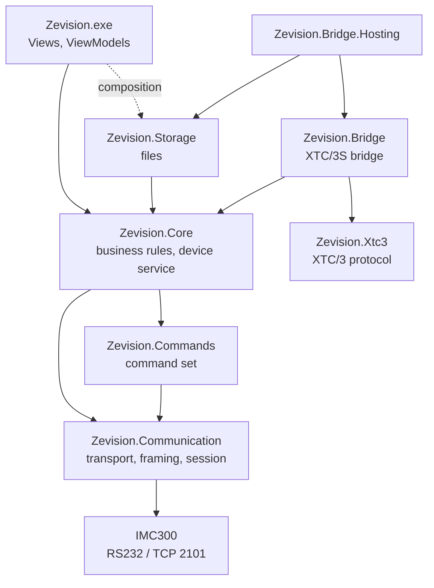

# Zevision

[中文](README.md) | English

Zevision is the host software for the INFICON IMC300 thin film controller ("IMC300 Comm Test"). It talks to the device over RS232 or Ethernet (TCP port 2101) using the Zevision protocol. The repository also contains an XTC/3S protocol bridge, which lets host software written for the XTC/3 Standard Protocol use an IMC300 instead.

All functions have been tested on an IMC300 (firmware 1.8.11); the records are in [`docs/联调记录.md`](docs/联调记录.md) (Chinese).

## 1 Components

Table 1  Assemblies and versions

| Assembly | Purpose | Version |
|---|---|---|
| `Zevision.exe` | WPF application (Material Design UI, INFICON colors) | 1.3.3 |
| `Zevision.Communication.dll` | Communication library: serial and TCP transports, framing, multi-packet reassembly, response parsing, `ZevisionClient` (session, retries, heartbeat) | 1.2.0 |
| `Zevision.Commands.dll` | Command set library: ID pattern, actions, names (Chinese and English), unit, range and options of every command | 1.1.1 |
| `Zevision.Core.dll` | Business logic: device service, handshake, rules for saving, restoring and editing configurations, process editor | 1.3.3 |
| `Zevision.Storage.dll` | Storage: configuration files (with MD5), settings, error log, communication data files, process editor files | 1.3.3 |
| `Zevision.Xtc3.dll` | XTC/3 Standard Protocol: packet format, command syntax, parameters, response encoding | 1.0.0 |
| `Zevision.Bridge.dll` | XTC/3S bridge: command execution, shadow objects, sampling and derived states | 1.0.0 |
| `Zevision.Bridge.Hosting.dll` | Bridge composition: settings file, one-call start | 1.0.0 |
| `Zevision.Xtc3Bridge.exe` | Standalone bridge program (console) | 1.0.0 |

The communication and command set libraries are used by production software and are versioned independently of the application. `Zevision.Core` and `Zevision.Storage` share the application's version. The three bridge libraries and the standalone program share one version.

## 2 Features

- **Connection**: RS232 (8N1, selectable baud rate) or TCP; a handshake on connect detects the device's frame format (checksum, length bytes); heartbeats detect a lost link while idle; optional automatic reconnection.
- **Commands**: one or several commands sent by hand (`QG01;QG1304;QG1305` as one frame), with each response parsed and shown; ASCII, HEX and Binary display; repeated sending; sent, received and error counters.
- **Data display and recording**: large replies (such as the `?` help table of about 116 KB) are split into lines; the displayed content can be saved as communication data files; errors are written to `logs\error.txt`.
- **Instrument configuration**: reads all device settings and saves them as a configuration file; restores from a file (writes only the differing items, re-creates materials, films, layers and processes when needed, and reads every item back); edits items from the device or from a file, and adds or deletes objects and list items.
- **Process editor**: materials (with a library of 253 materials) and processes are written locally; an upload reuses device objects with the same parameters and deletes the objects it created when it fails; processes and materials on the device can be viewed and deleted.
- **User interface language**: Chinese and English, chosen from the system language and switchable in the UI.
- **XTC/3S bridge**: host software connects to the bridge through a virtual serial port pair, and the bridge reaches the IMC300 over TCP or RS232; Film parameters, general parameters, status and remote commands are supported.

## 3 Structure



Figure 1  Layers (dependencies point down only)

The layers are separated by interfaces: the UI uses only the business layer's interfaces, the storage layer implements the storage interfaces defined by the business layer, and only `App.xaml.cs` (the composition root) creates the storage implementations. `LibraryBoundaryTests` checks the references and string rules of each assembly. The design is described in [`docs/概要设计说明书.md`](docs/概要设计说明书.md) (Chinese).

Table 2  Folders

| Folder | Content |
|---|---|
| `Views/`, `ViewModels/`, `App.xaml` | WPF application; view models grouped by feature into `Common`, `Main`, `Display`, `Operations`, `Editor`, `Design` |
| `Zevision.Communication/`, `Zevision.Commands/` | The two libraries |
| `Zevision.Core/`, `Zevision.Storage/` | Business and storage layers; translation file `Zevision.Core/Localization/Texts.json` |
| `Zevision.Xtc3/`, `Zevision.Bridge/`, `Zevision.Bridge.Hosting/` | XTC/3S bridge |
| `Zevision.Tests/` | Unit tests (xUnit), one folder per layer |
| `samples/Zevision.Sample/` | Minimal example that references only the two libraries (read-only queries) |
| `samples/Zevision.Xtc3Bridge/` | Standalone bridge program |
| `tools/` | Packaging scripts, raw frame probe `probe.ps1`, icon generator |
| `docs/` | Requirements, design, protocol, manuals, version description and test records |

## 4 Build

Requirements:

- Windows with the .NET Framework 4.7.2 targeting pack;
- Visual Studio 2019 (MSBuild 16.11, C# 9). The project files use the non-SDK format, so no .NET SDK is needed;
- NuGet: MaterialDesignThemes 5.3.2, MaterialDesignColors 5.3.2, Microsoft.CodeAnalysis.NetAnalyzers 10.0.402, xUnit 2.9.3 (restored by the build).

Build (in Git Bash use the `-p:` form of the switches):

```powershell
& "C:\Program Files (x86)\Microsoft Visual Studio\2019\Community\MSBuild\Current\Bin\MSBuild.exe" Zevision.sln -restore -t:Rebuild -p:Configuration=Debug
```

The output is `bin\Debug\Zevision.exe`. The Release configuration enables `TreatWarningsAsErrors`; the build has no warnings. While `bin\Debug\Zevision.exe` is running, the build fails on the locked file; build with `-p:OutDir=<another folder>\` instead.

## 5 Tests

```powershell
& "$env:USERPROFILE\.nuget\packages\xunit.runner.console\2.9.3\tools\net472\xunit.console.exe" Zevision.Tests\bin\Debug\Zevision.Tests.dll
```

Add `-class Zevision.Tests.ZevisionFrameDecoderTests` to run one test class. The unit tests use simulated serial ports and devices; no real device is needed. `ProtocolSpecTests` checks that the command table in the protocol specification matches the code; with the environment variable `ZEVISION_UPDATE_DOCS=1` it regenerates the table.

## 6 Run

Start `bin\Debug\Zevision.exe`, or press F5 in Visual Studio. Only one instance runs on a computer.

The program uses these files in the program folder (in `Documents\Zevision\` when the program folder is not writable):

Table 3  Runtime files

| File | Content |
|---|---|
| `settings.json` | Connection settings, send options, UI language |
| `configs\*.json` | Instrument configuration files |
| `recipes\material\`, `film\`, `layer\`, `process\` | Materials, films, layers and processes of the process editor |
| `logs\error.txt`, `logs\<serial number>_<date>_<time>.txt` | Error log, communication data files |
| `Texts.json`, `materials.json` | Translation file, material library (shipped with the program, read-only) |

Operation is described in [`docs/USER_GUIDE.en.md`](docs/USER_GUIDE.en.md) (Chinese version [`docs/USER_GUIDE.md`](docs/USER_GUIDE.md)).

## 7 Using the libraries

```csharp
var options = new ConnectionOptions(
    new TcpSettings("192.168.5.88", TcpSettings.DefaultPort),
    new FrameOptions(checksumEnabled: true, lengthEnabled: true),
    TimeSpan.FromSeconds(1));
using (var client = new ZevisionClient(options))
{
    var connected = await client.ConnectAsync();
    if (!connected.IsSuccess)
    {
        Console.WriteLine(connected.Error!.Message);
        return;
    }

    // Two queries in one frame; the responses come in command order.
    var reply = await client.SendAsync(ZevisionCommandSet.Query("G01") + ";" + ZevisionCommandSet.Query("G1304"));
    if (!reply.IsSuccess)
    {
        Console.WriteLine(reply.Error!.Message);
        return;
    }

    foreach (var response in reply.Value.Responses)
    {
        Console.WriteLine(response.Command + " " + (response.IsSuccess ? response.Data : response.ErrorCode.ToString()));
    }
}
```

The frame options must match the device settings (G1304/G1305 for RS232, G1407/G1408 for Ethernet). The full API and more examples are in [`docs/LIBRARY.md`](docs/LIBRARY.md) (Chinese) and `samples/Zevision.Sample/`.

## 8 XTC/3S bridge

```text
Host software (XTC/3) → COM1 ⇄ virtual serial port pair ⇄ COM2 → bridge → TCP 2101 (Zevision) → IMC300
```

```powershell
.\Zevision.Xtc3Bridge.exe init --host COM2 --device 192.168.5.88   # writes xtc3bridge.settings.json
.\Zevision.Xtc3Bridge.exe                                         # runs the bridge with the settings file
.\Zevision.Xtc3Bridge.exe client --port COM1 H1 S4 QF8:1 QG0 S0     # sends one command packet like the host software
```

When the host software is a .NET program, it can also start the bridge in its own process with `Xtc3BridgeHost.Start(settings, log)`. The bridge uses shadow objects on the IMC300 for Film 1 to 9 (numbers B1 to B9 by default, created automatically with `--create-shadow`). Command mapping, sources of the status values and limitations are described in [`docs/XTC3中间层编程手册.md`](docs/XTC3中间层编程手册.md) (Chinese).

## 9 Packaging

Table 4  Release packages

| Package | Command | Content |
|---|---|---|
| Libraries | `powershell -ExecutionPolicy Bypass -File tools\package-libraries.ps1` | `dist\Zevision.Libraries-<version>.zip`: the two libraries, XML documentation, programming manual, sample source code |
| Application | `powershell -ExecutionPolicy Bypass -File tools\package.ps1` | `dist\Zevision-<version>_wDotnet.zip` (with the .NET Framework 4.8 offline installer) and `_woDotnet.zip` |
| XTC/3S bridge | `powershell -ExecutionPolicy Bypass -File tools\package-bridge.ps1` | `dist\Zevision.Xtc3Bridge-<version>.zip`: standalone program, 7 dlls, `Texts.json`, programming manual, sample source code |

All three scripts first rebuild in the Release configuration and run all unit tests, then print the SHA256 of each package and archive the pdbs in `dist\symbols\`. Release contents, changes, checksums and the pre-release checks on the device are in [`docs/RELEASE.md`](docs/RELEASE.md) (Chinese).

## 10 Documents

Except for the English user manual, the documents are in Chinese.

Table 5  Documents

| Identifier | Document | Content |
|---|---|---|
| ZEV-SRS-01 | [Communication requirements](docs/通信需求规格.md) | Requirements and verification methods |
| ZEV-SDD-01 | [Software design description](docs/概要设计说明书.md) | Layers, interfaces, thread model, state machine, resource release |
| ZEV-IDD-01 | [Protocol specification](docs/协议规格书.md) | Frame format, multi-packet rules, error codes, session rules, command table |
| ZEV-SUM-01 | [User Manual](docs/USER_GUIDE.en.md), [用户手册](docs/USER_GUIDE.md) | Installation and operation |
| ZEV-OPS-01 | [Deployment and operation manual](docs/部署与运维手册.md) | Connection parameters, files, troubleshooting |
| ZEV-CPM-01 | [Library programming manual](docs/LIBRARY.md) | Communication and command set libraries |
| ZEV-CPM-02 | [Business and storage layer programming manual](docs/CORE_STORAGE.md) | For maintenance |
| ZEV-CPM-03 | [XTC/3S bridge programming manual](docs/XTC3中间层编程手册.md) | Bridge API and implementation conventions |
| ZEV-FAR-01 | [XTC/3S bridge feasibility analysis](docs/XTC3中间层可行性分析报告.md) | Choice of approach and command mapping |
| ZEV-SVD-01 | [Software version description](docs/RELEASE.md) | Release contents, changes, packaging, checksums |
| ZEV-STR-01 | [Test records](docs/联调记录.md) | Tests on the device (with raw bytes) |
| — | [Development specification](docs/开发文档.md) | The team's development specification and implementation status |
| — | [Zervison_Protocol.md](docs/Zervison_Protocol.md), [protocol description](docs/INFICON_IMC300_Zevision通讯协议说明.md), [XTC3.md](docs/XTC3.md) | Translations and excerpts of the vendor protocol documents |

The project documents in `docs/` follow the document types of GB/T 8567-2006.

## 11 Development conventions

- Target framework .NET Framework 4.7.2, language version C# 9, nullable reference types enabled; no APIs missing from 4.7.2.
- New `.cs` files need a `<Compile Include=...>` entry in the project file, XAML files a `<Page Include=...>` entry.
- The libraries, the business layer and the storage layer use `ConfigureAwait(false)`; view models do not; `.Result` and `.Wait()` are not used.
- Every command the program generates is built with `ZevisionCommandSet`; IDs are not concatenated by hand.
- UI text is written as `Lang.T("中文", "English")`; texts of the business and storage layers are in `Texts.json`.
- Views use only theme resources (`Views/InficonTheme.xaml`), no color values.
- New protocol logic (framing, checksums, parsing) needs unit tests.

## 12 Author

martin.liang@inficon.com
