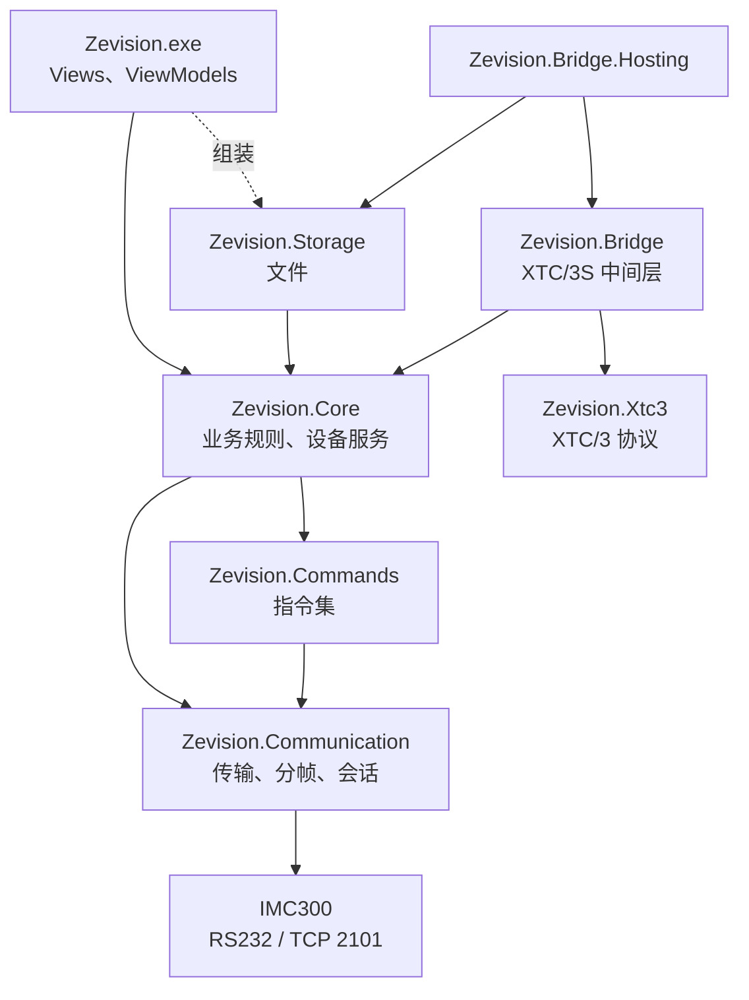

# Zevision

中文 | [English](README.en.md)

Zevision 是 INFICON IMC300 膜厚控制仪的上位机软件（“IMC300 通讯测试”），经 RS232 或以太网（TCP 端口 2101）以 Zevision 协议与设备通信。仓库中还包括 XTC/3S 协议兼容中间层，使按 XTC/3 Standard Protocol 通信的主机软件可以改用 IMC300。

全部功能均已在 IMC300（固件 1.8.11）上实测，记录见 [`docs/联调记录.md`](docs/联调记录.md)。

## 1 组成

表 1  程序集和版本

| 程序集 | 用途 | 版本 |
|---|---|---|
| `Zevision.exe` | WPF 应用（Material Design 界面，INFICON 配色） | 1.3.3 |
| `Zevision.Communication.dll` | 通信库：串口和 TCP 传输、分帧、多包重组、响应解析、`ZevisionClient`（会话、重发、心跳） | 1.2.0 |
| `Zevision.Commands.dll` | 指令集库：全部指令的 ID 模式、动作、名称（中、英文）、单位、范围和选项 | 1.1.1 |
| `Zevision.Core.dll` | 业务层：设备服务、握手、配置的保存/恢复/修改规则、工艺编辑 | 1.3.3 |
| `Zevision.Storage.dll` | 存储层：配置文件（带 MD5）、设置、错误日志、通讯数据文件、工艺文件 | 1.3.3 |
| `Zevision.Xtc3.dll` | XTC/3 Standard Protocol：包格式、命令语法、参数、响应编码 | 1.0.0 |
| `Zevision.Bridge.dll` | XTC/3S 中间层：命令执行、影子对象、采样和推导状态 | 1.0.0 |
| `Zevision.Bridge.Hosting.dll` | 中间层的组装：设置文件、一步启动 | 1.0.0 |
| `Zevision.Xtc3Bridge.exe` | 中间层独立程序（控制台） | 1.0.0 |

通信库和指令集库是生产程序使用的链接库，版本独立于应用；`Zevision.Core`、`Zevision.Storage` 的版本与应用相同；中间层的三个库和独立程序版本相同。

## 2 功能

- **连接**：RS232（8N1，波特率可选）或 TCP；连接时握手，自动识别设备的帧格式（校验和、长度字节）；空闲时心跳检测断线；可选自动重连。
- **指令**：手动发送一条或多条指令（`QG01;QG1304;QG1305` 作为一帧），逐条显示解析结果；显示格式 ASCII、HEX、Binary；重复发送；收发和错误计数。
- **数据显示和记录**：大响应（如约 116 KB 的 `?` 帮助表）分行显示；可把显示内容保存为通讯数据文件；错误写入 `logs\error.txt`。
- **仪器配置**：读取设备的全部设置并保存为配置文件；按文件恢复（只写有差异的项，必要时重新创建材料、膜系、膜层、工艺并逐项读回校验）；按实机数据或配置文件逐项修改，新建、删除对象和列表项。
- **工艺编辑**：在本地编写材料（可从 253 种材料的材料库查找）和工艺，上传时复用设备上参数相同的对象，失败时删除本次新建的对象；查看和删除设备上的工艺和材料。
- **界面语言**：中文和英文，按系统语言选择，可在界面中切换。
- **XTC/3S 中间层**：主机软件经虚拟串口对连接中间层，中间层经 TCP 或 RS232 访问 IMC300；支持 Film 参数、通用参数、状态和远程动作命令。

## 3 结构



图 1  分层结构（依赖只指向下层）

各层之间通过接口隔离：界面只使用业务层的接口，存储层实现业务层定义的存储接口，只有 `App.xaml.cs`（组装根）创建存储层的实现。`LibraryBoundaryTests` 检查各程序集的引用和字符串规则。设计见 [`docs/概要设计说明书.md`](docs/概要设计说明书.md)。

表 2  目录

| 目录 | 内容 |
|---|---|
| `Views/`、`ViewModels/`、`App.xaml` | WPF 应用；视图模型按功能分为 `Common`、`Main`、`Display`、`Operations`、`Editor`、`Design` |
| `Zevision.Communication/`、`Zevision.Commands/` | 两个链接库 |
| `Zevision.Core/`、`Zevision.Storage/` | 业务层、存储层；翻译文件 `Zevision.Core/Localization/Texts.json` |
| `Zevision.Xtc3/`、`Zevision.Bridge/`、`Zevision.Bridge.Hosting/` | XTC/3S 中间层 |
| `Zevision.Tests/` | 单元测试（xUnit），按层分文件夹 |
| `samples/Zevision.Sample/` | 只引用两个链接库的最小示例（只读查询） |
| `samples/Zevision.Xtc3Bridge/` | 中间层独立程序 |
| `tools/` | 打包脚本、原始帧探测脚本 `probe.ps1`、图标生成脚本 |
| `docs/` | 需求、设计、协议、手册、版本说明和联调记录 |

## 4 构建

环境要求：

- Windows，.NET Framework 4.7.2 目标包；
- Visual Studio 2019（MSBuild 16.11，C# 9）。项目文件为非 SDK 格式，不需要 .NET SDK；
- NuGet：MaterialDesignThemes 5.3.2、MaterialDesignColors 5.3.2、Microsoft.CodeAnalysis.NetAnalyzers 10.0.402、xUnit 2.9.3（构建时还原）。

构建（Git Bash 中应使用 `-p:` 形式的开关）：

```powershell
& "C:\Program Files (x86)\Microsoft Visual Studio\2019\Community\MSBuild\Current\Bin\MSBuild.exe" Zevision.sln -restore -t:Rebuild -p:Configuration=Debug
```

输出为 `bin\Debug\Zevision.exe`。Release 配置启用 `TreatWarningsAsErrors`，构建结果应为 0 警告。`bin\Debug\Zevision.exe` 正在运行时构建会因文件被占用而失败，此时用 `-p:OutDir=<其他目录>\` 构建。

## 5 测试

```powershell
& "$env:USERPROFILE\.nuget\packages\xunit.runner.console\2.9.3\tools\net472\xunit.console.exe" Zevision.Tests\bin\Debug\Zevision.Tests.dll
```

只运行一个测试类时加 `-class Zevision.Tests.ZevisionFrameDecoderTests`。单元测试使用模拟的串口和设备，不需要真实设备。`ProtocolSpecTests` 检查协议规格书中的指令表与代码一致；设置环境变量 `ZEVISION_UPDATE_DOCS=1` 运行时重新生成该表。

## 6 运行

启动 `bin\Debug\Zevision.exe`，或在 Visual Studio 中按 F5。同一台计算机上只运行一个实例。

程序在程序目录（不可写时为 `文档\Zevision\`）中使用以下文件：

表 3  运行时文件

| 文件 | 内容 |
|---|---|
| `settings.json` | 连接设置、发送选项、界面语言 |
| `configs\*.json` | 仪器配置文件 |
| `recipes\material\`、`film\`、`layer\`、`process\` | 工艺编辑的材料、膜系、膜层和工艺 |
| `logs\error.txt`、`logs\<序列号>_<日期>_<时间>.txt` | 错误日志、通讯数据文件 |
| `Texts.json`、`materials.json` | 翻译文件、材料库（随程序发布，只读） |

操作说明见 [`docs/USER_GUIDE.md`](docs/USER_GUIDE.md)（英文版 [`docs/USER_GUIDE.en.md`](docs/USER_GUIDE.en.md)）。

## 7 使用链接库

```csharp
var options = new ConnectionOptions(
    new TcpSettings("192.168.5.88", TcpSettings.DefaultPort),
    new FrameOptions(checksumEnabled: true, lengthEnabled: true),
    TimeSpan.FromSeconds(1));
using (var client = new ZevisionClient(options))
{
    var connected = await client.ConnectAsync();
    if (!connected.IsSuccess)
    {
        Console.WriteLine(connected.Error!.Message);
        return;
    }

    // 两条查询放在一帧中发送,响应按命令顺序排列。
    var reply = await client.SendAsync(ZevisionCommandSet.Query("G01") + ";" + ZevisionCommandSet.Query("G1304"));
    if (!reply.IsSuccess)
    {
        Console.WriteLine(reply.Error!.Message);
        return;
    }

    foreach (var response in reply.Value.Responses)
    {
        Console.WriteLine(response.Command + " " + (response.IsSuccess ? response.Data : response.ErrorCode.ToString()));
    }
}
```

帧格式应与设备的设置（RS232 为 G1304/G1305，以太网为 G1407/G1408）一致。完整的接口说明和示例见 [`docs/LIBRARY.md`](docs/LIBRARY.md) 和 `samples/Zevision.Sample/`。

## 8 XTC/3S 中间层

```text
客户软件 (XTC/3) → COM1 ⇄ 虚拟串口对 ⇄ COM2 → 中间层 → TCP 2101 (Zevision) → IMC300
```

```powershell
.\Zevision.Xtc3Bridge.exe init --host COM2 --device 192.168.5.88   # 生成 xtc3bridge.settings.json
.\Zevision.Xtc3Bridge.exe                                         # 按设置文件运行中间层
.\Zevision.Xtc3Bridge.exe client --port COM1 H1 S4 QF8:1 QG0 S0     # 代替客户软件发送一个命令包
```

客户软件为 .NET 程序时，也可在进程内调用 `Xtc3BridgeHost.Start(settings, log)` 启动中间层。中间层在 IMC300 上为 Film 1～9 使用影子对象（默认编号 B1～B9，`--create-shadow` 时自动创建）。命令的实现、状态的来源和限制见 [`docs/XTC3中间层编程手册.md`](docs/XTC3中间层编程手册.md)。

## 9 打包

表 4  发布包

| 发布包 | 命令 | 内容 |
|---|---|---|
| 链接库 | `powershell -ExecutionPolicy Bypass -File tools\package-libraries.ps1` | `dist\Zevision.Libraries-<版本>.zip`：两个链接库、XML 文档、编程手册、示例源代码 |
| 应用 | `powershell -ExecutionPolicy Bypass -File tools\package.ps1` | `dist\Zevision-<版本>_wDotnet.zip`（含 .NET Framework 4.8 离线安装包）和 `_woDotnet.zip` |
| XTC/3S 中间层 | `powershell -ExecutionPolicy Bypass -File tools\package-bridge.ps1` | `dist\Zevision.Xtc3Bridge-<版本>.zip`：独立程序、7 个 dll、`Texts.json`、编程手册、示例源代码 |

三个脚本均先以 Release 配置重新构建并运行全部单元测试，输出 SHA256，并把 pdb 存档到 `dist\symbols\`。发布材料、更改记录、校验值和发布前的实机检查见 [`docs/RELEASE.md`](docs/RELEASE.md)。

## 10 文档

表 5  文档

| 标识 | 文档 | 内容 |
|---|---|---|
| ZEV-SRS-01 | [通信需求规格](docs/通信需求规格.md) | 需求和验证方法 |
| ZEV-SDD-01 | [概要设计说明书](docs/概要设计说明书.md) | 分层、接口、线程模型、状态机、资源释放 |
| ZEV-IDD-01 | [协议规格书](docs/协议规格书.md) | 帧格式、多包规则、错误码、会话规则、指令表 |
| ZEV-SUM-01 | [用户手册](docs/USER_GUIDE.md)、[User Manual](docs/USER_GUIDE.en.md) | 安装和操作 |
| ZEV-OPS-01 | [部署与运维手册](docs/部署与运维手册.md) | 连接参数、文件、故障排查 |
| ZEV-CPM-01 | [链接库编程手册](docs/LIBRARY.md) | 通信库和指令集库 |
| ZEV-CPM-02 | [业务层与存储层编程手册](docs/CORE_STORAGE.md) | 供维护 |
| ZEV-CPM-03 | [XTC/3S 中间层编程手册](docs/XTC3中间层编程手册.md) | 中间层的接口和实现约定 |
| ZEV-FAR-01 | [XTC/3S 中间层可行性分析报告](docs/XTC3中间层可行性分析报告.md) | 方案选择和命令映射 |
| ZEV-SVD-01 | [软件版本说明](docs/RELEASE.md) | 发布材料、更改、打包、校验值 |
| ZEV-STR-01 | [联调记录](docs/联调记录.md) | 实机测试记录（含原始字节） |
| — | [开发规范](docs/开发文档.md) | 团队的开发规范和实现状态 |
| — | [Zervison_Protocol.md](docs/Zervison_Protocol.md)、[通讯协议说明](docs/INFICON_IMC300_Zevision通讯协议说明.md)、[XTC3.md](docs/XTC3.md) | 厂商协议文档的译文和摘录 |

`docs/` 中的项目文档按 GB/T 8567-2006 的文档类型编写。

## 11 开发约定

- 目标框架为 .NET Framework 4.7.2，语言版本 C# 9，启用可空引用类型；不使用 4.7.2 中没有的 API。
- 新增的 `.cs` 文件需在项目文件中加 `<Compile Include=...>`，XAML 加 `<Page Include=...>`。
- 链接库、业务层和存储层中使用 `ConfigureAwait(false)`，视图模型中不使用；不使用 `.Result`、`.Wait()`。
- 程序生成的指令都经 `ZevisionCommandSet` 构建，不手工拼接 ID。
- 界面文本写为 `Lang.T("中文", "English")`；业务层和存储层的文本放在 `Texts.json`。
- 视图中只使用主题资源（`Views/InficonTheme.xaml`），不写颜色值。
- 新的协议逻辑（分帧、校验、解析）需要单元测试。

## 12 作者

martin.liang@inficon.com
