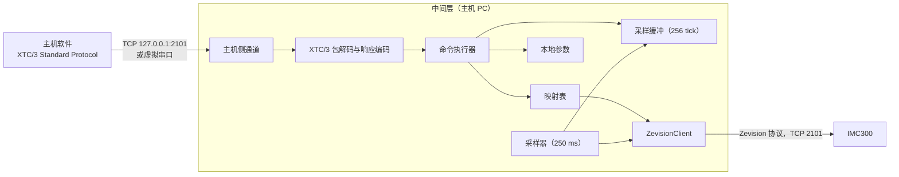

# XTC/3S 协议兼容中间层可行性分析报告

| 项目 | 内容 |
|---|---|
| 文档标识 | ZEV-FAR-01 |
| 文档版本 | 1.0 |
| 适用软件 | XTC/3S 协议兼容中间层（规划中）；Zevision 通信库 1.2.0，指令集库 1.1.0 |
| 编制单位 | INFICON |
| 日期 | 2026-10-20 |

## 1 范围

### 1.1 标识

本报告适用于规划中的 XTC/3S 协议兼容中间层（以下简称“中间层”）。中间层运行于主机 PC，按 XTC/3 Standard Protocol 应答主机软件，经以太网按 Zevision 协议访问 IMC300（固件 1.8.11）。

### 1.2 系统概述

现有镀膜设备的主机软件按 XTC/3 Standard Protocol 与 XTC/3S 通信，IMC300 提供 Zevision 协议。中间层的作用是在主机软件的通信代码不修改的前提下，以 IMC300 替换 XTC/3S：主机软件只改变连接目标（IP 地址或串口号）。

IMC300 的 G1301、G1406 设有“1 = XTC3”的协议类型选项。本项目不使用该选项（见 3.3 的 P-01）。

### 1.3 文档概述

本报告按 GB/T 8567-2006 中“可行性分析（研究）报告（FAR）”编排，用语按 GB/T 1.1-2020。剪裁情况：删除“经济可行性（成本－效益分析）”和“法律可行性”两章；“可选的方案”只比较部署形态和中间层的工作方式；指令映射的逐条结果列于附录 A。

分析范围为 XTC/3 通用指令和 XTC/3S 指令。XTC/3M 专用指令（QN、QI、QO、QT、QP、UN、UI、UO、UT、UP，QB 和 UB 的 ID 3、4）不在范围内。

## 2 引用文件

表 1  引用文件

| 标识 | 名称 |
|---|---|
| GB/T 8567-2006 | 计算机软件文档编制规范 |
| GB/T 1.1-2020 | 标准化工作导则 第 1 部分：标准化文件的结构和起草规则 |
| docs/XTC3.md | 《XTC/3 Standard Protocol 通讯指令集》，摘自 XTC/3 Operating Manual 第 5 章 Remote Communications |
| ZEV-IDD-01 | 《IMC300 Zevision 通信协议规格书》 |
| ZEV-SDD-01 | 《Zevision 概要设计说明书》 |
| ZEV-STR-01 | 《Zevision 联调记录》 |
| ZEV-CPM-01 | 《Zevision 链接库编程手册》 |
| ZEV-CPM-02 | 《Zevision 业务层与存储层编程手册》 |
| 074-786-P1A | IMC300 Operating Manual，第 7 章 |
| Zevision.Tests/TestData/imc300_1.8.11_h01_h02_help.bin | IMC300 固件 1.8.11 的 `?` 帮助表实测记录（以下简称“帮助表记录”） |

## 3 可行性分析的前提

### 3.1 项目的要求

a) 主机软件的 XTC/3 通信代码不修改，只修改连接目标。

b) 中间层对每个命令包给出与 XTC/3S 格式相同的响应包，包括 CCB、Timer、每条命令的 ACK 或错误码和校验和。

c) 覆盖 XTC/3 通用指令和 XTC/3S 指令；IMC300 上没有对应功能的指令按 5.6 的规则应答。

d) 中间层对 IMC300 的修改限于影子对象（5.2）和通讯 I/O 模式期间的输出分配（5.5）。

### 3.2 项目的目标

a) 启动、停止、复位、Film 参数读写和状态轮询等常用操作对主机软件透明。

b) 与 XTC/3S 的差异形成兼容性清单（附录 A 中类别为 C、D、L、X 的条目），随中间层交付客户。

### 3.3 条件、假定和限制

表 2  前提条件

| 编号 | 内容 | 来源 |
|---|---|---|
| P-01 | 不使用 IMC300 内置的 XTC3 协议类型（G1301、G1406 = 1） | 项目决定，2026-10-20 |
| P-02 | 中间层安装在主机 PC 上 | 项目决定，2026-10-20 |
| P-03 | 中间层与 IMC300 经以太网连接（TCP 端口 2101，Zevision 协议） | 项目决定，2026-10-20 |
| P-04 | IMC300 膜系的 P 项（`F**0903`）为过程增益，I 项（`F**0904`）为时间常数，D 项（`F**0905`）为死区时间，分别对应 XTC/3 的 Control Gain、Control Time Constant、Control Dead Time | INFICON，2026-10-20 |
| P-05 | 中间层可以为 R15/R16（通讯 I/O 模式）临时修改 IMC300 的输出分配，退出该模式和中间层退出时应还原 | 项目决定，2026-10-20 |
| P-06 | 中间层与 IMC300 的连接中断期间，需要设备数据的命令（含由采样得到的状态）回答错误码 `E`；E、H 和只涉及中间层本地数据的命令照常回答 | 项目决定，2026-10-20 |
| P-07 | IMC300 固件 1.8.11。速率单位为 Å/s，厚度单位为 kÅ，与 XTC/3 相同；帮助表记录中没有单位设置项 | 帮助表记录 |
| P-08 | XTC/3 协议以 docs/XTC3.md 为依据，与原版手册的差异按 8.2 确认 | — |

### 3.4 分析方法

逐条对照 docs/XTC3.md 的指令与 IMC300 的 Zevision 指令（ZEV-IDD-01 附录 A、帮助表记录），按表 3 的类别归类。结论依赖设备行为而尚无实测的，标为“待实测”，列入 8.3。

表 3  映射类别

| 代号 | 类别 | 含义 |
|---|---|---|
| M | 对应 | IMC300 有同义的设置或状态，只换算数据类型、单位和文本格式 |
| C | 换算 | 需要取值换算、组合多条 Zevision 指令或按约定解释 |
| D | 推导 | IMC300 没有对应项，由中间层的周期采样和状态历史计算 |
| L | 本地 | 由中间层保存或处理，不访问设备，对镀膜过程没有影响 |
| X | 不支持 | IMC300 没有对应功能，中间层不能实现 |

## 4 可选的方案

### 4.1 部署形态

表 4  部署形态

| 方案 | 说明 | 主机侧改动 | 结论 |
|---|---|---|---|
| A | 中间层安装在主机 PC 上，经以太网访问 IMC300 | 以太网主机软件把 XTC/3 的地址改为 `127.0.0.1`；串口主机软件改用虚拟串口对的一端 | 选定（P-02、P-03） |
| B | 独立的桥接计算机（双串口工控机），置于主机与 IMC300 之间 | 只更换连线 | 未选：增加硬件和现场维护点 |
| C | 嵌入式网关 | 只更换连线 | 未选：不能使用 .NET Framework，需另行开发 |
| D | IMC300 内置的 XTC3 协议类型 | 无 | 不采用（P-01） |

### 4.2 中间层的工作方式

可选的工作方式有两种：逐条翻译（每条 XTC 命令即时转为 Zevision 指令，中间层不保存状态）和有状态仿真（中间层维护时钟、采样缓冲和状态历史）。逐条翻译不能满足以下要求，故选定有状态仿真：

a) 每个响应包含 Timer 字节（每 250 ms 加 1）。S0 按主机给出的 tick 返回该时刻的数据，最多回溯 256 个 tick（约 64 s）。中间层应维护自身的 250 ms 时钟和 256 格的采样缓冲，并每 250 ms 从 IMC300 采样一次。

b) XTC/3 的多命令包中，一条命令失败后其后的命令不执行，回答 `P`；Zevision 遇到错误后继续执行其后的命令（ZEV-STR-01 的 4.4）。中间层应自行决定执行顺序和停止点。

c) XTC/3 命令之间没有分隔符，每条命令的长度由命令的语法决定。中间层应持有完整的语法表（组、子组、ID → 参数类型序列）。

d) S5（状态持续时间）、S15～S18、S19（数据日志）、S21（上电错误）和 S33 的大部分位在 IMC300 上没有对应项，只能由状态历史计算。

e) Graph Label、Graph Scale、远程锁定标志和通讯 I/O 模式只存在于中间层，应持久保存，使主机写入后读回的值不变。

### 4.3 有利条件

IMC300 与 XTC/3 有共同的设计渊源，以下实测和文档事实降低了映射难度：

a) XTC/3 的 S4 状态 0～12（Ready、Crucible Switch、Rise 1、Soak 1、Rise 2、Soak 2、Shutter Delay、Deposit、Rate Ramp、Manual、Time Power、Idle Ramp、Idle）与 IMC300 输出功能 17～29 的名称和顺序相同。

b) XTC/3 S19 的停止原因编码（0、1、5～12）与 IMC300 `C1F` 的编码相同。

c) XTC/3 的输入功能 0～35、输出功能 0～58 与 IMC300 输入分配、输出分配（`T0101**`、`T0102**`）的编码相同。

d) 速率、厚度单位相同（P-07）；XTC/3 的 TCP 端口与 IMC300 同为 2101。

## 5 选定的系统

### 5.1 系统组成

图 1  数据流

表 5  中间层的组成部分

| 部分 | 职责 |
|---|---|
| 主机侧通道 | 以太网主机：在 `127.0.0.1:2101`（可设置）监听；串口主机：打开虚拟串口对的一端，波特率按 UG14 |
| XTC/3 包解码与响应编码 | 按 2 字节长度（低字节在前）分包，校验和不含长度；字符间隔超过 3 s 丢弃当前包，不回答；生成 CCB、Timer、ACK、错误码和校验和 |
| 命令执行器 | 按语法表拆分命令，按顺序执行，第一条失败后其余回答 `P`；检查 XTC/3 的状态限制 |
| 映射表 | XTC/3 参数与 Zevision 指令的对应和取值换算（附录 A），为唯一数据来源 |
| 采样器与采样缓冲 | 每 250 ms 采样一次，按 tick 保存；计算推导状态 |
| 本地参数 | Graph Label、Graph Scale、远程锁定标志、S21 标志、通讯 I/O 模式和输出分配备份，保存在文件中 |
| ZevisionClient | 与 IMC300 的连接：握手、重发、发送锁优先级、自动重连 |

### 5.2 数据模型映射

XTC/3S 有 9 个 Film，每个 Film 含材料、预熔、沉积和速率参数；IMC300 的配置分为材料 M、膜系 F、膜层 L、工艺 P。中间层为每个 Film n（1～9）在 IMC300 上维护一组影子对象，对象编号 kk = 编号基数 + n（两位十六进制，基数见 8.1 的 Q-03）。

表 6  影子对象

| XTC/3S Film n | IMC300 影子对象 | 创建时设定的内容 |
|---|---|---|
| 密度、Z-Ratio | 材料 `Mkk` | 名称 `XTC n`；工具因子 `Mkk07` = 100 % |
| Rise、Soak、Idle、Rate Watcher、传感器、输出源、控制参数等 | 膜系 `Fkk` | 名称；材料 `Fkk02` = kk；预熔 2 步；后处理 1 步；传感器列表 1 项；主工具因子 `Fkk0802` = 100 %；最小功率 `Fkk0908` = 0 |
| 沉积速率、最终厚度、速率斜坡 | 膜层 `Lkk` | 名称；膜系列表 1 项，`Lkk020101` = kk；速率斜坡列表 1 项 |
| Film to run | 工艺 `P02kk` | 名称；膜层列表 1 项，`P02kk0701` = kk；自动启动下一膜层 `P02kk04` = 0 |

影子对象的规则：

a) 中间层与 IMC300 连接后，应核对影子对象存在、名称为中间层所设、各列表的数量正确（`Fkk03FE` = 2、`Fkk05FE` = 1、`Fkk07FE` = 1、`Lkk02FE` = 1、`Lkk0201 06FE` = 1、`P02kk07FE` = 1）。

b) 对象不存在时，经确认后创建；编号已被其他对象占用时，不修改该对象，记录错误，相应 Film 的命令回答 `E`。

c) 创建使用现有的按编号创建和追加列表项功能（`IInstrumentConfigWriter.CreateObjectAsync`、`AppendListItemAsync`）。按编号创建材料、膜系已实测，膜层、工艺待实测。

d) 当前传感器（S8）和当前输出源（S10）取自当前 Film 的 `Fkk070101`、`Fkk0901`，不按名称反查：帮助表记录中两个传感器都名为 `Sensor`，两个输出源都名为 `Source`。

### 5.3 命令处理

a) 解析：按语法表拆分命令包。遇到语法表中没有的命令时，无法确定其后命令的起点，处理方式按 8.2 确认的 XTC/3S 行为。

b) 执行顺序：命令按包内顺序执行；一条命令失败后，其后的命令不执行，回答 `P`。

c) 读取：相邻的只读命令合并为一个 Zevision 帧发送（每帧不超过 20 项）；收到回答后按回显对应，第一条失败之后的结果改为 `P`。

d) 写入：每条 XTC/3 写入命令单独执行，生成的 `U` 指令写入后以 `Q` 回读核对，比较方法与 Zevision 修改功能相同（`ParameterValue.AreEquivalent`）。UF255、UG255 在第一项失败处停止，已写入的项不回滚，回答该项的错误码。

e) 状态限制：XTC/3 规定的状态限制（G0 只在就绪或空闲时可改，R2 只在停止时有效，R11 只在手动时有效，Sensor、Transfer Sensor 运行中不可改）由中间层按最近一次采样检查，不符时回答 `F`；IMC300 回答 `-F` 时同样回答 `F`。

f) 数值：XTC/3 的 Float 按 IMC300 该项的小数位数写成文本（`ParameterValue.Normalize`）；时间在整数秒和 `H:MM:SS` 之间换算。读出时 IMC300 的值超出 XTC/3 范围的，按原值换算类型后返回；选项无法对应的，按附录 A 的规定返回。

### 5.4 周期采样与推导状态

采样器每 250 ms 发送一个 Zevision 帧，tick 同时加 1。每个 tick 采样的项目为 `SC11;SC12;SC13;SC15;SC16;SNss20;QC09;QC18;QC1F;QNss11`（ss 为当前传感器）；每 4 个 tick 增加 `QC17;QC20;QC21`、各输出的 `QOnn05` 和各输入的 `QInn05`。S 和 Q 是否可以在同一帧中混合待实测（8.3），不能混合时分为两帧。

采样器使用普通优先级，主机命令使用高优先级（`SendPriority.High`），主机命令最多等待一帧采样。

由采样缓冲和状态历史得到的状态：

a) S0：按主机给出的 tick 返回该格数据。Crystal Status 的 bit0 取自 `C18`，bit1 取自状态文本，bit2（读数无效）无对应项，取 0；不在沉积状态或停止时，速率和速率偏差返回 0（与 XTC/3 相同）。尚未采样到的格回答 `E`。

b) S1、S31：由 `C13` 的采样计算 1 s 和 6.25 s 平均。也可在影子工艺运行时把 `G1201`（速率滤波）设为 1.0 s，以 `C12` 作为 S1；两种做法的结果待实测比较。

c) S5：当前状态开始以来的秒数。

d) S15：功率 `C11` 不小于当前 Film 的最大功率 `Fkk0906`。

e) S17：一层结束后置位，R0、R2 后清除。

f) S19：每层结束时生成：层号、Film 号、结束前 1 s 平均速率、结束时厚度 `C15`、沉积状态的累计时间、沉积期间 `C11` 的平均值、`C20`、`C21`、沉积开始和结束时的 `C16`、`C17`、结束类型（正常、时间功率、停止）、`C1F`。第一层结束前回答 `E`。

g) S21：中间层与 IMC300 重连后，开机次数 `G0C` 增加时置 bit2；bit0、bit1 没有对应项，取 0；R22 清除。

h) S33：最大功率、晶振失效、晶振切换中、工艺结束、刻蚀模式、远程锁定、测试模式各位由上述状态和 `C1C`、`P02kk08` 得出；其余位取决于 `C09` 的子状态文本，待实测。

### 5.5 通讯 I/O 模式

a) R15：读取各输出的 `T0102nn` 并写入备份文件；把各输出的分配改为 36（计算机控制）；置模式标志。任一步失败时，还原已修改的项并回答错误码。

b) R17、R18：模式标志已置时写 `UOnn04:1`、`UOnn04:0`；未置时回答 `F`；输出号大于 IMC300 的输出数量（6）时回答 `B`。

c) R16：按备份还原 `T0102nn` 并回读核对，成功后删除备份、清除模式标志。

d) 中间层正常退出时，执行与 R16 相同的还原。

e) 中间层启动或与 IMC300 重连时，备份文件存在（上次异常退出或设备断电）即先还原。

f) 输出分配由 `T0102nn` 还是 `Onn03` 决定、`Onn04` 能否控制输出，待实测：帮助表记录中 `O0103` = 1 而 `T010201` = 0。

### 5.6 错误码

表 7  错误码的来源

| XTC/3 错误码 | 来源 |
|---|---|
| `A` | 语法表中没有该命令；附录 A 中类别为 X 的命令 |
| `B` | 参数超出 XTC/3 的范围（中间层先按 XTC/3 的范围检查）；IMC300 回答 `-B`；坩埚编号超出所选输出源的坩埚数量 |
| `C` | 命令的 ID 超出语法表 |
| `D` | 参数字节数与语法表不符 |
| `E` | 与 IMC300 的连接中断（P-06）；IMC300 回答 `-D` 或 `-A`（影子对象缺失）；采样数据尚不存在 |
| `F` | 不符合 XTC/3 的状态限制；IMC300 回答 `-F` |
| `L`、`O` | 中间层的协议层 |
| `P` | 同一包中前面的命令已失败 |
| 包错误 `C`、`F`、`I`、`L`、`M` | 中间层的协议层：校验和错误、格式错误、无效消息、长度错误、超过 100 条命令 |

IMC300 回答传输错误（`C`、`L`、`T`）或超时时，按 ZEV-SDD-01 的 DD-02 重发；重发后仍失败的，按连接中断处理。

### 5.7 与 IMC300 的连接

a) 使用 `ZevisionClient` 经 TCP 端口 2101 连接，连接后握手确定帧格式和型号（ZEV-SDD-01 的 DD-01），并核对 G1406 = 0。

b) 采样使连接持续有数据，心跳不发生作用；采样连续 3 次无应答时判定连接中断。

c) 连接中断后按 `ReconnectPolicy`（1、2、4……60 s）自动重连。中间层无人值守，自动重连始终启用。

d) 重连成功后依次：握手、核对影子对象、检查 `G0C`（S21）、还原通讯 I/O 模式的备份、恢复采样。中断期间的 tick 格标为无数据。

e) IMC300 以太网口能否同时接受多个客户端待实测。确认之前，中间层运行时 Zevision 软件经 RS232 连接设备。

### 5.8 主机侧接口

a) 以太网主机：中间层在 `127.0.0.1:2101`（地址和端口可设置）监听，主机软件把 XTC/3 的地址改为该地址。第二个连接的处理见 8.1 的 Q-04。

b) 串口主机：使用虚拟串口对（例如 com0com），主机软件和中间层各打开一端；受安装限制时，可用两个物理串口和一根交叉线代替。UG14 修改波特率时，中间层先应答，再切换波特率。

c) 时延：S0～S4 等由采样缓冲回答的命令，在中间层内完成，不访问设备；单条读写约为一次 IMC300 往返（RS232 实测 18～39 ms，ZEV-STR-01 的表 2；以太网待实测）；QF255 约为 2 帧。

### 5.9 与现有软件的关系

表 8  复用的部分

| 现有部分 | 用途 |
|---|---|
| `ZevisionClient`（重发、心跳、优先级发送锁、改变帧格式） | 与 IMC300 的连接 |
| `ZevisionDeviceService.HandshakeAsync`、`ReconnectPolicy` | 握手、自动重连 |
| `ZevisionCommandSet`（`Query`、`Update`、`Build`） | 生成全部 Zevision 指令 |
| `ParameterValue`、`CrucibleRule` | 数值和时间的格式、回读比较、坩埚上限 |
| `IInstrumentConfigWriter`、`ObjectTypes`、`DeviceIds` | 创建影子对象 |
| `SerialPortTransport` | 主机侧串口 |
| `CommunicationLogWriter`、`FileErrorLog` | 通讯记录和错误日志 |
| `SimulatedImc300`、`FakeSerialTransport`（测试） | 单元测试 |

表 9  新增的部分

| 部分 | 说明 |
|---|---|
| `Zevision.Xtc3.dll` | 协议库，只引用 .NET Framework：包解码、响应编码、语法表、参数类型、错误码 |
| `Zevision.Bridge.dll` | 业务层，引用通信库、指令集库和 `Zevision.Core`：映射表、命令执行器、采样器、推导状态、影子对象核对、通讯 I/O 模式、本地参数接口 |
| 本地参数存储 | 实现本地参数接口，JSON 文件 |
| 主机侧 TCP 服务端 | 现有 `IDeviceTransport` 只有客户端实现 |
| 中间层程序 | Windows 服务或托盘程序：组装根、设置、运行状态显示 |

全部项目沿用现有约束：.NET Framework 4.7.2，C# 9，非 SDK 格式的项目文件。

### 5.10 映射统计

表 10  映射统计

| 指令组 | 条数 | M | C | D | L | X |
|---|---|---|---|---|---|---|
| Film 参数（UF/QF） | 38 | 25 | 10 | 0 | 2 | 1 |
| 通用参数（UG/QG） | 16 | 6 | 8 | 0 | 2 | 0 |
| 状态（S） | 28 | 6 | 13 | 9 | 0 | 0 |
| 远程（R） | 26 | 11 | 10 | 0 | 1 | 4 |
| 合计 | 108 | 48 | 41 | 9 | 5 | 5 |

E、H、QB、UB 和 ID 255 的批量命令见表 A.5，不计入表 10。

### 5.11 影响

a) 设备：影子对象占用 IMC300 材料、膜系、膜层、工艺编号各 9 个；通讯 I/O 模式期间输出分配被临时修改；传感器、输出源、输入输出的配置和接线在 IMC300 上调试完成，不由中间层设定。

b) 主机 PC：安装中间层和 .NET Framework 4.7.2 或更高版本；串口主机软件另需虚拟串口驱动。

c) 运行：中间层应先于主机软件启动；中间层运行期间保持与 IMC300 的 TCP 连接。

### 5.12 局限性

a) 附录 A 中类别为 X 的 5 条命令不能实现：Tool Factor 2、R5～R8。

b) QB/UB 的块结构确认前，这两条命令不能实现。

c) 推导状态的时间分辨率为 250 ms；S0 的历史数据从中间层开始采样时算起。

d) 在 IMC300 前面板上修改影子对象的参数，主机软件下次读取时即可看到；删除影子对象或修改其列表结构后，相应 Film 的命令回答 `E`，直到中间层重新核对。

## 6 技术可行性（技术风险评价）

表 11  技术风险

| 编号 | 风险 | 等级 | 措施 |
|---|---|---|---|
| T-01 | 工艺状态机与 XTC/3S 的差异：一层结束后再次启动、空闲、停止与复位 | 高 | 在测试模式下实测（8.3）；差异列入兼容性清单 |
| T-02 | QB/UB 的块结构未知 | 高（对使用块命令的主机软件） | 取得原版手册或 XTC/3S 的通信记录（8.2） |
| T-03 | `C09` 的状态和子状态文本未知；S4、S0、S33 依赖它 | 中 | 在测试模式下记录全部文本 |
| T-04 | 控制参数按 P-04 对应；膜系的高级模式 `F**0909` 是否改变 P、I、D 的含义未知 | 中 | 测试模式下以相同参数对比 XTC/3S 与 IMC300 的控制过程 |
| T-05 | 每 250 ms 一帧采样占用的设备处理时间 | 低 | 实测一帧采样的往返时间 |
| T-06 | 影子对象在前面板上被删除或修改结构 | 中 | 连接时和 IMC300 回答 `-D` 时核对；不一致时回答 `E` 并记录 |
| T-07 | 通讯 I/O 模式的输出分配未还原（中间层异常退出、断电） | 中 | 备份写入文件；启动和重连时还原（5.5） |
| T-08 | 客户 PC 不允许安装虚拟串口驱动 | 中 | 两个物理串口加交叉线 |
| T-09 | 主机软件的响应超时短于块命令和批量命令的处理时间 | 中 | 取得主机软件的超时设定；批量读取合并为少量帧 |
| T-10 | docs/XTC3.md 的转录错误：S33 的位值有重复（如 0x00400000、0x00008000） | 低 | 对照原版手册 |
| T-11 | IMC300 以太网口不接受第二个客户端 | 低 | 实测；中间层运行时 Zevision 软件经 RS232 连接 |

结论：XTC/3 的包格式、数据类型、参数读写、状态查询和常用远程动作都能在 IMC300 上实现，108 条命令中 98 条可实现为类别 M、C、D，5 条由中间层本地处理，5 条不能实现。技术上可行。T-01、T-02 解决之前，不实现受其影响的部分（R0、R2、S17、S19 的状态逻辑和 QB/UB）。

## 7 用户使用可行性

a) 主机软件：只修改连接目标（4.1 的方案 A）。

b) 现场调试：在 IMC300 上配置传感器、输出源、输入输出分配并完成接线（XTC/3S 与 IMC300 的接口和引脚不同，不属于中间层）；启动中间层，确认创建影子对象。

c) 操作：设备的前面板为 IMC300 的界面；影子对象不应在前面板上删除。

d) 交付：兼容性清单（附录 A 中类别为 C、D、L、X 的条目）随中间层交付客户。

## 8 其他与项目有关的问题

### 8.1 待决定事项

表 12  待决定事项

| 编号 | 事项 | 说明 |
|---|---|---|
| Q-01 | Tool Factor 2 写入时，中间层保存并记录，或回答 `B` | 回答 `B` 时 UF255 整条失败 |
| Q-02 | Thickness Set Point 对应速率斜坡起始厚度 `Lkk02010601`，或由中间层保存 | 取决于 8.2 第 f) 项 |
| Q-03 | 影子对象编号基数，拟 0xB0（对象编号 B1～B9） | 实测设备上已有 M01～M10、M18、MA5、MFA、F01～F0A、F20 |
| Q-04 | 主机侧以太网的第二个连接：拒绝或替换第一个 | 取决于 XTC/3S 的行为 |
| Q-05 | S35 返回 IMC300 的地址，或中间层所在 PC 的地址 | — |
| Q-06 | QB/UB 在块结构确认前的应答，拟回答 `A` | — |

### 8.2 待确认的资料

以下内容应以 XTC/3 原版手册或 XTC/3S 的通信记录确认：

a) QB、UB 的 ID 1、2 在 XTC/3S 上的块结构。

b) H2 返回的 4 个 Integer（Structure number、Compatibility number、Range number、Unit Type）的取值。

c) 命令没有错误时，响应末尾是否有 Packet Error Code 字节。

d) Film Number 参数的类型（Byte 或 Integer），QF255、UF255、QG255、UG255 的参数顺序。

e) 命令包中出现不认识的命令时 XTC/3S 的应答；XTC/3S 收到 XTC/3M 专用命令时的错误码；S20 在 XTC/3S 上的应答。

f) Film 参数的工艺含义：Thickness Set Point 与速率斜坡的关系、速率斜坡停用的表示、Idle 的保持方式、Time Power、Rate Watcher 的启用条件、晶振寿命 S9 的方向。这些在原版手册的 Film 参数章节中，不在第 5 章。

g) S33 的完整位定义（见 T-10）；S6 层计数在复位后的初值。

h) XTC/3S 以太网口同时接受的连接数。

### 8.3 待实测的设备行为

以下测试涉及 C 组工艺控制，应在测试模式（`C1C` = 1）下进行，结束后恢复设置并以查询确认：

a) 运行影子工艺的完整流程，记录 `C09` 的全部状态和子状态文本。

b) 一层结束后再次 `UC01:1` 的行为；停止后 `RC04` 的行为。

c) 运行中哪些 `U` 指令回答 `-F`。

d) S 和 Q 能否在同一帧中混合；采样帧的往返时间（以太网）。

e) `T0102nn` = 36 的设定、`Onn04` 对输出的控制、`Onn03` 与 `T0102nn` 的关系。

f) `G0E02`、`G11` 的锁定效果（R3、R4）。

g) 按编号创建膜层（`AL..`）和工艺（`AP02..`）。

h) IMC300 以太网口的客户端数量。

### 8.4 实施阶段

表 13  实施阶段

| 阶段 | 内容 | 完成条件 |
|---|---|---|
| 0 | 完成 8.1 的决定、8.2 的确认和 8.3 的实测 | 结果记入 ZEV-STR-01 和本报告 |
| 1 | `Zevision.Xtc3` 协议库 | 包解码、响应编码和语法表的单元测试通过 |
| 2 | 映射表、命令执行器、影子对象核对和创建 | 对 `SimulatedImc300` 的单元测试通过 |
| 3 | 采样器、采样缓冲、推导状态、通讯 I/O 模式 | 单元测试通过 |
| 4 | 主机侧通道、本地参数存储、中间层程序 | 以太网和虚拟串口两种接入可用 |
| 5 | 实机联调和对照测试 | 同一主机脚本分别对 XTC/3S 和“中间层 + IMC300”运行，逐字节比较响应；差异与兼容性清单一致 |

## 9 注解

### 9.1 术语

表 14  术语

| 术语 | 定义 |
|---|---|
| 中间层 | 安装在主机 PC 上，把 XTC/3 Standard Protocol 转换为对 IMC300 的 Zevision 协议访问的软件 |
| 主机软件 | 镀膜设备上按 XTC/3 Standard Protocol 与膜厚控制仪通信的软件 |
| Film | XTC/3S 的一组工艺参数，含材料、预熔、沉积和速率参数，编号 1～9 |
| 影子对象 | 中间层在 IMC300 上为每个 Film 维护的一组材料、膜系、膜层和工艺 |
| tick | XTC/3 的时钟计数，0～255，每 250 ms 加 1 |
| 采样缓冲 | 中间层按 tick 保存的 256 份采样数据 |
| 通讯 I/O 模式 | XTC/3S 中数字输出由主机经 R17、R18 控制的模式 |
| 映射类别 | 表 3 规定的 M、C、D、L、X |

### 9.2 缩略语

表 15  缩略语

| 缩略语 | 全称 |
|---|---|
| FAR | 可行性分析（研究）报告（Feasibility Analysis Report） |
| CCB | 条件码字节（Condition Code Byte） |
| DDS | 直接数字频率合成（Direct Digital Synthesis） |
| IAD | 离子辅助沉积（Ion Assisted Deposition） |
| PID | 比例－积分－微分（Proportional-Integral-Derivative） |
| TCP | 传输控制协议（Transmission Control Protocol） |

## 附录 A（资料性）指令映射表

本附录中，kk 为当前 Film 的影子对象编号，ss 为当前传感器编号，nn 为输入或输出编号，r 为配置为记录仪的输出源编号；时间的换算均为整数秒与 `H:MM:SS` 之间的换算。类别见表 3。

表 A.1  Film 参数（UF/QF）

| ID | 参数 | XTC/3 类型和范围 | IMC300 项 | 换算和说明 | 类别 |
|---|---|---|---|---|---|
| 0 | Rise Time 1 | Int，0～5999 s | `Fkk030101` | 时间 | M |
| 1 | Soak Power 1 | Float，0.0～100.0 % | `Fkk030102` | IMC300 上限 99.99 %，写入 100.0 时写 99.99 | M |
| 2 | Soak Time 1 | Int，0～5999 s | `Fkk030103` | 时间 | M |
| 3 | Rise Time 2 | Int，0～5999 s | `Fkk030201` | 时间 | M |
| 4 | Soak Power 2 | Float，0.0～100.0 % | `Fkk030202` | 同 ID 1 | M |
| 5 | Soak Time 2 | Int，0～5999 s | `Fkk030203` | 时间 | M |
| 6 | Idle Ramp | Int，0～5999 s | `Fkk050101` | 时间；后处理保持时间 `Fkk050103` 的作用待实测 | C |
| 7 | Idle Power | Float，0.0～100.0 % | `Fkk050102` | 同 ID 1 | C |
| 8 | Deposition Rate | Float，0.0～999.9 Å/s | `Lkk020102` | — | M |
| 9 | Final Thickness | Float，0.000～999.9 kÅ | `Lkk020103` | — | M |
| 10 | Thickness Set Point | Float，0.000～999.9 kÅ | 候选 `Lkk02010601` | 见 Q-02 | C |
| 11 | New Rate | Float，0.0～999.9 Å/s | `Lkk02010603` | 速率斜坡停用的表示待确认 | C |
| 12 | Rate Ramp Time | Int，0～5999 s | `Lkk02010602` | 时间 | C |
| 13 | Rate Watcher Accuracy | Int，1～99 % | `Fkk0603` | — | C |
| 14 | RW Hold Time | Int，0～5999 s | `Fkk0602`、`Fkk0601` | 0 → `Fkk0601` = 0；其他值 → `Fkk0601` = 1 并写时间；启用条件待确认 | C |
| 15 | Sensor | Int，1～2 | `Fkk070101` | 运行中回答 `F` | M |
| 16 | Tool Factor 1 | Float，10.0～500.0 % | `Fkk070103` | `Mkk07`、`Fkk0802` 固定为 100 % | M |
| 17 | Tool Factor 2 | Float，10.0～500.0 %，仅 CrystalTwo | 无 | IMC300 没有按晶振设定的工具因子；见 Q-01 | X |
| 18 | Xtal Stability Single | Int，0 或 25～9999 | `Fkk0809` | 1～24 回答 `B` | M |
| 19 | Xtal Stability Total | Int，0 或 25～9999 | `Fkk080A` | 同 ID 18 | M |
| 20 | Xtal Quality Percent | Int，0～99 % | `Fkk0807` | IMC300 的值带小数，读出时取整 | M |
| 21 | Xtal Quality Counts | Int，0～99 | `Fkk0808` | — | M |
| 22 | Source | Int，1～2 | `Fkk0901` | — | M |
| 23 | Crucible | Int，0～8 | `Fkk0902` | 0 = 任意；上限为所选输出源的坩埚数量 `S0r07`（`CrucibleRule`），超出回答 `B` | C |
| 24 | Control Gain | Float，0.01～100.0 Å/s/% | `Fkk0903` | P-04 | M |
| 25 | Control Time Constant | Float，0.1～100.0 s | `Fkk0904` | P-04；IMC300 的值可为 0 | M |
| 26 | Control Dead Time | Float，0.1～100.0 s | `Fkk0905` | P-04；IMC300 的值可为 0 | M |
| 27 | Max Power | Float，0.0～100.0 % | `Fkk0906` | — | M |
| 28 | Density | Float，0.50～99.99 g/cm³ | `Mkk03` | — | M |
| 29 | Z-Ratio | Float，0.100～9.999 | `Mkk04` | — | M |
| 30 | Time Power | Int，1 = Yes，0 = No | `Fkk070105`（失败动作） | 写入 1 → 4（时间功率），0 → 2（停止）；读出 4 → 1，其他 → 0 | C |
| 31 | Delay option | Int，0～3 | `Fkk0401` | 选项相同 | M |
| 32 | Transfer Sensor | Int，1 = Yes，0 = No | `Fkk0405` | 1 → 另一个传感器的编号，0 → 0；运行中回答 `F` | C |
| 33 | Transfer Tooling | Float，10.0～500.0 % | `Fkk0406` | — | M |
| 34 | Control Delay Time | Int，0～5999 s | `Fkk0402` | 时间 | M |
| 35 | Ion Assisted Deposit | Int，1 = Yes，0 = No | `Fkk0604` | — | M |
| 36 | Graph Label | Int，0～1 | 无 | 中间层保存 | L |
| 37 | Graph Scale | Int，0～3 | 无 | 中间层保存 | L |

表 A.2  通用参数（UG/QG）

| ID | 参数 | XTC/3 类型和范围 | IMC300 项 | 换算和说明 | 类别 |
|---|---|---|---|---|---|
| 0 | Film to run | Int，1～9 | `P01` | n ↔ kk；只在就绪或空闲时可改，否则回答 `F` | C |
| 1 | Start Layer Without Backup Xtal | Int，0～1 | 各影子工艺的 `P02kk0B` | 写入 9 个工艺；读出取当前 Film 的工艺 | M |
| 2 | Stop on Alarms | Int，0～1 | `C02` | — | M |
| 3 | Stop On Max Power | Int，0～1 | 各影子膜系的 `Fkk0907` | 写入 1 → 2（结束工艺），0 → 0（继续）；读出 2 → 1，其他 → 0；对应关系待确认 | C |
| 4 | Dep/Etch Mode | Int，0～1 | 各影子工艺的 `P02kk08` | 同 ID 1 | M |
| 5 | Test | Int，0～1 | `C1C` | — | M |
| 6 | Sensor 1 Type | Int，0～5 | `N0102` | 0 → 0，1 → 2，2 → 3，3 → 4，4 → 5（待确认），5 → 1 | C |
| 7 | Sensor 2 Type | Int，0～4（读出可为 5） | `N0202` | 同 ID 6 | C |
| 8 | Source Control Voltage | Int，0～5 | `S010A`、`S020A` | 0 → 10 V，1 → −10 V，2 → 5 V，3 → −5 V，4 → 2.5 V，5 → −2.5 V；读出取最接近的选项 | C |
| 9 | Recorder Mode | Int，0～3 | `S0r13` | 0 → 1（速率，滤波）或 0（速率，原始，见 ID 11），1 → 2，2 → 4，3 → 3；未配置记录仪输出源时由中间层保存 | C |
| 10 | Recorder Range | Int，0～1 | `S0r15`、`S0r17` 等 | 0 → 满量程 100，1 → 1000；厚度和功率的换算待确认 | C |
| 11 | Recorder Filter | Int，0～1 | `S0r13` | 速率模式下 1 → 1（滤波），0 → 0（原始） | C |
| 12 | Audio Feedback | Int，0～1 | `G0F01` | — | M |
| 13 | Dim LCD | Int，0～99 min | `G0E04` | IMC300 范围 0～300 min | M |
| 14 | RS232 Baud Rate | Int，0～4 | 中间层主机侧串口 | 应答后切换；以太网主机时只保存 | L |
| 15 | RS232 Communications Protocol | Int，0～3 | 中间层 | 只接受 0，其他值回答 `B` | L |

表 A.3  状态（S）

| 命令 | 内容 | IMC300 项 | 换算和说明 | 类别 |
|---|---|---|---|---|
| S0 | 过程信息（按 tick） | 采样缓冲 | 见 5.4 a) | D |
| S1 | 速率，1 s 平均 | `SC13` 的采样 | 见 5.4 b) | C |
| S2 | 功率 | `SC11` | — | M |
| S3 | 厚度 | `SC15` | — | M |
| S4 | 状态 | `QC09` | 文本 → 0～12；文本表待实测 | C |
| S5 | 状态持续时间 | 状态历史 | 秒 | D |
| S6 | 当前层 | 中间层层计数 | R0 开始新的一层时加 1；R2 后的初值待确认 | C |
| S7 | 当前 Film | `P01` | kk → n | C |
| S8 | 当前传感器 | 当前 Film 的 `Fkk070101` | — | C |
| S9 | 晶振寿命 | `QC17` | 数值方向待确认 | C |
| S10 | 当前输出源 | 当前 Film 的 `Fkk0901` | — | C |
| S11 | 输出状态 | 各输出的 `QOnn05` | 拼成位图；IMC300 有 6 个输出 | C |
| S12 | 输入状态 | 各输入的 `QInn05` | 按 XTC/3 的位定义拼成；IMC300 有 8 个输入，Input 9 取 0 | C |
| S13 | 原始频率 | `SC16` | Hz ÷ 0.0034924596，取整 | M |
| S14 | 晶振失效 | `QC18` | — | M |
| S15 | 最大功率 | 采样 | 见 5.4 d) | D |
| S16 | 晶振切换中 | 状态文本或 `SNss17` | 待实测 | D |
| S17 | 工艺结束 | 状态历史 | 见 5.4 e) | D |
| S18 | 停止 | `QC09`、`QC1F` | 停止状态或 `C1F` ≠ 0 | D |
| S19 | 数据日志 | 状态历史、`QC20`、`QC21`、`QC17`、`QC1F` | 见 5.4 f) | D |
| S20 | 当前工艺 | `P01` | XTC/3S 的应答待确认，拟返回当前 Film 编号 | C |
| S21 | 上电错误标志 | `QG0C` | 见 5.4 g) | D |
| S30 | 各晶振状态 | `QNss10nn02`（健康度） | 健康度大于 0 视为完好，待实测 | C |
| S31 | 6.25 s 滚动平均速率 | `SC13` 的采样 | 见 5.4 b) | C |
| S32 | 当前晶振 | `QNss11` | 编号起点待实测 | C |
| S33 | 状态消息位图 | 多项组合 | 见 5.4 h) | D |
| S34 | 原始速率 | `SC13` | — | M |
| S35 | 以太网参数 | `QG1402`、`QG1403` | 文本 → 8 字节；见 Q-05 | M |

表 A.4  远程（R）

| 命令 | 功能 | IMC300 项 | 换算和说明 | 类别 |
|---|---|---|---|---|
| R0 | 启动 | `UC01:1` | 从空闲启动下一层的行为待实测 | C |
| R1 | 停止 | `UC01:0` | — | M |
| R2 | 复位 | `RC04` | 只在停止状态有效，否则回答 `F` | C |
| R3 | 远程锁定 | `UG0E02:1`（候选） | 同时置中间层的锁定标志；效果待实测 | C |
| R4 | 解除远程锁定 | `UG0E02:0`（候选） | 同 R3 | C |
| R5 | 晶振失效抑制 | 无 | 回答 `A` | X |
| R6 | 解除晶振失效抑制 | 无 | 回答 `A` | X |
| R7 | Soak 2 保持 | 无（IMC300 只能经数字输入） | 回答 `A` | X |
| R8 | 解除 Soak 2 保持 | 无 | 回答 `A` | X |
| R9 | 进入手动 | `UC06:1` | — | M |
| R10 | 退出手动 | `UC06:0` | — | M |
| R11 | 设定功率 | `UC07:<值>` | 非手动状态回答 `F` | M |
| R12 | 厚度清零 | `RC03` | IMC300 清零全部传感器 | M |
| R13 | 触发最终厚度 | `RC1E` | — | M |
| R14 | 晶振切换 | `RNss18` | — | M |
| R15 | 进入通讯 I/O 模式 | `T0102nn` | 见 5.5 | C |
| R16 | 退出通讯 I/O 模式 | `T0102nn` | 见 5.5 | C |
| R17 | 闭合输出 | `UOnn04:1` | 见 5.5 b) | C |
| R18 | 断开输出 | `UOnn04:0` | 见 5.5 b) | C |
| R19 | 背光开 | `UG0E01:1` | 显示开 | C |
| R20 | 背光关 | `UG0E01:0` | 显示关 | C |
| R21 | 蜂鸣 | `RG16:1` | — | M |
| R22 | 清除上电错误标志 | 中间层 | 清除 S21 | L |
| R26 | 清除全部晶振状态 | `RNss1B` | — | M |
| R27 | 旋转传感器头 | `RNss19` | IMC300 回答 `-A`、`-F` 时回答 `A`、`F` | M |
| R28 | 清除 S 和 Q 计数 | `RC05` | — | M |

表 A.5  基础命令和批量命令

| 命令 | 处理 | 说明 |
|---|---|---|
| E | 中间层回送 | 不访问设备 |
| H1 | 中间层回答 `XTC/3S Version y.yy` | y.yy 为中间层设置项 |
| H2 | 中间层回答 4 个 Integer | 取值待确认（8.2 b)） |
| H3 | 中间层回答 Float 版本号 | 与 H1 一致 |
| QF255、UF255 | 按表 A.1 逐项读写 | 参数顺序待确认（8.2 d)）；UF255 在第一项失败处停止 |
| QG255、UG255 | 按表 A.2 逐项读写 | 同上 |
| QB、UB（ID 1、2） | 块结构确认前不实现 | 见 Q-06 |
| XTC/3M 专用命令 | 按 XTC/3S 的应答 | 见 8.2 e) |
