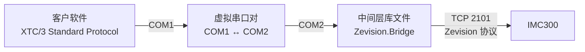

# XTC/3S 协议兼容中间层编程手册

| 项目 | 内容 |
|---|---|
| 文档标识 | ZEV-CPM-03 |
| 文档版本 | 0.1 |
| 适用软件 | `Zevision.Xtc3` 0.1.0，`Zevision.Bridge` 0.1.0，`Zevision.Bridge.Hosting` 0.1.0，`Zevision.Xtc3Bridge` 控制台程序 |
| 编制单位 | INFICON |
| 日期 | 2026-10-23 |

## 1 范围

### 1.1 标识

本文档适用于表 1 所列的 XTC/3S 协议兼容中间层（以下简称“中间层”）的链接库和控制台程序。

表 1  软件标识

| 标识 | 名称 | 版本 | 文件 |
|---|---|---|---|
| `Zevision.Xtc3` | XTC/3 协议库 | 0.1.0 | `Zevision.Xtc3.dll` |
| `Zevision.Bridge` | 中间层业务库 | 0.1.0 | `Zevision.Bridge.dll` |
| `Zevision.Bridge.Hosting` | 中间层的组装（设置文件、一步启动） | 0.1.0 | `Zevision.Bridge.Hosting.dll` |
| `Zevision.Xtc3Bridge` | 中间层独立程序（控制台） | 0.1.0 | `Zevision.Xtc3Bridge.exe` |

软件作者：martin.liang@inficon.com。

### 1.2 系统概述

现有镀膜设备的主机软件（以下简称“客户软件”）按 XTC/3 Standard Protocol 与 XTC/3S 通信。中间层运行于主机 PC，在虚拟串口对的一端按 XTC/3 Standard Protocol 应答客户软件，经 TCP（端口 2101，Zevision 协议）访问 IMC300，使客户软件只修改串口号即可改用 IMC300。方案的分析和选定见 ZEV-FAR-01。



图 1  连接方式

虚拟串口对只在两个串口之间传递字节（开发计算机上为 Eltima Virtual Serial Port Driver 6.9 建立的 COM1↔COM2）；到 IMC300 的 TCP 连接由中间层建立。中间层有两种运行方式：

- 独立程序：`Zevision.Xtc3Bridge.exe` 按设置文件运行，客户软件不修改，只打开 COM1（3.3）；
- 客户软件进程内：客户软件为 .NET 程序时，引用库文件并调用 `Xtc3BridgeHost.Start` 启动中间层，中间层在客户软件的进程中打开 COM2 和 TCP 连接，客户软件的通信代码照常打开 COM1（4.3）。

本版本（0.1.0）实现的功能：

- XTC/3 Standard Protocol 的包格式、全部 XTC/3S 命令的语法和响应编码；
- Film 参数（QF/UF，含 ID 255）和通用参数（QG/UG，含 ID 255）的读写；
- 状态命令 S0～S18、S20、S21、S30～S35（晶振状态、速率、厚度、频率、功率、状态和推导状态）；
- 远程动作：启动、停止、复位、手动、设定功率、厚度清零、触发最终厚度、切换晶振、显示、蜂鸣等；
- 每 250 ms 一次的采样和 256 个 tick 的采样缓冲；
- 影子对象的核对和按需创建；本地参数的保存；与 IMC300 断线后自动重连。

### 1.3 文档概述

本文档依据 GB/T 8567-2006 中计算机编程手册（CPM）的内容要求编写，描述中间层的编程环境、编程接口、程序设计实例、实现约定、错误检测和限制。

剪裁说明：删除 CPM 中面向机器指令和硬件寄存器的条目；在第 5 章给出 XTC/3 命令与 IMC300 指令的实现约定，在第 6 章列出待确认的约定和限制。

## 2 引用文件

表 2  引用文件

| 标识 | 名称 |
|---|---|
| GB/T 8567-2006 | 计算机软件文档编制规范 |
| GB/T 1.1-2020 | 标准化工作导则 第 1 部分：标准化文件的结构和起草规则 |
| docs/XTC3.md | 《XTC/3 Standard Protocol 通讯指令集》（XTC/3 Operating Manual 第 5 章摘录） |
| ZEV-FAR-01 | 《XTC/3S 协议兼容中间层可行性分析报告》 |
| ZEV-CPM-01 | 《Zevision 链接库编程手册》 |
| ZEV-CPM-02 | 《Zevision 业务层与存储层编程手册》 |
| ZEV-IDD-01 | 《IMC300 Zevision 通信协议规格书》 |
| ZEV-STR-01 | 《Zevision 联调记录》 |

## 3 软件编程环境

### 3.1 组成部件

表 3  组成部件和依赖

| 文件 | 用途 | 依赖 |
|---|---|---|
| `Zevision.Xtc3.dll` | 协议库：包的分帧和校验和、字符间隔超时、命令语法表、参数类型和范围、响应编码；主机侧的命令编码和响应解码（测试和调试用） | 仅 .NET Framework |
| `Zevision.Bridge.dll` | 业务库：命令执行、XTC/3 参数与 IMC300 设置项的映射、影子对象、采样和推导状态、本地参数、主机侧串口、与 IMC300 的连接管理 | `Zevision.Communication`、`Zevision.Commands`、`Zevision.Core`、`Zevision.Xtc3`；.NET 的 `System.Runtime.Serialization`、`System.Xml` |
| `Zevision.Bridge.Hosting.dll` | 组装：设置文件 `xtc3bridge.settings.json`（`Xtc3BridgeSettings`），一步启动（`Xtc3BridgeHost`）：读取 `Texts.json`、错误日志、IMC300 的连接、本地参数文件 | 以上各库和 `Zevision.Storage` |
| `Zevision.Xtc3Bridge.exe` | 独立程序：运行中间层（不带参数或 `bridge`），生成设置文件（`init`），代替客户软件发送 XTC/3 命令（`client`） | 以上各库；`Texts.json` |

源码位于 `Zevision.Xtc3\`、`Zevision.Bridge\`、`Zevision.Bridge.Hosting\` 和 `samples\Zevision.Xtc3Bridge\`，均为 .NET Framework 4.7.2、C# 9、非 SDK 格式的项目文件，属于解决方案 `Zevision.sln`。`LibraryBoundaryTests` 检查 `Zevision.Xtc3` 只引用 .NET Framework、`Zevision.Bridge` 不引用 `Zevision.Storage` 和 WPF，两个库的字符串字面量不含中文。

### 3.2 运行环境

- Windows，.NET Framework 4.7.2 或更高版本。
- 主机软件使用串口时，需要虚拟串口对（如 com0com 或其他虚拟串口驱动）。本机测试使用的虚拟串口对为 COM1↔COM2，二进制数据透明传输。
- 与 IMC300 的连接为 TCP 端口 2101 或 RS232。中间层运行期间，Zevision 应用不应连接同一接口。

### 3.3 独立程序

`Zevision.Xtc3Bridge.exe` 的用法：

```text
Zevision.Xtc3Bridge.exe init --host <COMx> --device <IP | COMy[:baud]> [--create-shadow] [--base B0] [--state <文件>]
Zevision.Xtc3Bridge.exe
Zevision.Xtc3Bridge.exe bridge [--settings <文件>] [--host <COMx>] [--host-baud 115200] [--device <IP | COMy[:baud]>]
                               [--create-shadow] [--base B0] [--state <文件>] [--quiet]
Zevision.Xtc3Bridge.exe client --port <COMx> [--baud 115200] [--repeat N] [--interval ms] <命令> [<命令> …]
```

- `init`：在程序旁生成设置文件 `xtc3bridge.settings.json`（表 4）。
- 不带参数：程序旁有设置文件时按它运行中间层，否则显示用法。
- `bridge`：运行中间层。设置取自设置文件，命令行参数优先。`--create-shadow` 时在设备上创建缺少的影子对象（会修改设备配置，见 5.1）。错误写入 `logs\xtc3bridge-error.txt`。Ctrl+C 停止。
- `client`：代替客户软件，把全部命令放入一个命令包发送，并显示响应。命令的写法为 `H1`、`E:文本`、`S4`、`S0`（用上一个响应的 Timer）或 `S0:tick`、`R11:50`、`QF8:1`（ID 8，Film 1）、`UF8:1:2.5`、`QG0`、`UG0:2`。

表 4  设置文件 `xtc3bridge.settings.json`

| 字段 | 初值 | 说明 |
|---|---|---|
| `hostPort` | `COM2` | 虚拟串口对中中间层的一端 |
| `hostBaudRate` | 115200 | 主机侧波特率；客户软件经 UG14 修改后以本地参数中保存的为准 |
| `device` | （必填） | IMC300 的 IP 地址（TCP 端口 2101），或 `COM3`、`COM3:115200` |
| `createShadowObjects` | `false` | 影子对象不存在时是否创建 |
| `shadowBase` | `B0` | 影子对象的编号基数（十六进制） |
| `stateFile` | `xtc3bridge.json` | 本地参数文件；相对路径相对于设置文件所在的文件夹 |
| `logFolder` | `logs` | 错误日志的文件夹；相对路径同上 |
| `version` | `1.00` | H1、H3 回答的版本号 |
| `language` | （空） | IMC300 消息的语言 `en` 或 `zh`；为空时不改变（`init` 写入 `en`） |

示例：

```powershell
.\Zevision.Xtc3Bridge.exe init --host COM2 --device 192.168.5.88
.\Zevision.Xtc3Bridge.exe
.\Zevision.Xtc3Bridge.exe client --port COM1 H1 S2 S3 S4 QF8:1 S0
```

## 4 编程信息

### 4.1 编程特征

- 线程：`Xtc3Bridge` 在后台运行设备连接循环、采样循环和主机侧串口循环；事件在后台线程上触发。主机命令一次处理一个包。
- 主机命令与采样共用一个 `IDeviceService`（`ZevisionDeviceService`），其发送锁使二者的帧依次发送；主机命令最多等待一帧采样（经以太网约 26 ms，ZEV-STR-01 的 STR-2026-10-23-03）。
- 与 IMC300 未就绪（未连接、握手或核对影子对象未完成）时，需要设备数据的命令回答 `E`，E、H 和本地参数照常回答（ZEV-FAR-01 的 P-06）。
- 与 IMC300 的连接中断（`ConnectionLost`，或连续 3 次采样无应答）后按 `ReconnectPolicy` 自动重连（1、2、4……60 s）。
- 中间层的记录为英文（`Log` 事件）；错误同时写入构造时传入的 `IErrorLog`。

### 4.2 编程接口

表 5  `Zevision.Bridge` 和 `Zevision.Bridge.Hosting` 的主要类型

| 类型 | 说明 |
|---|---|
| `Xtc3Bridge` | 中间层。`StartAsync()` 开始运行（立即返回），`StopAsync()` 停止，`ProcessPacketAsync(packet, ct)` 处理一个包并返回响应（主机侧串口和测试调用），`CreateShadowObjectsAsync(ct)` 创建缺少的影子对象并重新核对。属性 `IsDeviceOnline`、`IsHostPortOpen`、`ShadowChecks`、`Timer`；事件 `Log`、`HostExchange` |
| `Xtc3BridgeOptions` | 设置：`Device`（IMC300 的 `ConnectionOptions`）、`HostPort`（主机侧串口，为 null 时不打开串口）、`ShadowBase`（默认 0xB0）、`CreateMissingShadowObjects`（默认 false）、`Version`（H1、H3，默认 `1.00`）、`HelloNumbers`（H2）、`SampleMissLimit`（默认 3）、`MaxSampleAge`（默认 2 s） |
| `ShadowFilm`、`ShadowCheck`、`ShadowStatus` | Film n 的影子对象编号（`MaterialId`、`FilmId`、`LayerId`、`ProcessId`、`ObjectNumber`）和核对结果（`Ready`、`Missing`、`Occupied`、`Invalid`） |
| `BridgeLocalState`、`IBridgeStateStore`、`JsonFileBridgeStateStore`、`MemoryBridgeStateStore` | 本地参数和它的存储 |
| `BridgeLogEventArgs`、`HostExchangeEventArgs` | 事件参数 |
| `Xtc3BridgeHost`（`Zevision.Bridge.Hosting`） | `Start(settings, log)` 组装并启动中间层，返回的对象 `Bridge`、`ErrorLogPath`、`StateFilePath`，`StopAsync()`，`Dispose()` 停止并断开 |
| `Xtc3BridgeSettings`（`Zevision.Bridge.Hosting`） | 设置（表 4）：`Load(path)`、`Save(path)`、`ToOptions()`、`ParseDevice(text)` |

表 6  `Zevision.Xtc3` 的主要类型

| 类型 | 说明 |
|---|---|
| `Xtc3PacketDecoder` | 字节流解码：`Push(data, count, now)` 返回解出的 `Xtc3Packet`（消息、包错误或超时丢弃的字节）。命令包和响应包都可用 |
| `Xtc3MessageParser` | `Parse(message)` 按语法表拆成 `Xtc3Command`；返回包错误 F（缺少字节）或 M（超过 100 条） |
| `Xtc3Command` | 一条命令：`Group`、`SubGroup`、`Id`、`Parameters`、`ParseError`、`FilmNumber`；工厂方法 `Hello`、`Echo`、`Status`、`ProcessInformation`、`Remote`、`QueryFilm`、`UpdateFilm`、`UpdateFilmAll`、`QueryGeneral`、`UpdateGeneral`、`UpdateGeneralAll` |
| `Xtc3CommandResult` | 一条命令的结果：`Ok(values)` 或 `Fail(code)` |
| `Xtc3ResponseEncoder` | `Encode(timer, results)`、`EncodePacketError(timer, error)` |
| `Xtc3HostCodec` | 主机侧：`EncodeCommands(commands)` 生成命令包，`DecodeResponse(message, commands)` 解析响应 |
| `Xtc3Value`、`Xtc3ValueType` | 参数和响应值（Byte、Word、Integer、Float、String、Bytes），低字节在前 |
| `Xtc3Parameters`、`Xtc3Parameter`、`Xtc3FilmParameterId`、`Xtc3GeneralParameterId` | Film 参数（0～37）和通用参数（0～15）的类型、范围和显示小数位数 |
| `Xtc3Syntax` | 各命令的参数和响应格式；`FilmNumberType` 为 Film 编号的类型 |
| `Xtc3State`、`Xtc3CrystalStatus`、`Xtc3PowerUpErrors`、`Xtc3StatusMessages` | S4、S0、S21、S33 的取值 |
| `Xtc3ErrorCode`、`Xtc3PacketError`、`Xtc3Protocol` | 错误码、包错误码和协议常量 |

### 4.3 程序设计实例

客户软件（.NET）在自己的进程中运行中间层，一步启动（程序文件夹中应有 3.1 所列的库文件和 `Texts.json`）：

```csharp
using Zevision.Bridge.Hosting;

using var host = Xtc3BridgeHost.Start(new Xtc3BridgeSettings { HostPort = "COM2", Device = "192.168.5.88" }, (_, e) => Console.WriteLine(e));
// 客户软件的 XTC/3 通信代码照常打开 COM1;退出时 Dispose 停止中间层、断开 IMC300。
```

也可读取设置文件：`Xtc3BridgeHost.Start(Xtc3BridgeSettings.Load("xtc3bridge.settings.json"))`。

需要自行组装时（与 `Xtc3BridgeHost` 的内容相同，组装根应先加载 `Texts.json`）：

```csharp
using Zevision.Bridge;
using Zevision.Communication;
using Zevision.Core.Devices;
using Zevision.Core.Localization;
using Zevision.Storage;

var texts = TextFile.Load(TextFile.DefaultPath);
TextCatalog.Initialize(texts.Value);
var errorLog = new FileErrorLog(@"logs\xtc3bridge-error.txt");

var device = new ConnectionOptions(new TcpSettings("192.168.5.88", TcpSettings.DefaultPort), new FrameOptions(true, true)) { RetryCount = 2 };
var options = new Xtc3BridgeOptions(device) { HostPort = new SerialSettings("COM2", 115200) };

using var service = new ZevisionDeviceService(DeviceTransports.Create, errorLog);
using var bridge = new Xtc3Bridge(options, service, new JsonFileBridgeStateStore("xtc3bridge.json"), errorLog);
bridge.Log += (_, e) => Console.WriteLine(e);
await bridge.StartAsync();
// …
await bridge.StopAsync();
```

影子对象缺少时，确认后创建（设备应处于 Ready）：

```csharp
if (bridge.ShadowChecks.Any(c => c.Status == ShadowStatus.Missing))
{
    var created = await bridge.CreateShadowObjectsAsync(CancellationToken.None);
    Console.WriteLine(created.IsSuccess ? "created" : created.Error);
}
```

用协议库组成命令包并解析响应（主机侧，与控制台程序的 `client` 相同）：

```csharp
using var port = new SerialPort("COM1", 115200);
port.Open();
var commands = new[] { Xtc3Command.Hello(1), Xtc3Command.QueryFilm(8, 1), Xtc3Command.Status(4) };
var packet = Xtc3HostCodec.EncodeCommands(commands);
port.Write(packet, 0, packet.Length);

var decoder = new Xtc3PacketDecoder();
var clock = Stopwatch.StartNew();
var buffer = new byte[4096];
Xtc3ResponsePacket? response = null;
while (response == null)
{
    var count = port.Read(buffer, 0, buffer.Length);
    foreach (var received in decoder.Push(buffer, count, clock.Elapsed).Where(p => p.IsMessage))
    {
        response = Xtc3HostCodec.DecodeResponse(received.Message, commands);
    }
}

Console.WriteLine(response.Results[0].Values[0].Text); // XTC/3S Version 1.00
Console.WriteLine(response.Results[2].IsSuccess ? "State " + response.Results[2].Values[0].Integer : "Error " + (char)response.Results[2].Error!.Value);
```

## 5 实现约定

### 5.1 影子对象

XTC/3S 的 Film n（1～9）对应 IMC300 上的一组影子对象：材料 `Mkk`、膜系 `Fkk`、膜层 `Lkk`、工艺 `P02kk`，kk = `ShadowBase` + n，默认 B1～B9（ZEV-FAR-01 的 Q-03）。四个对象的名称均为 `XTC Film n`。

连接后读取设备配置（`?`）并核对：

- 对象不存在：`Missing`。`CreateMissingShadowObjects` 为 true 或调用 `CreateShadowObjectsAsync` 时，经恢复流程（`RestorePlanner`、`ExecuteRestoreAsync`）按编号创建，写入初值：材料密度 1.000、Z 比 1.000、工具因子 100.00；膜系的材料为 kk、预熔 2 步、后处理 1 步、传感器列表 1 项（传感器 1，工具因子 100.00）、主工具因子 100.00、输出源 1、最小功率 0.00；膜层的膜系列表 1 项（膜系 kk）、速率斜坡 1 项；工艺的膜层列表 1 项（膜层 kk）、活动膜层 1、不自动启动下一膜层。已有的对象不写入。
- 名称不是 `XTC Film n`：`Occupied`，不修改该对象。
- 列表条数或引用不符（`Fkk02`、`Fkk03FE` = 2、`Fkk05FE` = 1、`Fkk07FE` = 1、`Lkk02FE` = 1、`Lkk020101`、`Lkk020106FE` = 1、`P02kk07FE` = 1、`P02kk0701`）：`Invalid`，不修复。

不是 `Ready` 的 Film 的命令回答 `E`。中间层不设置活动工艺；UG0（Film to run）把 `P01` 设为该 Film 的影子工艺。

### 5.2 命令

表 7  命令的实现

| 命令 | 实现 |
|---|---|
| E、H1～H3 | 中间层回答。H1 为 `XTC/3S Version <Version>`，H3 为 `Version` 的数值，H2 为 `HelloNumbers`（默认 1、83、0、0，待确认） |
| QF/UF 0～37、255 | 按 ZEV-FAR-01 表 A.1。17（Tool Factor 2）、36、37 为本地参数；1、4、7 写入 100.0 时写 99.99；14 写入 0 时停用速率监视，否则启用并写时间；30 写入 1/0 时失败动作为 4（时间功率）/2（停止），读回 4 为 1、其他为 0；32 写入 1 时为另一个传感器的编号，读回非 0 为 1；23 超出所选输出源的坩埚数量时回答 `B` |
| QG/UG 0～15、255 | 按 ZEV-FAR-01 表 A.2。1、3、4 写入全部可用的影子 Film，读出当前 Film 的（没有当前 Film 时为第一个可用的）；9～11 为本地参数；14 保存后在发出响应后切换主机侧串口的波特率；15 只接受 0 |
| S0～S18、S20、S31～S34 | 由采样得到（5.3）；没有不超过 `MaxSampleAge` 的采样时回答 `E` |
| S19 | 回答 `E`（数据日志未实现，与 XTC/3 在第一层结束前相同） |
| S21 | 本地参数（5.3） |
| S30、S35 | 收到时查询设备：S30 为当前传感器各晶振的健康度（`QNss10nn02` 大于 0 为 1），S35 为 `G1402`、`G1403` |
| R0 | `UC01:1`。设备在 Idle（影子工艺只有一层，一层已结束）时回答 `-B`，中间层先停止（`UC01:0`，等到 `Stopped`）、复位（`RC04`，等到 `Ready`）再启动，层计数接着增加 |
| R1 | `UC01:0`；设备回答 `-B` 而设备已停止或为 Ready 时回答 ACK |
| R2 | 停止时 `RC04`；Idle 时先停止再复位；Ready 时回答 ACK；运行中回答 `F` |
| R3、R4 | `UG0E02:1`、`UG0E02:0`（前面板锁定）并置远程锁定标志 |
| R9、R10、R11 | `UC06:1`、`UC06:0`、`UC07:<功率>`；R11 只在手动状态执行（同一个包中 R9 之后的 R11 可以执行） |
| R12、R13、R14 | `RC03`、`RC1E`、`RNss18` |
| R19、R20、R21、R22 | `UG0E01:1`、`UG0E01:0`、`RG16:1`、清除 S21 |
| R26、R27、R28 | `RNss1B`、`RNss19`、`RC05` |
| R5～R8 | 回答 `A`（IMC300 没有对应功能） |
| R15、R16 | 回答 `A`（通讯 I/O 模式本版本未实现） |
| R17、R18 | 输出号 1～20 时回答 `F`（未进入通讯 I/O 模式），否则 `B` |
| QB、UB、XTC/3M 专用命令 | 回答 `A` |

R0、R1、R2、R11 和 UG0 按当场查询的 `C09`、`C1F` 判断状态（采样可能晚一个 tick，主机在 R0 之后紧接着发 R1、R2 时按采样会判断错），UF 写入 Sensor、Transfer Sensor 时也一样。

写入（UF、UG）先查询各项的当前值，与要写入的值相同的项不写（IMC300 对写入与当前值相同的传感器编号回答 `-B`，ZEV-STR-01 的 STR-2026-10-23-04）；其余每一项发送 `U` 并在同一帧中以 `Q` 读回，读回不一致时回答 `B`。数按设备保存的小数位数写出（如密度 3 位、功率 2 位、速率 3 位、速率斜坡起始厚度 4 位），读回的误差为 XTC/3 显示精度的一半；时间在整数秒和 `H:MM:SS` 之间换算。浮点数先取 7 位有效数字。UF255、UG255 先检查全部值的范围，再每 10 项一帧写入，第一项失败时回答该项的错误码，同一帧中其后的项已写入，不回滚。

### 5.3 采样和推导状态

每个 tick（250 ms）发送一帧：`SC11;SC12;SC13;SC15;SC16;SNss20;QC09;QC18;QC1F;QNss09`（ss 为当前 Film 的传感器，没有当前 Film 时为 1），并按 tick 轮流加上：tick % 4 = 0 时 `QC17;QC20;QC21;QP01;QC1C`，= 1 时各输出的 `QOnn05`，= 2 时各输入的 `QInn04`。第一次采样全部加上。采样保存在 256 格的缓冲中。

表 8  状态的来源

| 命令 | 来源 |
|---|---|
| S0 | 指定 tick 的采样：晶振状态（bit0 = `C18`）、状态、传感器、活动晶振（`Nss09`）、速率（1 s 平均，只在沉积和速率斜坡状态且未停止时给出）、厚度 `C15`、功率 `C11`、速率偏差（同速率的条件）、频率（`C16` ÷ 0.0034924596）；该 tick 没有采样或超过 256 个 tick 时为 `E` |
| S1、S31 | 最近 4 个、25 个 tick 的 `C13` 平均 |
| S2、S3、S34 | `C11`、`C15`、`C13` |
| S4 | `C09` 的文本按表 9 对应；`Stopped` 时为停止前的状态；不认识的文本回答 `E`，并记录一次 |
| S5 | 当前状态开始以来的秒数 |
| S6 | 层计数：复位回到 Ready 时为 1，从 Idle 再次进入运行状态时加 1（含 R0 在 Idle 时由中间层停止、复位再启动），R2 后为 1 |
| S7、S20 | 活动工艺 `P01` 对应的 Film；不是影子工艺时为 0（QG0 同） |
| S8、S10 | 当前传感器；当前 Film 的输出源 |
| S9 | `C17` |
| S11 | 输出 n 的 `QOnn05` 为第 n−1 位 |
| S12 | 输入 1～8 的 `QInn04`（活动状态）为 0x0100～0x8000，输入 9 为 0x0001 |
| S13 | `C16` 换算为 DDS 单位 |
| S14 | `C18` |
| S15 | `C11` 不小于当前 Film 的最大功率 `Fkk0906` |
| S16 | 0（IMC300 没有对应的状态项） |
| S17 | 从运行状态进入 Idle 且未停止时置位，R0、R2 后清除 |
| S18 | `C09` 为 `Stopped`，或 `C1F` 不为 0 |
| S21 | bit2：连接时开机次数 `G0C` 大于上次连接时；R22 清除 |
| S32 | `Nss09` |
| S33 | Max Power（S15）、Crystal Fail（S14）、End of Process（S17）、Etch Mode（当前 Film 的 `P02kk08`）、Remote Lock（R3/R4 的标志）、Test（`C1C`）；其余位为 0 |

表 9  `C09` 的文本与 S4

| `C09` 的文本 | S4 |
|---|---|
| `Ready` | 0 Ready |
| `Precon Rise 1`、`Precon Soak 1` | 2 Rise 1、3 Soak 1 |
| `Precon Rise n`、`Precon Soak n`（n ≥ 2） | 4 Rise 2、5 Soak 2 |
| `Dep …`（实测 `Dep Rate Hold 1`） | 7 Deposit；含 `Ramp` 时 8 Rate Ramp，含 `Manual` 时 9 Manual，含 `TimeP` 时 10 Time Power |
| `Manual Power` 等含 `Manual` 的文本 | 9 Manual |
| `Feed …`（实测 `Feed Ramp 1`） | 11 Idle Ramp |
| `Idle` | 12 Idle |
| 含 `Shutter Delay`、`Control Delay` | 6 Shutter Delay |
| 含 `Crucible` | 1 Crucible Switch |
| `Stopped` | 停止前的状态；S18 = 1 |
| XTC/3 的状态名称（`Rise 1`、`Deposit`、`Idle Ramp` 等） | 对应的状态 |

表中实测的文本见 ZEV-STR-01 的 STR-2026-10-23-04（测试模式）；`Rate Ramp`、`Time Power`、延迟和坩埚切换的文本为推断，未在设备上出现过。

### 5.4 错误码

表 10  错误码的来源

| 错误码 | 来源 |
|---|---|
| `A` | 不认识的命令或子组；表 7 中回答 `A` 的命令；设备对远程动作回答 `-A` |
| `B` | 值超出 XTC/3 的范围；Film 编号不在 1～9；坩埚超出；设备回答 `-B`；写入后读回不一致 |
| `C` | 命令的 ID 不存在（H、S、R、QF/UF、QG/UG） |
| `E` | 与 IMC300 未就绪；影子对象不可用；采样数据不存在或太旧；设备回答 `-A`、`-D` 或通讯失败 |
| `F` | 状态限制：运行中写入 Sensor、Transfer Sensor；非 Ready/Idle 时修改 Film to run；未停止时复位；非手动时设定功率；设备回答 `-F` |
| `P` | 同一包中前面的命令已失败 |
| 包错误 `C`、`L`、`F`、`M` | 校验和错误；长度为 0 或超过 57800；缺少参数字节；超过 100 条命令 |

### 5.5 本地参数

只存在于中间层的参数保存在本地参数文件（`BridgeLocalState`，JSON）中：各 Film 的 Graph Label、Graph Scale、Tool Factor 2，Recorder Mode、Range、Filter，RS232 Baud Rate，远程锁定标志，S21 的标志和上次的开机次数。文件缺少的字段取初值，超出范围的值改为初值。

## 6 待确认的约定和限制

### 6.1 待确认的约定

以下约定在 XTC/3 原版手册或 XTC/3S 的通信记录确认前按表 11 处理（ZEV-FAR-01 的 8.2），确认后修改相应的常量或方法。

表 11  待确认的约定

| 内容 | 本版本的处理 | 位置 |
|---|---|---|
| Film 编号的类型 | Byte | `Xtc3Syntax.FilmNumberType` |
| 命令没有错误时响应末尾的包错误码 | 不加 | `Xtc3ResponseEncoder.Encode` |
| CCB 的低 7 位 | 0 | 同上 |
| S12、S30 的字节顺序 | 低字节在前的 16 位值 | `Xtc3Syntax` |
| S33 的位值 | 按“每项右移一位”改正转录中的重复值（`Xtc3StatusMessages`） | `Xtc3Status.cs` |
| H2 的 4 个整数 | 1、83、0、0 | `Xtc3BridgeOptions.HelloNumbers` |
| 不认识的命令之后的字节 | 算作该命令，回答一个 `A` | `Xtc3MessageParser` |
| `C09` 中未出现过的状态文本（速率斜坡、时间功率、延迟、坩埚切换） | 按关键字推断（表 9）；不认识的回答 `E` 并记录 | `DeviceStates` |
| 活动晶振 | `N**09`（当前位置，从 1 起） | 采样 |
| Thickness Set Point | 速率斜坡起始厚度 `Lkk0201060101`（ZEV-FAR-01 的 Q-02） | `FilmMap` |
| Sensor Type 的 Rotary | IMC300 的 Generic（5） | `BridgeEngine` |

### 6.2 限制

- 未实现：通讯 I/O 模式（R15～R18）、数据日志（S19）、QB/UB、以太网主机（TCP 服务端）、记录仪（通用参数 9～11 只保存在中间层）。
- 实机测试（ZEV-STR-01 的 STR-2026-10-23-03、STR-2026-10-23-04）：经虚拟串口对、IMC300 的 RS232 和以太网的完整测试全部通过（影子对象、只读命令、参数读写、测试模式下的启动、停止、复位、手动、设定功率、厚度清零、触发最终厚度）。测试期间设备的以太网口两次失去响应（ping 和 TCP 均无回应，RS232 正常，重启设备后恢复），原因待确认（ZEV-STR-01 的 STR-2026-10-23-04）。未测试：运行中写入参数的 `F`、多晶振传感器、记录仪、真实蒸发源。
- 推导状态的时间分辨率为 250 ms；S0 的历史数据从中间层开始采样时算起。

## 7 测试

表 12  测试

| 测试类 | 内容 |
|---|---|
| `Xtc3ProtocolTests` | 分帧和校验和、跨读取的包和一次读到的多个包、字符间隔超时、长度错误、各类命令的解析、非法 ID 和不认识的命令、缺少字节、命令过多、响应编码与解码、响应过长、参数范围 |
| `BridgeEngineTests` | 影子对象的核对（可用、占用、结构不符）和经恢复流程创建全部 9 个 Film；Film 参数和通用参数的读写、换算、本地参数、范围和状态限制、设备拒绝和读回不一致、相同值不写入；离线时的回答；采样、S0 的 tick、平均速率、状态历史、实测的状态文本和 `Stopped`、未知状态文本、停止和最大功率、晶振状态和以太网参数、开机次数；远程动作，含按实测行为模拟的 Idle 时 R0（停止、复位、启动）、同一个包中 R0 后的 R2 和 R9 后的 R11 |
| `Xtc3BridgeTests` | 端到端：主机侧串口收发、Timer、包错误、改波特率后重新打开串口、设备未连接、连接中断后重连、后台采样、本地参数文件 |
| `Xtc3BridgeHostTests` | 设置文件的读写、初值和无效内容，连接目标的解析，`Xtc3BridgeHost.Start` 的组装（主机侧串口、错误日志、本地参数文件）和停止 |
| `LibraryBoundaryTests` | 两个库的引用和字符串字面量 |

## 8 注解

表 13  术语

| 术语 | 定义 |
|---|---|
| 中间层 | 把 XTC/3 Standard Protocol 转换为对 IMC300 的 Zevision 协议访问的软件 |
| 主机软件 | 按 XTC/3 Standard Protocol 与膜厚控制仪通信的软件 |
| 影子对象 | 中间层在 IMC300 上为每个 Film 维护的一组材料、膜系、膜层和工艺 |
| tick | XTC/3 的时钟计数，每 250 ms 加 1；响应中的 Timer 为其低 8 位 |
| 当前 Film | 活动工艺 `P01` 对应的 Film |
| 本地参数 | 只由中间层保存、不写入 IMC300 的参数 |
