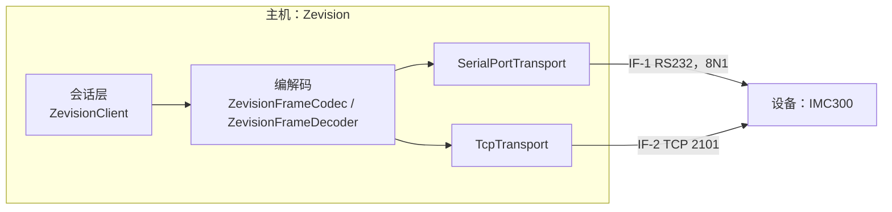
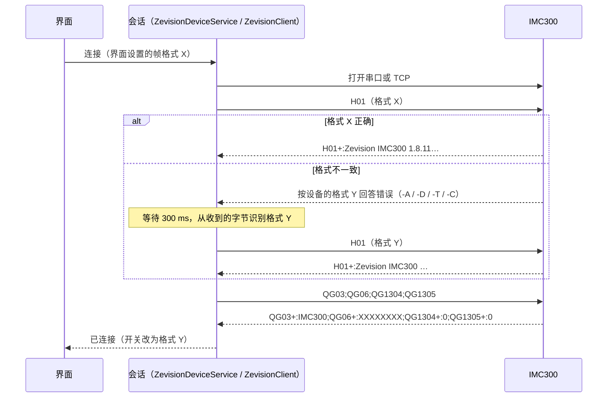
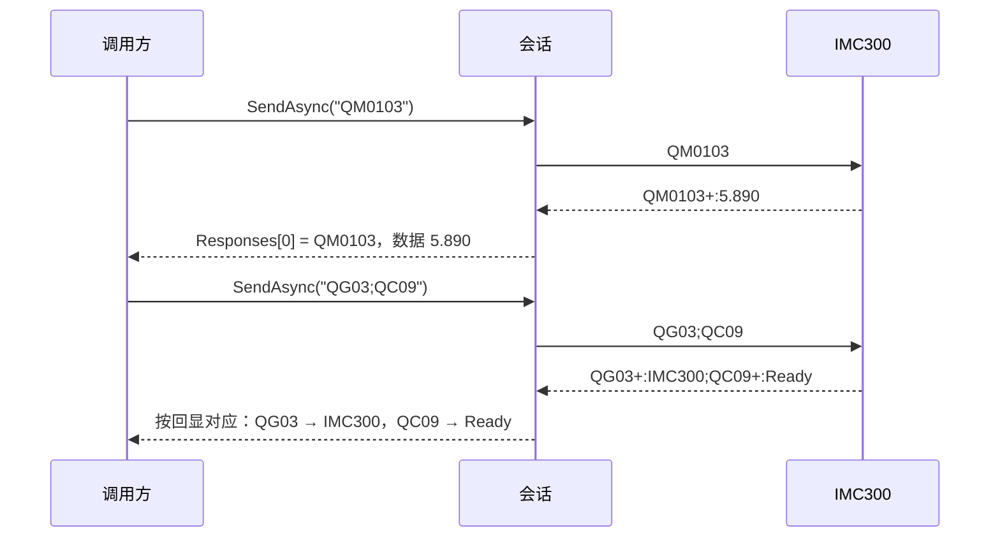
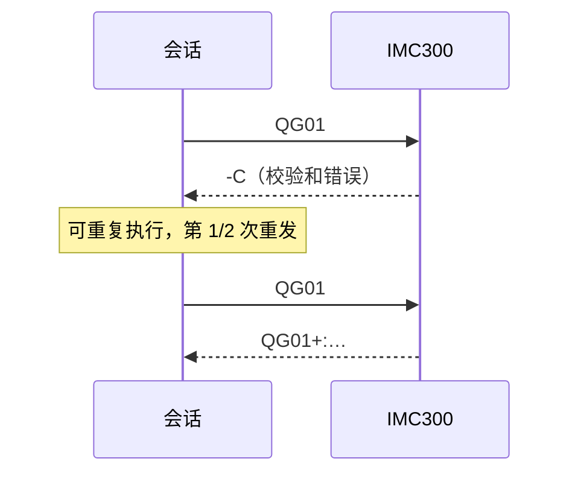
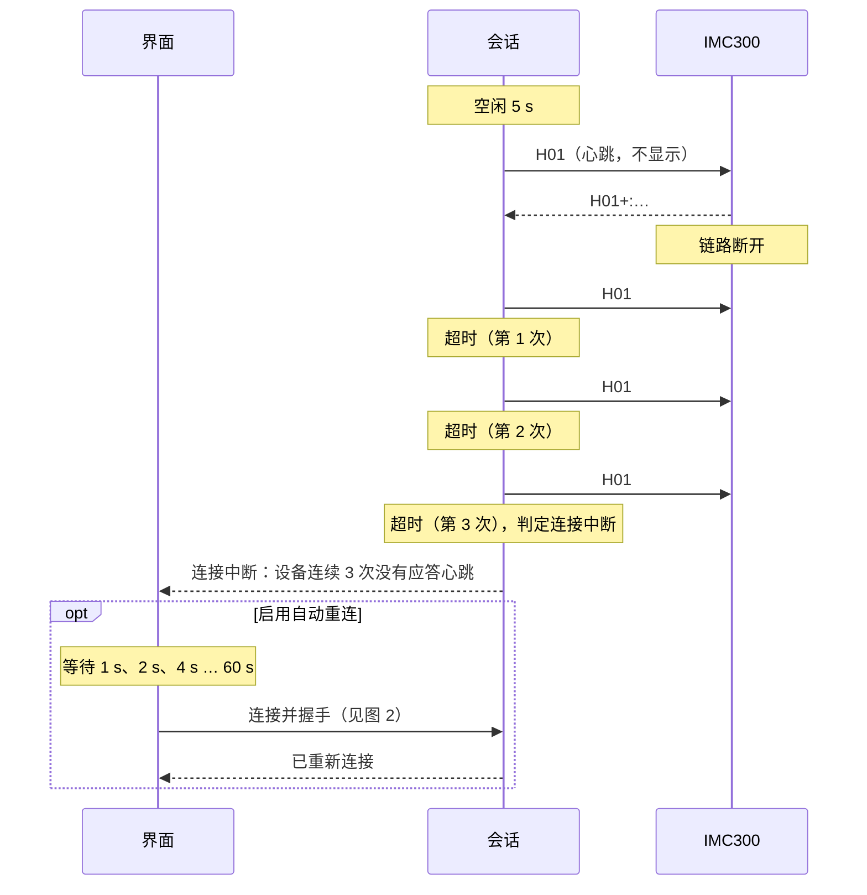
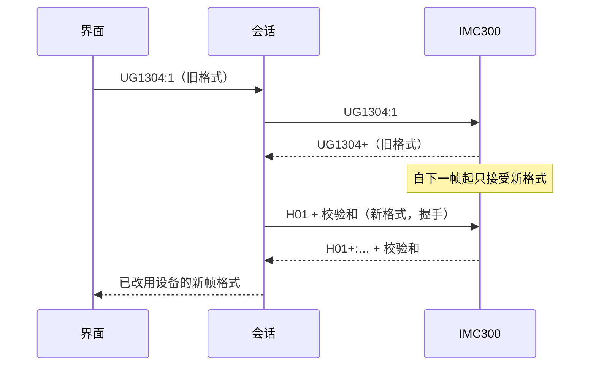

# IMC300 Zevision 通信协议规格书

| 项目 | 内容 |
|---|---|
| 文档标识 | ZEV-IDD-01 |
| 文档版本 | 1.2 |
| 适用软件 | Zevision 1.2.0（通信库 1.2.0，指令集库 1.1.0）；设备 INFICON IMC300，固件 1.8.11 |
| 编制单位 | INFICON |
| 日期 | 2026-10-21 |

## 1 范围

### 1.1 标识

本文档标识为 ZEV-IDD-01，版本 1.2，名称为《IMC300 Zevision 通信协议规格书》。

本文档适用于 Zevision 1.2.0（通信库 `Zevision.Communication` 1.2.0，指令集库 `Zevision.Commands` 1.1.0）与 INFICON IMC300（固件 1.8.11）之间的 Zevision 协议接口。

### 1.2 系统概述

Zevision 是 IMC300 的上位机通信测试与配置软件，经 RS232 或以太网（TCP）发送 Zevision 协议指令，读取、保存、恢复和修改仪器配置。本文档所述接口的一端为主机（运行 Zevision 的计算机），另一端为设备（IMC300）。

### 1.3 文档概述

本文档按 GB/T 8567-2006 中接口设计说明（IDD）的格式编制，规定以下内容：

- 接口标识与物理、链路特性（第 3.1 节、第 3.2 节）；
- 帧格式（第 3.3 节）；
- 数据元素：命令与响应（第 3.4 节）；
- 协议特性：会话规则（第 3.5 节）；
- 时序（第 3.6 节）；
- 命令表（附录 A）。

剪裁情况：IDD 中的“接口实体的特性”只描述主机与设备两个实体，未单列；数据元素的“安全保密性”“优先级”条目不适用，已删除；“接口的数据元素组合体”只描述帧一种组合体。

本文档与协议译稿（见第 2 章）不一致之处以实测结果为准，并在条文中标注来源，格式为“（实测，固件 1.8.11，日期）”。实测的原始记录见 ZEV-STR-01《Zevision 联调记录》。

第 3.3.1 节的帧常量、第 3.4.6 节的错误码表和附录 A 的命令表由单元测试 `ProtocolSpecTests` 与程序代码比对。附录 A 由该测试生成，不应手工修改。

## 2 引用文件

表 1  引用文件

| 编号 | 名称 | 位置 |
|---|---|---|
| [1] | GB/T 8567-2006 计算机软件文档编制规范 | — |
| [2] | GB/T 1.1-2020 标准化工作导则 第 1 部分：标准化文件的结构和起草规则 | — |
| [3] | IMC300 Operating Manual 074-786-P1A，第 7 章 | `docs/zevision_comm.pdf` |
| [4] | Zevision 协议译稿 | `docs/Zervison_Protocol.md` |
| [5] | INFICON IMC300 Zevision 通讯协议说明（译稿） | `docs/INFICON_IMC300_Zevision通讯协议说明.md` |
| [6] | INFICON IMC300 Zevision U 类型指令汇总 | `docs/INFICON_IMC300_Zevision_U类型指令汇总.xlsx` |
| [7] | IMC300 / Zevision 上位机软件开发规范 | `docs/开发文档.md` |
| [8] | ZEV-SRS-01 Zevision 通信需求规格说明 | `docs/通信需求规格.md` |
| [9] | ZEV-SDD-01 Zevision 概要设计说明书 | `docs/概要设计说明书.md` |
| [10] | ZEV-STR-01 Zevision 联调记录 | `docs/联调记录.md` |

## 3 接口设计

### 3.1 接口标识和接口图

表 2  接口标识

| 标识 | 名称 | 主机侧 | 设备侧 | 帧格式设置 |
|---|---|---|---|---|
| IF-1 | RS232 串行接口 | 串口（含 USB 转串口） | RS232 端口 | G1304（校验和）、G1305（长度） |
| IF-2 | 以太网接口 | TCP 客户端 | TCP 服务器，端口 2101 | G1407（校验和）、G1408（长度） |

两个接口共用同一套帧格式、命令和会话规则，区别仅在于物理链路和帧格式设置项。



图 1  接口图

### 3.2 物理与链路特性

表 3  物理与链路特性

| 接口 | 链路参数 | 帧格式设置 | 协议类型 |
|---|---|---|---|
| IF-1 RS232 | 波特率由 G1303 设置（出厂值 115200 bit/s），数据格式固定为 8N1 | G1304 校验和、G1305 长度 | G1301 = 0（Zevision） |
| IF-2 以太网 | TCP，端口固定为 2101，设备 IP 地址由 G1402 设置 | G1407 校验和、G1408 长度 | G1406 应为 0（Zevision） |

两个接口的帧格式设置相互独立（实测，固件 1.8.11，2026-10-19：RS232 为 0/0 时以太网为 1/1）。

### 3.3 数据元素组合体：帧

#### 3.3.1 帧结构

表 4  帧结构

| 字段 | 长度（字节） | 存在条件 | 内容 |
|---|---|---|---|
| 起始符 | 1 | 总是 | `{` (0x7B) |
| 长度 | 2 | 启用长度 | 数据的字节数，高字节在前；取值 1 ~ 57000 |
| 数据 | n | 总是 | 命令或响应（ASCII；设备的说明文字为 UTF-8，例如 `Å/s` 编码为 `C3 85`） |
| 校验和 | 1 | 启用校验和 | 数据各字节之和模 256（不含起始符、停止符、长度和校验和本身） |
| 停止符 | 1 | 总是 | `}` (0x7D) |

示例（实测，固件 1.8.11，H01，长度和校验和均启用）：`7B 00 28 "H01+:Zevision IMC300 1.8.11.202606101229" C5 7D`，长度字段 0x0028 = 40。

注：协议译稿 [4] 中 `{H02}` 的校验和示例写作“hex 170，即 y”，该示例有误：十进制 170 为 0xAA，字符 `y` 为 0x79。校验和以计算结果为准。

#### 3.3.2 帧格式一致性

设备只接受与本接口帧格式设置一致的帧，并始终按本接口的设置回答。主机发送格式不一致的帧时，设备的回答见表 5。

表 5  帧格式不一致时设备的回答（实测，固件 1.8.11，2026-10-19，主机发送 `H01`）

| 设备的帧格式 | 设备的回答 | 说明 |
|---|---|---|
| 无长度、无校验和 | `{<00>…<00>-A}` 或 `{H01<A9>-D}` | 起止符之间的内容作为命令回显；首字节不可打印时整段回显为 0 |
| 仅长度 | 约 200 ms 后回答 `{<00><02>-T}` | 设备把命令的前两个字节当作长度，等不到数据，回答字符超时 |
| 仅校验和 | `{-Cp}` | 校验和错误，不回显命令 |
| 长度和校验和 | `{<00><02>-Cp}` | 同上（以太网接口实测） |

修改帧格式设置项（G1304、G1305、G1407、G1408）的 `U` 命令，其响应按修改前的格式发送；自下一帧起，设备只接受修改后的格式。

主机不应假定帧格式。启用握手时，帧格式由第 3.5.1 节规定的握手过程确定。

#### 3.3.3 多包消息

大响应（例如完整帮助 `?`，约 116 KB）分为多个包发送（实测，固件 1.8.11，2026-10-16；协议译稿未规定）：

```
{ [长度] 数据 [校验和] >   < [长度] 数据 [校验和] >   …   < [长度] 数据 [校验和] > }
```

表 6  多包规则

| 规则 | 内容 |
|---|---|
| 包分隔 | `>` 表示后续还有包，`<` 开始续包，`}` 结束整个消息 |
| 每包 | 最多 57000 字节；长度和校验和只覆盖本包数据 |
| 最后一包 | 同样以 `>` 结尾，其后为 `}` |
| 固件缺陷 | 最后一个续包的长度字段多计包尾（实测数据 2602 字节，长度字段为 2604）；仅对续包且校验和正确时按此读出 |
| 无长度模式 | `>` 仅在下一个字节为 `<`，或多包消息中下一个字节为 `}` 时作为包分隔符；单包消息数据末尾的 `>` 属于数据 |
| 上限 | 整个消息最多 1048576 字节（1 MB），超过时报告长度错误 |

实测数据：`?` 的回答分为 56931、56957、2604 字节共 3 包，在 115200 bit/s 下约需 10 s；首字节约 0.38 s 到达，包间隔约 0.35 s。

主机的解码器应将多包重组为一条完整消息后再交给会话层（`ZevisionFrame.PacketCount`、`ZevisionFrame.DataRanges`）。

#### 3.3.4 长度模式下的纯文本回复

启用长度时，设备曾发送不带长度和校验和的 `{数据}`（实测，固件 1.8.11，2026-10-18，RS232 接口的 `?` 回答）。主机的处理规则如下：第一包按声明长度读完后，若下一个字节不是停止符，且“长度”的高字节是回显的开头（`?` 或 `A`～`Z`），已收到的字节均为文本，则整条消息按无长度格式重新读出。真实的长度字节通常为二进制，因此损坏的帧仍报告 `MissingStopByte`。

#### 3.3.5 定界字节规避

即使启用了长度，设备也把等于 `}` 的校验和字节当作停止符，回答 `-C` 且不回显命令（实测，固件 1.8.11，2026-10-16；例如 `AL0702010600` 的校验和为 0x7D）。发送前，若长度字节或校验和字节等于 `{`、`}`、`<`、`>`，主机在命令后追加 `;H01`（只读命令）以改变校验和，多出的 `H01` 响应不返回给调用方。

### 3.4 数据元素

#### 3.4.1 命令构成

```
动作 + 组 + ID（每级 2 位十六进制，00~FF）[ : 数据 ]
```

示例：`QM0103`（查询材料 01 的第 03 项）、`UM0103:2.700`、`AM03`（按编号新建材料）、`AF010300`（在列表末尾追加）、`H01`（无动作字母）。

一帧可包含多条命令，以 `;` 分隔，总长不超过 57000 字节。设备逐条执行；一条命令回答 `-D` 或 `-A` 后，其后的命令照常执行（实测，固件 1.8.11，2026-10-19：`{QM0F01;QG03}` → `{QM0F01-D;QG03+:IMC300}`）。

#### 3.4.2 动作

表 7  动作

| 字母 | 动作 | 重复执行结果是否不变 |
|---|---|---|
| `Q` | 查询配置 | 是 |
| `U` | 更新配置（写入同一个值） | 是 |
| `A` | 添加：`<列表>00` 追加到列表末尾，或按编号新建对象 | 否 |
| `D` | 删除：`<列表>00` 删除列表最后一项，或按编号删除对象 | 否 |
| `S` | 读取运行时状态（带同步计数，见第 3.4.8 节） | 是 |
| `R` | 远程执行动作（例如切换坩埚） | 否 |
| `E` | 回显 | 是 |
| `H` | Hello：`H01` 返回协议名、型号和固件版本 | 是 |
| `?` | 帮助：`?` 返回全部设置的表格，`?M` 只列出一组 | 是 |

命令部分应为大写字母；小写命令回答 `-A`。

#### 3.4.3 组

表 8  组

| 组 | 内容 | 组 | 内容 |
|---|---|---|---|
| `C` | 工艺控制与状态 | `M` | 材料 |
| `E` | 回显 | `N` | 传感器 |
| `F` | 膜系 | `O` | 输出 |
| `G` | 通用（含通信设置 G13、G14） | `P` | 工艺（`P02**`） |
| `H` | Hello | `S` | 输出源 |
| `I` | 输入 | `T` | 逻辑 |
| `L` | 膜层 | | |

对象编号的规则如下：

- 对象编号不连续（例如材料 M01～M0A、M0C、M10），最大到 FA；数量（`MFE`）不能推出存在哪些编号。
- 编号只使用 01～FD。FE 表示数量；`QMFF01` 返回的也是数量。
- 查询不存在的对象回答 `-D`；查询存在对象的不存在字段回答 `-A`。

#### 3.4.4 文本规则

命令和数据只能是可打印 ASCII 字符（0x20～0x7E），不能包含 `{` 或 `}`；数据还不能包含 `;`（`ProtocolText.CheckCommand`、`ProtocolText.CheckValue`）。数字的小数点为 `.`，主机按 `CultureInfo.InvariantCulture` 解析。时间格式为 `H:MM:SS`。

#### 3.4.5 响应格式

```
回显 + ( "+" [ ":" 数据 ] | "-" 错误码 )
```

多条命令的响应以 `;` 分隔，每条命令一个响应。回显为命令中 `:` 之前的全部内容。示例：`QM0103+:5.890`、`UM0103+`、`UM0103-B`、`QG01+:x;QG1304+:0`。

#### 3.4.6 错误码

表 9  错误码与主机的处置

<!-- 错误码表:与 ZevisionErrorCode 一致,由 ProtocolSpecTests 检查 -->
| 代码 | 含义 | 主机的处置 |
|---|---|---|
| `A` | 非法命令，不支持该命令（含小写命令、存在对象的不存在字段） | 不重发；报告命令、回显和错误码 |
| `B` | 非法参数值（例如引用了不存在的对象） | 不重发；报告 |
| `C` | 校验和错误（仅启用校验和时；设备不回显命令） | 可重复执行的命令最多重发 2 次；仍失败时报告 |
| `D` | 非法格式（含查询不存在的对象） | 不重发；报告 |
| `F` | 状态错误，设备当前状态不允许该命令（例如工艺运行中） | 不重发；查询 C09 并将当前状态一并报告；不自动切换设备状态 |
| `L` | 长度错误（仅启用长度时） | 同 `C` |
| `T` | 超时：收到起始符后 200 ms 内未收到停止符（多由帧格式不一致引起） | 同 `C` |

响应状态为 `-` 但没有错误码或错误码无法识别时，主机将其记为 `Unknown`。设备拒绝命令（`-A` 等）不属于通信失败：请求成功完成，对应响应的 `IsSuccess` 为 false。

#### 3.4.7 无回显的错误

设备无法解析帧时（例如校验和错误）只回答 `-C`，不回显命令。此类响应无法按回显与命令对应，主机将其作为当前请求的响应。

#### 3.4.8 状态命令与同步计数

状态命令 `S` 的响应格式见表 10。

表 10  状态命令的响应（实测，固件 1.8.11，2026-10-19）

| 命令 | 响应 | 说明 |
|---|---|---|
| `{SC11}` | `{SC11+:D9,0.00}` | 功率，同步计数 0xD9 |
| `{SC12}` | `{SC12+:DE,0.0000}` | 速率，同步计数 0xDE |
| `{SC11;SC12}` | `{SC11+:E6,0.00;SC12+:E5,0.0000}` | 每一项有各自的计数 |

规则如下：

- 数据格式为 `计数,值`。计数为两位十六进制数（00～FF），每 100 ms 测量递增一次，溢出后回到 00；两次读取的计数相同，表示设备未更新该值。
- 只有运行时变量支持 `S`：`QC11` 回答 `-A`；`SC09`（状态）也回答 `-A`，状态应以 `QC09` 查询。
- 主机的响应解析器将 `计数,值` 整体作为 `Data` 返回。本版本不提供状态轮询。

注：两份协议译稿中的示例与实测不符：[4] 的示例没有计数（`SC03+:12.5`），[5] 的示例缺少 `:`（`SC11+93,23.82`）。

#### 3.4.9 请求与响应的对应

同一时刻只有一个请求在途。主机按回显将收到的帧对应到请求：回显相同（不区分大小写），或无法判断（帧无效、无法解析、无回显的 `-C`）时，该帧作为该请求的响应；回显不同的帧（超时后迟到的响应、取消 `?` 后设备继续发送的剩余数据）作为未请求数据显示，不作为下一个请求的响应。

一帧多条命令的响应按回显逐条对应（`InstrumentConfigReader.SendQueriesAsync`），不按到达顺序对应。

### 3.5 协议特性：会话规则

#### 3.5.1 握手

启用“连接时握手”时，主机按以下步骤建立连接：

1. 打开通道（串口或 TCP）。
2. 按界面设置的帧格式发送 `H01`，不重发。回答为 `H01+:Zevision IMC300 …` 时，帧格式正确，转第 4 步。
3. 否则等待 300 ms，使设备的错误回答接收完毕；依次用“长度和校验和”“仅长度”“仅校验和”“无长度、无校验和”四种格式解码收到的字节，第一个能解出有效响应的格式即为设备的格式；改用该格式后再次发送 `H01`。无法识别时依次尝试其余格式，最多 4 次。第一次尝试未收到任何字节时，握手失败（设备对任何输入都会回答）。
4. 以一帧查询 `QG03;QG06;QG1304;QG1305`（以太网接口为 `QG03;QG06;QG1407;QG1408`）：读不到型号时握手失败；序列号（G06）用于通信数据文件名，读不到时不影响握手；型号不是 IMC300，或设备报告的设置与实际使用的格式不一致时，给出提示并继续。
5. 以上全部成功后，连接状态置为“已连接”；失败时断开通道并报告原因。握手过程的收发不在数据显示区显示。

实测耗时（固件 1.8.11，2026-10-19）：帧格式一致时约 50 ms；不一致时约 380 ms～460 ms。

#### 3.5.2 请求-响应

- 发送锁保证同一时刻只有一个请求在途。排队的请求按优先级（高、普通、低；同级按先后）发送；正在等待响应的请求不被打断。
- 响应超时为空闲超时，从发送或最近一次收到字节时起算，可选 500 ms、1000 ms、2000 ms、5000 ms，默认 1000 ms（约为设备 200 ms 字符超时的 5 倍）。大响应持续传输时不超时；`?` 的空闲超时至少为 2 s。

#### 3.5.3 重发

表 11  重发规则

| 条件 | 处置 |
|---|---|
| 超时、响应帧无效、响应无法解析，或设备回答 `C`、`L`、`T` | 帧中全部为可重复执行的命令（表 7）时重发，最多 2 次；每次重发在数据显示区记录“第 n/2 次重发 …”；仍失败时报告最后一次的错误 |
| 设备回答 `A`、`B`、`D` | 不重发 |
| 设备回答 `F` | 不重发；查询 C09 并一并报告 |
| 帧中包含 `A`、`D`、`R` 命令 | 不重发：超时不能说明设备未执行 |

#### 3.5.4 心跳

连接空闲（无收发）5 s 后，主机发送 `H01`，该帧不显示、不计数。设备的任何回答均视为应答。一次无应答后立即再次发送；连续 3 次无应答时，判定连接中断。

以太网接口另启用 TCP keep-alive（空闲 5 s 后每 1 s 探测一次）；对端关闭（读取返回 0）时立即判定连接中断。

#### 3.5.5 断线与重连

- 串口拔出、TCP 断开、读取出错或心跳无应答时，判定连接中断；正在进行的请求以“连接已断开”结束。
- 启用自动重连时，主机依次等待 1 s、2 s、4 s、8 s、16 s、32 s，此后每次等待 60 s，重新打开通道并重新握手，直至成功或用户停止。被中断的配置操作和重复发送不恢复。

#### 3.5.6 修改帧格式设置

经指令输入框发送并被设备接受的 `UG1304`、`UG1305`（以太网接口为 `UG1407`、`UG1408`）命令：设备对该命令仍按旧格式回答；主机随后以新格式重新握手（第 3.5.1 节），成功后更新界面上的开关，失败时断开连接。恢复配置不写入 G13、G14，修改配置窗口也不提供这两组设置。

### 3.6 时序



图 2  连接与握手



图 3  单命令与多命令



图 4  重发



图 5  心跳、断线与重连



图 6  修改帧格式设置

注：Mermaid 时序图中的 `#59;` 表示字符 `;`。本版本不提供状态轮询，因此没有轮询时序。

## 4 需求可追踪性

本文档条款与 ZEV-SRS-01《Zevision 通信需求规格说明》中需求的对应关系见表 12。

表 12  需求可追踪性

| 本文档条款 | ZEV-SRS-01 中的需求 |
|---|---|
| 3.1、3.2 | SRS-IF-01～SRS-IF-05 |
| 3.3.1、3.3.3～3.3.5、3.4.4 | SRS-EXT-01 |
| 3.3.2、3.5.6 | SRS-FO-01～SRS-FO-03 |
| 3.5.1 | SRS-HS-01～SRS-HS-05，SRS-FO-02，SRS-FO-04 |
| 3.4.1～3.4.3、附录 A | SRS-CMD-01～SRS-CMD-03 |
| 3.4.5～3.4.9 | SRS-EXT-01，SRS-REL-07 |
| 3.5.2 | SRS-REL-01，SRS-REL-02 |
| 3.5.3 | SRS-REL-03，SRS-REL-07，SRS-LOG-01 |
| 3.5.4 | SRS-REL-04，SRS-REL-05，SRS-LOG-04 |
| 3.5.5 | SRS-REL-04～SRS-REL-06 |

## 5 注解

### 5.1 术语和缩略语

表 13  术语和缩略语

| 术语或缩略语 | 含义 |
|---|---|
| 主机 | 运行 Zevision 的计算机 |
| 设备 | INFICON IMC300 |
| 帧 | 以 `{` 开始、以 `}` 结束的一条消息，可由多个包组成 |
| 包 | 多包消息中由 `>` 分隔的一段，各带长度和校验和 |
| 回显 | 响应中重复的命令部分（命令中 `:` 之前的内容） |
| 帧格式 | 长度字节、校验和是否存在的组合 |
| 握手 | 连接后确认设备应答、确定帧格式、读取型号的过程 |
| 心跳 | 连接空闲时为检测链路而发送的 `H01` |
| 空闲超时 | 从发送或最近一次收到字节时起算的响应超时 |
| 同步计数 | 状态命令响应中表示数据新旧的计数 |
| IDD | 接口设计说明（Interface Design Description） |
| SRS | 软件需求规格说明（Software Requirements Specification） |

### 5.2 字节的书写

`<XX>` 表示一个不可打印字节的十六进制值；`"…"` 表示其中为 ASCII 文本。

## 附录 A（规范性）命令表

本附录由 `ZevisionCommandSet` 生成（`ProtocolSpecTests.CommandTable_MatchesCommandSet`）；设置环境变量 `ZEVISION_UPDATE_DOCS=1` 后运行该测试即重新生成，不应手工修改。

表中 `**` 为一级两位十六进制编号：第一级通常是对象编号（材料、膜系、膜层、工艺 `P02**`），之后为子列表编号。动作列中，Q 为查询，U 为更新，A 为添加，D 为删除，S 为状态，R 为远程；“—”表示没有动作字母（例如 `H01`）。实测与协议文档的差异记录在 `Zevision.Commands/CommandTable.cs` 的注释中。

表 A.1  命令表

<!-- 命令表开始 (由 ProtocolSpecTests 生成,不要手工修改) -->
| 指令 ID | 动作 | 名称 | English | 类型 | 范围 / 选项 |
|---|---|---|---|---|---|
| `H01` | — | 产品名 + 软件版本 | String containing the Product Name and Software Version number | — |  |
| `H02` | — | 软件版本,逗号分隔 | String containing the Software Version number, with each of the values separated by commas | — |  |
| `E` | — | 回显测试 | Echo, Echo Received Data to the Output | 文本 | E:数据 → 原样返回数据 |
| `G01` | Q | 通信 API 版本 | Communication API Version | 文本 |  |
| `G02` | Q | 设备类型 | Device Type | 文本 |  |
| `G03` | Q | 设备名 | Device Name | 文本 |  |
| `G04` | Q | 厂商 | Vendor | 文本 |  |
| `G05` | Q | 型号 | Model Number | 文本 |  |
| `G06` | Q | 系统序列号 | System Serial Number | 文本 |  |
| `G07` | Q | 系统硬件版本 | System Hardware Version | 文本 |  |
| `G08` | Q | 系统软件版本 | System Software Version | 文本 |  |
| `G09**01` | Q | 选项卡类型/名称 | Option Card Type/Name | 文本 |  |
| `G09FE` | Q | 选项卡数量 | Number of option cards in the system | 文本 |  |
| `G0A` | QU | 系统时间 | System Time | 文本 | 实机返回 MM-DD-YYYY HH:MM:SS,文档写 YYYY-MM-DD HH:MM:SS;写入格式未验证 |
| `G0B` | Q | 开机以来时间 | Time Since Power On | 文本 |  |
| `G0C` | Q | 开机次数 | Power On Count | 文本 |  |
| `G0D` | R | 复位命令 | Reset Command, resets the unit | — |  |
| `G0E01` | QU | 显示开/关 | Turn On/Off Display | 选项 | 0=关, 1=开 |
| `G0E02` | QU | 前面板锁定 | Lock GUI Updates | 选项 | 0=允许屏幕更新, 1=禁止 |
| `G0E03` | QU | 亮度 | Brightness | 整数 | 20 ~ 100 % |
| `G0E04` | QU | 调光定时 | Dim Timer | 整数 | 0 ~ 300 分钟, 文档范围 1~300;实机值为 0 |
| `G0E05` | QU | 关屏定时 | Off Timer | 整数 | 0 ~ 300 分钟, 文档范围 1~300;实机值为 0 |
| `G0F01` | QU | 按键音 | Keystroke Off/On | 选项 | 0=关, 1=开 |
| `G0F02` | QU | 通知音 | Notification Off/On | 选项 | 0=关, 1=开 |
| `G11` | QU | 通信锁定 | Lock Command | 选项 | 0=未锁定, 1=已锁定 |
| `G1201` | QU | 速率滤波 | Rate Filter (seconds) | 数字 | 0.1 ~ 30.0 秒 |
| `G1202` | QU | 偏差图限制 | Dev Graph Limits (Å/s) | 整数 | 1 ~ 15 Å/s |
| `G1203` | QU | 混合最大功率线 | Mix Max Power Line | 选项 | 0=关, 1=开 |
| `G1204` | QU | 晶振寿命警告 | Crystal Life Warning | 整数 | 1 ~ 99 % |
| `G1205` | QU | 晶振寿命错误 | Crystal Life Error | 整数 | 1 ~ 99 % |
| `G1301` | Q | RS232 协议类型 | RS232 Protocol Type | 选项 | 0=Zevision, 1=XTC3 |
| `G1302` | Q | RS232 协议版本 | RS232 Protocol Version | 文本 |  |
| `G1303` | Q | RS232 波特率 | RS232 Baud Rate (bps) | 文本 |  |
| `G1304` | QU | RS232 校验和 | RS232 Enable/Disable Checksum | 选项 | 0=禁用, 1=启用 |
| `G1305` | QU | RS232 长度检查 | RS232 Enable/Disable Length Checking | 选项 | 0=禁用, 1=启用 |
| `G1306` | QU | RS232 文件传输 | RS232 Enable/Disable File Transfer | 选项 | 0=禁用, 1=启用 FTP |
| `G1401` | QU | DHCP | Ethernet DHCP | 选项 | 0=静态IP, 1=DHCP |
| `G1402` | QU | IPv4 地址 | Ethernet IP Address | 文本 |  |
| `G1403` | QU | IPv4 子网掩码 | Ethernet Net Mask | 文本 |  |
| `G1404` | QU | IPv4 网关 | Ethernet Gateway | 文本 |  |
| `G1405` | Q | 以太网 MAC 地址 | Ethernet MAC Address | 文本 |  |
| `G1406` | QU | 以太网协议类型 | Ethernet Protocol Type | 选项 | 0=Zevision, 1=XTC3 |
| `G1407` | QU | 以太网校验和 | Ethernet Enable/Disable Checksum | 选项 | 0=禁用, 1=启用 |
| `G1408` | QU | 以太网长度检查 | Ethernet Enable/Disable Length Checking | 选项 | 0=禁用, 1=启用 |
| `G140A` | Q | 以太网链路状态 | Ethernet Link Status | 选项 | 0=链路断开, 1=链路连通 |
| `G1409` | QU | 以太网文件传输 | Ethernet Enable/Disable File Transfer | 文本 | 文档未列出,实机帮助表有 |
| `G16` | R | 触发蜂鸣器 | Trigger Beeper | 选项 | 1=用户提示音, 2=错误提示音, 3=按键音 |
| `G180101` | Q | 板序列号 | Board Serial Number | 文本 |  |
| `G180102` | Q | 板部件号 | Board Part Number | 文本 |  |
| `C01` | QU | 停止/启动工艺 | Stop/Start Process | 选项 | 0=停止, 1=启动/恢复 |
| `C02` | QU | 报警停止 | Stop on Alarm | 选项 | 0=不停止, 1=停止 |
| `C03` | R | 所有传感器厚度清零 | Zero Thickness | — |  |
| `C04` | R | 复位工艺,回到就绪状态 | Reset Process | — |  |
| `C05` | R | 清除 S 和 Q 计数 | Clear S and Q Counts | — |  |
| `C06` | QU | 膜层控制 | Layer Control | 选项 | 0=PID, 1=手动 |
| `C07` | QU | 手动功率设定 | Manual Power Setpoint | 数字 | 0.00 ~ 100.00 % |
| `C08` | QU | 运行号 | Run Number | 整数 | 0 ~ 4294967295 |
| `C09` | Q | 当前状态 | Current State | 文本 |  |
| `C0A` | Q | 活动工艺名 | Active Process | 文本 |  |
| `C0B` | Q | 活动膜层名 | Active Layer | 文本 |  |
| `C0C` | Q | 活动膜系名 | Active Film | 文本 |  |
| `C0D` | Q | 活动传感器名 | Active Sensor | 文本 |  |
| `C0E` | Q | 活动输出源名 | Active Power Source | 文本 |  |
| `C0F` | S | 电源输出电压 | Active Power (V) | 数字 |  |
| `C10` | Q | 最大功率 | Max Power | 文本 |  |
| `C11` | S | 当前功率 | Active Power (%) | 数字 |  |
| `C12` | S | 当前速率,滤波后 | Active Rate | 数字 |  |
| `C13` | S | 原始速率 | Raw Rate | 数字 |  |
| `C14` | S | 速率滚动平均 | Rate Rolling Average | 数字 |  |
| `C15` | S | 当前厚度 | Current Thickness | 数字 |  |
| `C16` | S | 原始频率 | Raw Frequency | 数字 |  |
| `C17` | Q | 活动晶振寿命 | Crystal Life | 文本 |  |
| `C18` | Q | 活动晶振失败 | Crystal Fail | 选项 | 0=正常, 1=失效 |
| `C19` | Q | 报警状态 | Alarm State | 选项 | 0=无报警, 1=报警 |
| `C1A` | Q | 当前工艺时间 | Current Process Time | 文本 |  |
| `C1B` | Q | 最后工艺错误 | Last Process Error | 文本 |  |
| `C1C` | QU | 测试模式 | Enable/Disable Test Mode | 选项 | 0=禁用, 1=启用 |
| `C1D` | QU | 测试模式速率 | Test Mode Rate (A/S) | 数字 | 0.000 ~ 999.9 Å/s |
| `C1E` | R | 触发最终厚度 | Trigger Final Thickness | — |  |
| `C1F` | Q | 停止原因 | Stop Reason | 选项 | 0=未停止, 1=键盘, 5=晶振失效, 6=最大功率, 7=手控器, 8=通讯, 9=数字输入, 10=断电, 11=速率偏差错误, 12=晶振切换器故障 |
| `C20` | Q | 当前稳定性总计 | Current Stability Total | 文本 |  |
| `C21` | Q | 当前质量计数 | Current Quality Count | 文本 |  |
| `M00` | AD | 在列表末尾添加/删除材料 | Add or Delete material from the end of the list | — |  |
| `M**` | AD | 添加/删除指定编号的材料 | Add or delete material with the given number | — | 添加实机验证:AM01~AM03;按编号删除 (D) 文档未说明 |
| `M**01` | QU | 材料名称 | Name | 文本 |  |
| `M**03` | QU | 密度 | Density (g/cm^3) | 数字 | 0.100 ~ 100.000 g/cm³ |
| `M**04` | QU | Z 比 | Z Ratio | 数字 | 0.100 ~ 15.000 |
| `M**07` | QU | 工具因子 | Tooling | 数字 | 1.0 ~ 1000.0 % |
| `MFE` | Q | 材料数量 | Number Of Materials | 文本 |  |
| `F00` | AD | 在列表末尾添加/删除膜系 | Add or Delete film from the end of the list | — | 文档未列出,实机帮助表有 |
| `F**` | AD | 添加/删除指定编号的膜系 | Add or delete film with the given number | — | 添加实机验证:AF01、AF02;按编号删除 (D) 文档未说明 |
| `F**01` | QU | 膜系名称 | Name | 文本 | 文档未列出,实机为 Name |
| `F**02` | QU | 材料 ID | Material | 引用 | 0=未选择, 已有的材料编号 |
| `F**0300` | AD | 添加/删除预熔 | Add or Delete Pre Condition from the end of the list | — |  |
| `F**03**01` | QU | 起始斜坡/上升时间 | Start Ramp/Rise time | 时间 | H:MM:SS (0:00:00 ~ 150:00:00) |
| `F**03**02` | QU | 斜坡功率 | Ramp Power | 数字 | 0.00 ~ 99.99 % |
| `F**03**03` | QU | 保持时间 | Hold Time | 时间 | H:MM:SS (0:00:00 ~ 150:00:00) |
| `F**03FE` | Q | 预熔数量 | Number of Pre Conditions | 文本 |  |
| `F**0401` | QU | 延迟选项 | Delay Option | 选项 | 0=无, 1=挡板, 2=控制, 3=两者 |
| `F**0402` | QU | 控制延迟时间 | Control Delay Time | 时间 | H:MM:SS (0:00:00 ~ 150:00:00) |
| `F**0403` | QU | 挡板延迟精度 | Shutter Delay Accuracy | 数字 | 1 ~ 99 % |
| `F**0404` | QU | 挡板延迟超时 | Shutter Delay Timeout | 时间 | H:MM:SS (0:00:01 ~ 3:00:00) |
| `F**0405` | QU | 传输传感器 ID | Transfer Sensor | 引用 | 0=未选择, 已有的传感器编号 |
| `F**0406` | QU | 传输工具因子 | Transfer Tooling | 数字 | 1.0 ~ 10000.0 % |
| `F**0500` | AD | 添加/删除后处理 | Add or Delete Post Condition from the end of the list | — |  |
| `F**05**01` | QU | 后处理斜坡/上升时间 | Ramp/Rise time | 时间 | H:MM:SS (0:00:00 ~ 150:00:00) |
| `F**05**02` | QU | 后处理斜坡功率 | Ramp Power | 数字 | 0.00 ~ 99.99 % |
| `F**05**03` | QU | 后处理保持时间 | Hold Time | 时间 | H:MM:SS (0:00:00 ~ 150:00:00) |
| `F**05FE` | Q | 后处理数量 | Number of Post Conditions | 文本 |  |
| `F**0601` | QU | 速率监视 | Rate Watcher Enabled | 选项 | 0=禁用, 1=启用 |
| `F**0602` | QU | 速率监视时间 | Rate Watcher Time | 时间 | H:MM:SS (0:00:00 ~ 150:00:00) |
| `F**0603` | QU | 速率监视精度 | Rate Watcher Accuracy | 数字 | 1 ~ 100 % |
| `F**0604` | QU | 离子辅助沉积 | Ion Assisted Deposit | 选项 | 0=否, 1=是 |
| `F**0700` | AD | 添加/删除传感器 | Add or Delete Sensor from the end of the list | — |  |
| `F**07**01` | QU | 传感器编号 | Sensor Number | 引用 | 已有的传感器编号 |
| `F**07**02` | QU | 晶振位置 | Crystal Position | 整数 | 0 ~ , 文档范围 1~晶振数;实机值为 0 |
| `F**07**03` | QU | 传感器膜系工具因子 | Tooling | 数字 | 1.0 ~ 9999.0 % |
| `F**07**04` | QU | 最后晶振位置 | Crystal Position Last | 整数 | 0 ~ , 0=禁用, 1~晶振数 |
| `F**07**05` | QU | 失败动作 | Failure Action | 选项 | 0=不使用, 1=沉积后处理, 2=停止, 3=暂停, 4=时间功率 |
| `F**07**06` | QU | 失败触发 | Failure Trigger | 选项 | 0=失效时, 1=最后一个失效时 |
| `F**07**07` | QU | 权重 | Weight | 文本 | 文档未列出,实机帮助表有 |
| `F**07**08` | QU | 校准厚度 | Cal Thickness | 文本 | 文档未列出,实机帮助表有 |
| `F**07FE` | Q | 传感器数量 | Number of Sensors | 文本 |  |
| `F**0801` | QU | 传感器模式 | Mode | 选项 | 0=简单, 1=高级 |
| `F**0802` | QU | 主工具因子 | Master Tooling | 文本 | 文档未列出,实机帮助表有 |
| `F**0803` | QU | 多点 | Multipoint | 文本 | 文档未列出,实机帮助表有 |
| `F**0804` | QU | 聚合倍乘 | Aggregate Multiply | 文本 | 文档未列出,实机帮助表有 |
| `F**0805` | QU | 备份传感器 ID | Backup Sensor | 引用 | 0=未选择, 已有的传感器编号 |
| `F**0806` | QU | 备份工具因子 | Backup Tooling | 数字 | 1.0 ~ 10000.0 % |
| `F**0807` | QU | 质量百分比 | Quality Percent | 数字 | 0 ~ 99 % |
| `F**0808` | QU | 质量计数 | Quality Counts | 整数 | 0 ~ 99 |
| `F**0809` | QU | 稳定性单个 | Stability Single | 整数 | 0 ~ 9999, 文档范围 25~9999;实机值为 0 |
| `F**080A` | QU | 稳定性总计 | Stability Total | 整数 | 0 ~ 9999, 文档范围 25~9999;实机值为 0 |
| `F**0901` | QU | 输出源 ID | Source Setting | 引用 | 0=未选择, 已有的输出源编号 |
| `F**0902` | QU | 坩埚 | Crucible | 整数 | 0 ~ , 0=任意, 1~所选输出源的坩埚数量 (S\*\*07) |
| `F**0903` | QU | P 项 | P Term | 数字 | 0.010 ~ 10000.00 |
| `F**0904` | QU | I 项 | I Term | 数字 | 0.000 ~ 10000.000 秒 |
| `F**0905` | QU | D 项 | D Term | 数字 | 0.000 ~ 10000.000 秒 |
| `F**0906` | QU | 最大功率 | Maximum Power | 数字 | 0.0 ~ 100.0 % |
| `F**0907` | QU | 最大功率选项 | Max Power Option | 选项 | 0=继续, 1=沉积后处理, 2=结束工艺, 3=暂停工艺 |
| `F**0908` | QU | 最小功率 | Min Power | 数字 | 0.0 ~ 100.0 % |
| `F**0909` | QU | 高级模式 | Advanced Mode | 文本 | 文档未列出,实机帮助表有 |
| `FFE` | Q | 膜系数量 | Number Of Films | 文本 |  |
| `L00` | AD | 添加/删除膜层 | Add or Delete layer from the end of the list | — |  |
| `L**` | AD | 添加/删除指定编号的膜层 | Add or delete layer with the given number | — | 按材料的规则推断,未经实机验证 |
| `L**01` | QU | 膜层名称 | Layer Name | 文本 |  |
| `L**0200` | AD | 添加/删除膜系到膜系列表 | Add or Delete Film from the end of the list | — |  |
| `L**02**01` | QU | 膜系 ID | Film | 引用 | 0=未选择, 已有的膜系编号 |
| `L**02**02` | QU | 速率 | Rate | 数字 | 0.000 ~ 999.9 Å/s |
| `L**02**03` | QU | 最终厚度 | Final Thickness | 数字 | 0.0000 ~ 1000.000 kÅ |
| `L**02**0600` | AD | 添加/删除速率斜坡 | Add or Delete Rate Ramp from the end of the list | — |  |
| `L**02**06**` | QU | 速率斜坡项 | Rate Ramp | — | 实机为没有值的列表节点,设置项是其下的起始厚度等 |
| `L**02**06**01` | QU | 起始厚度 | Start Thickness | 数字 | 0.0000 ~ 999.9999 kÅ |
| `L**02**06**02` | QU | 斜坡时间 | Ramp Time | 时间 | H:MM:SS (0:00:00 ~ 150:00:00) |
| `L**02**06**03` | QU | 新速率 | New Rate | 数字 | 0.000 ~ 999.999 Å/s |
| `L**02**06FE` | Q | 速率斜坡数量 | Number of Rate Ramps | 文本 |  |
| `L**02FE` | Q | 膜系列表数量 | Number of Layer Films | 文本 |  |
| `LFE` | Q | 膜层数量 | Number Of Layers | 文本 |  |
| `P01` | QU | 设置活动工艺 | Set Active Process | 整数 | 1 ~ 250, 工艺编号;文档写 P0201~P02C8 |
| `P0200` | AD | 添加/删除工艺 | Add or Delete process from the end of the list | — |  |
| `P02**` | AD | 添加/删除指定编号的工艺 | Add or delete process with the given number | — | 按材料的规则推断,未经实机验证 |
| `P02**01` | QU | 工艺名称 | Name | 文本 |  |
| `P02**02` | QU | 活动膜层数量 | Active Layer | 整数 | 1 ~ , 1~膜层列表中的膜层数 |
| `P02**03` | QU | 需要输出源 DAC | Source DAC Required | 文本 | 文档未列出,实机帮助表有 |
| `P02**04` | QU | 自动启动下一膜层 | Auto Start Next | 选项 | 0=否, 1=是 |
| `P02**05` | QU | 活动膜层输出 | Active Layer Output | 文本 | 文档未列出,实机帮助表有 |
| `P02**06` | QU | 运行号 | Run Number | 整数 | 1 ~ 4294967295 |
| `P02**0700` | AD | 添加/删除膜层 | Add or Delete Layer from the end of the list | — |  |
| `P02**07**` | QU | 膜层 ID | Layer | 引用 | 0=未选择, 已有的膜层编号 |
| `P02**07FE` | Q | 膜层数量 | Number Of Layers | 文本 |  |
| `P02**08` | QU | 沉积/刻蚀 | Deposit/Etch Mode | 选项 | 0=沉积, 1=刻蚀 |
| `P02**09` | QU | 显示负速率 | Display Negative Rates | 选项 | 0=否, 1=是 |
| `P02**0A` | QU | 链接工艺 ID | Linked Process ID | 整数 | 0 ~ 250 |
| `P02**0B` | QU | 无备份晶振启动 | Start without Backup XTAL | 选项 | 0=否, 1=是 |
| `P02FE` | Q | 工艺数量 | Number Of Processes | 文本 |  |
| `N**01` | QU | 传感器名称 | Name | 文本 |  |
| `N**02` | QU | 传感器类型 | Sensor Type | 选项 | 0=单, 1=双晶振, 2=2 晶振, 3=6 晶振, 4=12 晶振, 5=通用 |
| `N**03` | QU | 控制类型 | Control Type | 选项 | 0=手动, 1=直接, 2=单独, 3=BCD |
| `N**04` | QU | 驱动类型 | Drive Type | 选项 | 0=上, 1=下 |
| `N**05` | QU | 步进 | Step | 选项 | 0=单, 1=双 |
| `N**06` | QU | 反馈类型 | Feedback Type | 整数 | 0=无 |
| `N**07` | QU | 索引延迟 | Indexer Delay | 时间 | H:MM:SS (0:00:00 ~ 999:00:00) |
| `N**08` | Q | 位置数量 | Number of Positions | 文本 |  |
| `N**09` | QU | 当前位置 | Current Position | 整数 | 1 ~ 32 |
| `N**0A` | QU | 晶振工具因子 | Crystal Tooling | 数字 | 1.00 ~ 10000.00 % |
| `N**0B**` | QU | 晶振切换输出设置 | Crystal Switch Output Relay | 引用 | 0=未选择, 已有的输出编号 |
| `N**0C` | QU | 开/关挡板 | Shutter Control | 选项 | 0=关闭, 1=打开 |
| `N**0D` | QU | 挡板延迟 | Shutter Delay | 文本 | 文档未列出,实机帮助表有 |
| `N**0E` | QU | 挡板输出设置 | Shutter Relay | 引用 | 0=未选择, 已有的输出编号 |
| `N**0F` | QU | 晶振失败输出设置 | Crystal Fail Relay | 引用 | 0=未选择, 已有的输出编号 |
| `N**10**02` | Q | QCM 健康 | Health | 文本 |  |
| `N**10FE` | Q | QCM 数量 | Number Of QCMs | 文本 |  |
| `N**11` | Q | 活动 QCM ID | Active QCM ID | 文本 |  |
| `N**12` | S | 活动 QCM 频率 | Active QCM Frequency (Hz) | 数字 |  |
| `N**13` | S | 活动 QCM 速率 | Active QCM Rate (Å/s) | 数字 |  |
| `N**14` | S | 活动 QCM 厚度 | Active QCM Thickness | 数字 |  |
| `N**15` | S | 活动 QCM 状态 | Active QCM Status | 选项 | 0=正常, 1=失效 |
| `N**16` | S | 活动 QCM 寿命 | Active QCM Life | 数字 |  |
| `N**17` | S | 活动 QCM 活动 | Active QCM Activity | 数字 |  |
| `N**18` | R | 切换晶振 | Switch Crystal | — |  |
| `N**19` | R | 旋转转盘 | Rotate Carousel | — |  |
| `N**1A**` | QU | 晶振切换输入设置 | Crystal Switch Feedback Input | 引用 | 0=未选择, 已有的输入编号 |
| `N**1B` | R | 清除晶振状态 | Clear All Crystals | — |  |
| `N**1C` | Q | XIU 连接 | XIU Connection Status | 选项 | 0=未连接, 1=已连接 |
| `N**1D` | Q | XIU 类型 | XIU Type | 文本 |  |
| `N**1E` | Q | XIU 序列号 | XIU Serial Number | 文本 |  |
| `N**1F` | Q | XIU 电缆长度 | XIU Cable Length (ft) | 文本 |  |
| `N**20` | S | 速率偏差 | Rate Deviation (Å) | 数字 |  |
| `NFE` | Q | 传感器数量 | Number Of Sensors | 文本 |  |
| `S**01` | QU | 输出源名称 | Name | 文本 |  |
| `S**02` | QU | 输出源输出配置 | Source Output Configuration | 选项 | 0=输出源, 1=记录仪 |
| `S**03` | S | 当前电压 | Current Voltage | 数字 |  |
| `S**04` | S | 当前百分比功率 | Current Percent | 数字 |  |
| `S**05` | QU | 挡板输出设置 | Shutter Output | 引用 | 0=未选择, 已有的输出编号 |
| `S**06` | QU | 开/关挡板 | Open/Close Shutter | 选项 | 0=关闭, 1=打开 |
| `S**07` | QU | 坩埚数量 | Number of Crucibles | 整数 | 0 ~ 32 |
| `S**08` | QU | 当前坩埚编号 | Current Crucible Number | 整数 | 1 ~ 32, 1~坩埚数量 (S\*\*07) |
| `S**0900` | AD | 添加/删除坩埚材料 | Add or Delete Crucible Material from the end of the list | — |  |
| `S**09**` | QU | 材料 ID | Crucible Material | 引用 | 0=未选择, 已有的材料编号 |
| `S**09FE` | Q | 坩埚材料数量 | Number of Crucible Materials | 文本 |  |
| `S**0A` | QU | 最大输出 | Max Output | 数字 | -10 ~ 10 V |
| `S**0B` | QU | 控制类型 | Control Type | 选项 | 0=手动, 1=直接, 2=单独, 3=BCD |
| `S**0C**` | QU | 坩埚输出继电器设置 | Crucible Output Relay | 引用 | 0=未选择, 已有的输出编号 |
| `S**0D**` | QU | 坩埚输入继电器设置 | Crucible Feedback Input | 引用 | 0=未选择, 已有的输入编号 |
| `S**0E` | QU | 驱动类型 | Drive Type | 选项 | 0=上, 1=下 |
| `S**0F` | QU | 步进 | Step | 选项 | 0=单, 1=双 |
| `S**10` | QU | 反馈类型 | Feedback Type | 选项 | 0=无, 1=单独, 2=BCD, 4=到位 |
| `S**11` | QU | 索引延迟 | Indexer Delay | 时间 | H:MM:SS (0:00:01 ~ 150:00:00) |
| `S**12` | QU | 记录仪输出选择 | Recorder Output | 整数 |  |
| `S**13` | QU | 记录仪功能 | Recorder Function | 选项 | 0=原始速率, 1=滤波后速率, 2=厚度, 3=速率偏差, 4=功率, 5=频率 |
| `S**14` | QU | 速率 0% 输出 | Rate 0 Percent Output (Å/s) | 数字 | 0 ~ 100000 Å/s |
| `S**15` | QU | 速率 100% 输出 | Rate 100 Percent Output (Å/s) | 数字 | 0 ~ 100000 Å/s |
| `S**16` | QU | 厚度 0% 输出 | Thickness 0 Percent Output (kÅ) | 数字 | 0 ~ 100 kÅ |
| `S**17` | QU | 厚度 100% 输出 | Thickness 100 Percent Output (kÅ) | 数字 | 0 ~ 100 kÅ |
| `S**18` | QU | 速率偏差 0% 输出 | Rate Deviation 0 Percent Output | 数字 | -100 ~ 100 |
| `S**19` | QU | 速率偏差 100% 输出 | Rate Deviation 100 Percent Output | 数字 | -100 ~ 100 |
| `S**1A` | QU | 功率 0% 输出 | Power 0 Percent Output (%) | 数字 | 0 ~ 100 % |
| `S**1B` | QU | 功率 100% 输出 | Power 100 Percent Output (%) | 数字 | 0 ~ 100 % |
| `S**1C` | QU | 频率 0% 输出 | Frequency 0 Percent Output (Hz) | 数字 | 4000000 ~ 6000000 Hz |
| `S**1D` | QU | 频率 100% 输出 | Frequency 100 Percent Output (Hz) | 数字 | 4000000 ~ 6000000 Hz |
| `S**1E` | R | 切换坩埚 | Switch Crucible | — |  |
| `SFE` | Q | 输出源数量 | Number Of Sources | 文本 |  |
| `I**01` | QU | 输入名称 | Name | 文本 |  |
| `I**02` | QU | 高/低有效 | Active High/Low | 选项 | 0=低, 1=高 |
| `I**03` | Q | 分配功能 | Assigned | 选项 | 0=未分配, 1=启动, 2=停止, 3=结束沉积, 4=速率监视保持开始, 5=禁止速率监视保持, 6=禁止晶振失效, 7=厚度清零, 8=浸润 2 保持, 9=坩埚 1 有效, 10=坩埚 2 有效, 11=复位, 12=选择工艺 1-4 (2 位), 13=选择工艺 1-4 第 2 位, 14=选择工艺 1-16 (4 位), 15=选择工艺 1-16 第 2 位, 16=选择工艺 1-16 第 3 位, 17=选择工艺 1-16 第 4 位, 18=选择工艺 1-64 (6 位), 19=选择工艺 1-64 第 2 位, 20=选择工艺 1-64 第 3 位, 21=选择工艺 1-64 第 4 位, 22=选择工艺 1-64 第 5 位, 23=选择工艺 1-64 第 6 位, 24=选择工艺 1-99 (7 位), 25=选择工艺 1-99 第 2 位, 26=选择工艺 1-99 第 3 位, 27=选择工艺 1-99 第 4 位, 28=选择工艺 1-99 第 5 位, 29=选择工艺 1-99 第 6 位, 30=选择工艺 1-99 第 7 位, 31=切换晶振, 32=非沉积保持, 33=膜系时间清零, 34=禁止启动, 35=浸润 1 保持, 37=未实现 |
| `I**04` | Q | 活动状态 | Active State | 选项 | 0=无效, 1=有效 |
| `I**05` | Q | 原始状态 | Raw State | 选项 | 0=低, 1=高 |
| `IFE` | Q | 输入数量 | Number Of Inputs | 文本 |  |
| `O**01` | QU | 输出名称 | Name | 文本 |  |
| `O**02` | QU | 正常/非活动状态 | Normal (Inactive) State | 选项 | 0=常开, 1=常闭 |
| `O**03` | Q | 分配功能 | Assigned | 选项 | 0=未分配, 1=输出源挡板 1, 2=输出源挡板 2, 3=传感器挡板 1, 4=传感器挡板 2, 5=停止, 6=工艺结束, 7=厚度设定点, 8=晶振失效, 9=报警, 10=输出源使用中, 11=最终厚度, 12=膜系结束, 13=膜层中, 14=离子辅助沉积, 15=晶振切换器 1, 16=晶振切换器 2, 17=就绪, 18=坩埚切换中, 19=上升 1, 20=浸润 1, 21=上升 2, 22=浸润 2, 23=挡板延迟, 24=沉积, 25=速率斜坡, 26=手动, 27=时间功率, 28=空闲斜坡, 29=空闲, 30=最大功率, 31=速率偏差错误, 32=晶振切换器故障, 33=晶振切换中, 34=坩埚切换器故障, 35=挡板延迟错误, 36=计算机控制, 37=输出源 1 坩埚选择 (二进制), 38=输出源 1 坩埚选择 (二进制) 第 2 位, 39=输出源 1 坩埚选择 (二进制) 第 3 位, 40=输出源 1 坩埚选择 (二进制) 第 4 位, 41=输出源 1 坩埚选择 (二进制) 第 5 位, 42=输出源 1 坩埚选择 (二进制) 第 6 位, 43=输出源 1 坩埚选择 (二进制) 第 7 位, 44=输出源 1 坩埚选择 (二进制) 第 8 位, 45=输出源 1 坩埚选择 (BCD), 46=输出源 1 坩埚选择 (BCD) 第 2 位, 47=输出源 1 坩埚选择 (BCD) 第 3 位, 48=输出源 2 坩埚选择 (二进制), 49=输出源 2 坩埚选择 (二进制) 第 2 位, 50=输出源 2 坩埚选择 (二进制) 第 3 位, 51=输出源 2 坩埚选择 (二进制) 第 4 位, 52=输出源 2 坩埚选择 (二进制) 第 5 位, 53=输出源 2 坩埚选择 (二进制) 第 6 位, 54=输出源 2 坩埚选择 (二进制) 第 7 位, 55=输出源 2 坩埚选择 (二进制) 第 8 位, 56=输出源 2 坩埚选择 (BCD), 57=输出源 2 坩埚选择 (BCD) 第 2 位, 58=输出源 2 坩埚选择 (BCD) 第 3 位, 60=未实现 |
| `O**04` | QU | 活动状态 | Active State | 选项 | 0=无效, 1=有效 |
| `O**05` | Q | 原始状态 | Raw State | 选项 | 0=断开/低, 1=闭合/高 |
| `OFE` | Q | 输出数量 | Number Of Outputs | 文本 |  |
| `T0101**` | QU | 基本事件 | Basic Event | 选项 | 0=未分配, 1=启动, 2=停止, 3=结束沉积, 4=速率监视保持开始, 5=禁止速率监视保持, 6=禁止晶振失效, 7=厚度清零, 8=浸润 2 保持, 9=坩埚 1 有效, 10=坩埚 2 有效, 11=复位, 12=选择工艺 1-4 (2 位), 13=选择工艺 1-4 第 2 位, 14=选择工艺 1-16 (4 位), 15=选择工艺 1-16 第 2 位, 16=选择工艺 1-16 第 3 位, 17=选择工艺 1-16 第 4 位, 18=选择工艺 1-64 (6 位), 19=选择工艺 1-64 第 2 位, 20=选择工艺 1-64 第 3 位, 21=选择工艺 1-64 第 4 位, 22=选择工艺 1-64 第 5 位, 23=选择工艺 1-64 第 6 位, 24=选择工艺 1-99 (7 位), 25=选择工艺 1-99 第 2 位, 26=选择工艺 1-99 第 3 位, 27=选择工艺 1-99 第 4 位, 28=选择工艺 1-99 第 5 位, 29=选择工艺 1-99 第 6 位, 30=选择工艺 1-99 第 7 位, 31=切换晶振, 32=非沉积保持, 33=膜系时间清零, 34=禁止启动, 35=浸润 1 保持, 37=未实现 |
| `T0102**` | QU | 基本动作 | Basic Action | 选项 | 0=未分配, 1=输出源挡板 1, 2=输出源挡板 2, 3=传感器挡板 1, 4=传感器挡板 2, 5=停止, 6=工艺结束, 7=厚度设定点, 8=晶振失效, 9=报警, 10=输出源使用中, 11=最终厚度, 12=膜系结束, 13=膜层中, 14=离子辅助沉积, 15=晶振切换器 1, 16=晶振切换器 2, 17=就绪, 18=坩埚切换中, 19=上升 1, 20=浸润 1, 21=上升 2, 22=浸润 2, 23=挡板延迟, 24=沉积, 25=速率斜坡, 26=手动, 27=时间功率, 28=空闲斜坡, 29=空闲, 30=最大功率, 31=速率偏差错误, 32=晶振切换器故障, 33=晶振切换中, 34=坩埚切换器故障, 35=挡板延迟错误, 36=计算机控制, 37=输出源 1 坩埚选择 (二进制), 38=输出源 1 坩埚选择 (二进制) 第 2 位, 39=输出源 1 坩埚选择 (二进制) 第 3 位, 40=输出源 1 坩埚选择 (二进制) 第 4 位, 41=输出源 1 坩埚选择 (二进制) 第 5 位, 42=输出源 1 坩埚选择 (二进制) 第 6 位, 43=输出源 1 坩埚选择 (二进制) 第 7 位, 44=输出源 1 坩埚选择 (二进制) 第 8 位, 45=输出源 1 坩埚选择 (BCD), 46=输出源 1 坩埚选择 (BCD) 第 2 位, 47=输出源 1 坩埚选择 (BCD) 第 3 位, 48=输出源 2 坩埚选择 (二进制), 49=输出源 2 坩埚选择 (二进制) 第 2 位, 50=输出源 2 坩埚选择 (二进制) 第 3 位, 51=输出源 2 坩埚选择 (二进制) 第 4 位, 52=输出源 2 坩埚选择 (二进制) 第 5 位, 53=输出源 2 坩埚选择 (二进制) 第 6 位, 54=输出源 2 坩埚选择 (二进制) 第 7 位, 55=输出源 2 坩埚选择 (二进制) 第 8 位, 56=输出源 2 坩埚选择 (BCD), 57=输出源 2 坩埚选择 (BCD) 第 2 位, 58=输出源 2 坩埚选择 (BCD) 第 3 位, 60=未实现 |
<!-- 命令表结束 -->
