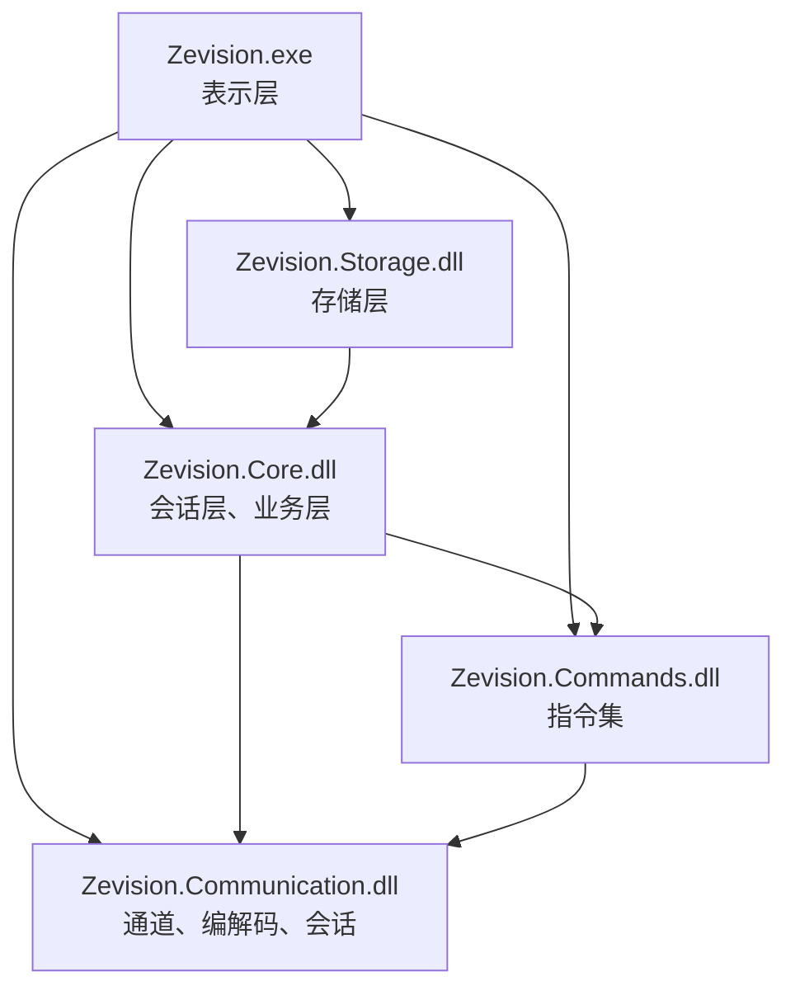
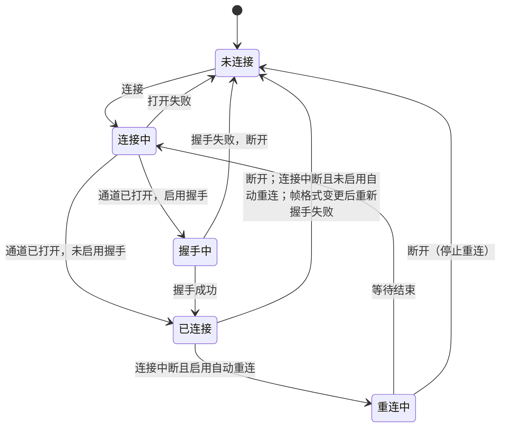
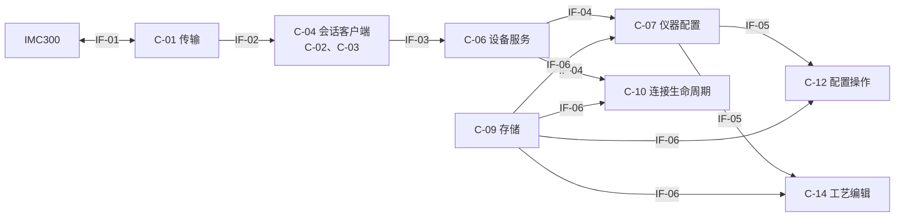

# Zevision 概要设计说明书

| 项目 | 内容 |
|---|---|
| 文档标识 | ZEV-SDD-01 |
| 文档版本 | 1.3 |
| 适用软件 | Zevision 1.3.3（通信库 1.2.0，指令集库 1.1.1） |
| 编制单位 | INFICON |
| 日期 | 2026-10-26 |

## 1 范围

### 1.1 标识

本文档适用于 Zevision（IMC300 通信测试）软件 1.3.3 版。本 CSCI 由 `Zevision.exe` 和 `Zevision.Communication`、`Zevision.Commands`、`Zevision.Core`、`Zevision.Storage` 四个程序集组成。

### 1.2 系统概述

Zevision 是 INFICON IMC300 膜厚控制仪的上位机测试与配置软件，通过 RS232 或以太网（TCP）按 Zevision 协议与仪器通信，提供指令收发、仪器配置的保存、恢复和修改功能。需求见 ZEV-SRS-01。

### 1.3 文档概述

本文档按 GB/T 8567-2006 中“软件设计说明（SDD）”编排，说明 CSCI 级设计决策、体系结构设计和需求可追踪性，用语按 GB/T 1.1-2020。剪裁情况：删除“数据库设计”“人机界面设计”条目；第 5 章“CSCI 详细设计”只给出详细设计所在的文档，协议细节见 ZEV-IDD-01，程序接口见 ZEV-CPM-01 和 ZEV-CPM-02，类型和成员的说明见代码中的 XML 文档。

## 2 引用文件

表 1  引用文件

| 标识 | 名称 |
|---|---|
| GB/T 8567-2006 | 计算机软件文档编制规范 |
| GB/T 1.1-2020 | 标准化工作导则 第 1 部分：标准化文件的结构和起草规则 |
| docs/开发文档.md | 《IMC300 / Zevision 上位机软件开发规范》（以下简称《开发规范》） |
| ZEV-SRS-01 | 《Zevision 通信需求规格说明》 |
| ZEV-IDD-01 | 《IMC300 Zevision 通信协议规格书》 |
| ZEV-CPM-01 | 《Zevision 链接库编程手册》 |
| ZEV-CPM-02 | 《Zevision 业务层与存储层编程手册》 |
| ZEV-STR-01 | 《Zevision 联调记录》 |

## 3 CSCI 级设计决策

表 2  设计决策

| 标识 | 决策 | 依据 |
|---|---|---|
| DD-01 | 帧格式由探测确定：先用界面上的帧格式发送 `H01`；回答不正确时等待 300 ms，依次用“长度和校验和”“仅长度”“仅校验和”“无长度无校验和”解码这期间收到的字节，第一个能解出有效响应的格式即为设备的帧格式，改用后再次发送 `H01` 确认；识别不出时依次尝试其余格式，最多 4 次；第一次未收到任何字节时即判定失败。确认后读取 G03 和帧格式设置核对。 | 不知道帧格式时无法读取 G1304、G1305；设备对任何 `{…}` 输入都按自身的帧格式在 230 ms 内回答（实测，固件 1.8.11，2026-10-19，ZEV-STR-01）。 |
| DD-02 | 重发只针对传输错误（超时、响应帧无效、响应无法解析、设备回答 C、L、T），只重发全部指令的动作为 Q、S、U、H、E、`?` 的帧，最多 2 次；重发在发送锁内完成，其间不插入其他请求。 | A、D、R 重复执行后设备状态不同；超时不能证明设备未执行；A、B、D 重发的结果不变。 |
| DD-03 | 设备回答 F 时不重发、不切换设备状态，查询 C09 后与错误一同报告。 | 自动切换设备状态（如中止工艺）对镀膜设备存在安全风险。本决策为《开发规范》§3.4 的偏离，见《开发规范》§9.3。 |
| DD-04 | RS232 和以太网都使用心跳：连接空闲 5 s 后发送 `H01`，不触发收发事件；只在发送锁空闲时发送；任何回答都视为应答；超时或写入失败计为一次无应答，其后立即再发；连续 3 次无应答结束会话。 | 拔下串口线（非 USB 转换器）时读取不报错；TCP keep-alive 发现断线约需 15 s。 |
| DD-05 | 读取循环、心跳和通信数据写入采用异步任务，不使用专用线程；发送锁保证同一时刻只有一个写入方。 | 与专用线程的效果相同，占用资源少。 |
| DD-06 | 发送锁为带优先级的互斥锁（高、普通、低），同一优先级按先后；正在等待响应的请求不被打断。 | 协议同一时刻只允许一个请求在途。 |
| DD-07 | 握手可以关闭。关闭时只打开通道，帧格式按界面开关，不重发、不发送心跳，行为与 1.0 版相同。 | 调试帧格式不一致时需要观察设备的原始回答。 |
| DD-08 | 自动重连默认关闭；重连后重新握手；不恢复被中断的配置操作和重复发送。 | 测试场合断线后通常先检查现场；配置操作中断后设备状态未知，不宜自动继续。 |
| DD-09 | 会话的取消令牌源不释放。 | 该令牌源没有计时器和关联令牌，不持有非托管资源；连接中断和主动断开可能在不同线程上结束会话，释放后再取消会引发异常。 |
| DD-10 | 对固件行为容错：多包消息最后一个续包的长度字段多计包尾、且校验和正确时，按实际数据读出；长度模式下收到纯文本回复时，按无长度重新读出；长度或校验和字节等于 `{`、`}`、`<`、`>` 时，在命令后追加 `;H01`。 | ZEV-STR-01 记录的实测结果。 |
| DD-11 | 型号不是 IMC300 时提示，不拒绝连接；恢复和修改在写入前另行核对型号。 | 通信测试也用于其他型号；写入前的核对保证配置安全。 |
| DD-12 | 会话参数（重发次数、心跳间隔、重连等待）为程序内常量，集中定义（见 4.2.1）。 | 本版本不提供高级设置文件。 |
| DD-13 | 握手期间的收发不转发到数据显示区，收到的字节另行记录（最多 4096 字节）用于识别帧格式。 | 帧格式不一致时的探测帧显示为错误数据，干扰诊断；握手失败说明附带收到的字节。 |
| DD-14 | 工艺上传失败（写入被拒绝、校验不一致、新建后仍有项不能写入、超时、取消）时，重新读取相关的组，删除本次新建且仍在设备上的对象（按工艺、膜层、膜系、材料的顺序，同类中编号大的在前），再读取确认；复用的对象不动。恢复配置和修改配置出错时仍不回滚。 | 上传只新建对象，不修改已有对象，这些对象的编号在上传开始时空闲，删除它们即回到上传前的状态（用户需求，2026-10-23）；恢复和修改改写已有的设置，回写旧值同样可能失败。 |
| DD-15 | 材料、工艺和生成的膜层名称最多 30 个字符。 | 设备最多保存 31 个字符，帮助表只显示前 30 个；复用和删除按帮助表中的名称比较（ZEV-STR-01 STR-2026-10-23-01）。 |

## 4 CSCI 体系结构设计

### 4.1 体系结构

#### 4.1.1 程序单元

表 3  程序单元

| 程序单元 | 层（《开发规范》§1） | 职责 | 不承担 |
|---|---|---|---|
| `Zevision.Communication.dll` | 物理通信层、协议编解码层、会话层 | 串口和 TCP 的字节收发；帧编解码、多包重组、响应解析；请求与响应的对应、超时、重发、心跳、改变帧格式 | 界面、日志、文件读写 |
| `Zevision.Commands.dll` | 协议编解码层 | 指令定义、指令生成和检查 | 通道、界面 |
| `Zevision.Core.dll` | 会话层、业务层 | 握手、结果说明的本地化、仪器配置的读取、恢复和修改规则；定义存储接口 | 文件读写、界面 |
| `Zevision.Storage.dll` | 存储层 | 配置文件、设置、错误日志、通信数据文件、文本文件的读写 | 业务规则 |
| `Zevision.exe` | 表示层 | 界面、输入、状态显示、连接生命周期的编排、组装根 | 协议逻辑；创建串口或 TCP 对象 |

#### 4.1.2 依赖关系

依赖只指向下层。只有组装根 `App` 引用 `Zevision.Storage`；视图模型和视图只使用 `Zevision.Core` 定义的接口。通道由工厂 `DeviceTransports.Create` 创建，在组装根中传给 `ZevisionDeviceService`。依赖规则由 `LibraryBoundaryTests` 检查：各程序集引用的程序集、库中不含中文字符串和文件类型、视图模型和视图不引用存储层。

图 1  程序集依赖关系

### 4.2 全局数据结构说明

#### 4.2.1 常量

表 4  常量

| 名称 | 值 | 定义位置 |
|---|---|---|
| 单包最大数据长度 | 57000 字节 | `ZevisionFrameCodec.MaxDataLength` |
| 消息最大长度 | 1048576 字节（1 MB） | `ZevisionFrameDecoder.MaxReceiveLength` |
| 读取缓冲区 | 4096 字节 | `ZevisionClient` |
| 分隔符规避指令 | `H01` | `ZevisionFrameCodec.FillerCommand` |
| 默认响应超时 | 1000 ms | `ConnectionOptions.DefaultResponseTimeout` |
| 帮助指令最低超时 | 2 s | `InstrumentConfigReader.SlowReplyTimeout` |
| 批量查询每帧条数 | 20 | `InstrumentConfigReader.QueryBatchSize` |
| TCP 连接超时 | 5 s | `TcpTransport.ConnectTimeout` |
| TCP keep-alive | 空闲 5 s，间隔 1 s | `TcpTransport` |
| 重发次数（启用握手时） | 2 | `ConnectionSettingsViewModel.HandshakeRetryCount` |
| 重发次数上限 | 5 | `ConnectionOptions.MaxRetryCount` |
| 心跳间隔（启用握手时） | 5 s | `ConnectionSettingsViewModel.HandshakeHeartbeatInterval` |
| 心跳无应答判定次数 | 3 | `ConnectionOptions.DefaultHeartbeatMissLimit` |
| 握手探测后的等待 | 300 ms | `DeviceHandshake.Settle` |
| 握手记录的字节上限 | 4096 字节 | `ZevisionDeviceService` |
| 重连等待 | 1 s、2 s、4 s、8 s、16 s、32 s，之后 60 s | `ReconnectPolicy` |
| 配置操作阶段限时 | 60 s | `OperationLimits.PhaseTimeLimit` |
| 恢复时创建对象的轮次上限 | 4 | `InstrumentConfigService` |
| 数据显示区记录上限 | 20000 条，超出时按 2000 条的整数倍删除 | `LogViewModel.MaxEntries`、`TrimBatch` |
| 程序不在前台时数据显示区的刷新时机 | 显示的内容每积累 50 KB（与通信数据文件的内存缓存相同）、停止保存通信数据时 | `LogViewModel.BackgroundShowBytes` |
| 数据显示区逐行添加的一批记录的行数上限 | 50 行，更多时一次添加 | `LogViewModel.IncrementalAddLimit` |
| 错误日志轮换阈值 | 5 MB | `FileErrorLog.MaxFileBytes` |

#### 4.2.2 配置数据

配置数据保存在 `settings.json` 中（`ConnectionPreferences`，DataContract）。文件中缺少的项取默认值；文件损坏时使用默认值并在数据显示区报告。

表 5  配置数据

| 键 | 默认值 | 说明 |
|---|---|---|
| `connectionType` | `Serial` | 连接方式：`Serial` 或 `Tcp` |
| `portName`、`baudRate` | 空、115200 | RS232 的串口和波特率 |
| `tcpHost` | 空 | 设备 IP 地址；端口固定为 2101，不保存 |
| `checksumEnabled`、`lengthEnabled` | false | RS232 的帧格式开关，握手后按设备更新 |
| `tcpChecksumEnabled`、`tcpLengthEnabled` | 与 RS232 相同 | 以太网的帧格式开关 |
| `responseTimeoutMs` | 1000 | 响应空闲超时，单位 ms |
| `handshakeEnabled` | true | 连接时握手，并启用重发和心跳 |
| `autoReconnect` | false | 连接意外中断后自动重连 |
| `rawCaptureEnabled`、`tcpSaveCommunicationData` | false | RS232、以太网连接时保存通信数据 |
| `displayFormat` | `Ascii` | 显示格式：`Ascii`、`Hex`、`Binary` |
| `repeatSend`、`repeatIntervalMs` | false、1000 | 重复发送及其间隔，单位 ms |
| `editSource` | `Device` | 修改配置的数据来源：`Device` 或 `File` |
| `language` | `auto` | 界面语言：`auto`、`zh`、`en` |

#### 4.2.3 持久数据

表 6  持久数据

| 文件 | 位置 | 格式和写入方式 |
|---|---|---|
| `settings.json` | 程序目录 | JSON，缩进；写入临时文件后替换；读取时跳过 UTF-8 BOM |
| `configs\*.json` | 程序目录下的 `configs` | JSON，`formatVersion` 2，带 MD5；写入临时文件后替换 |
| `logs\error.txt` | 程序目录下的 `logs` | UTF-8 文本，追加；超过 5 MB 时改名为 `error.1.txt` |
| `logs\<序列号>_yyyyMMdd_HHmm.txt` | 程序目录下的 `logs` | UTF-8 文本，每次连接一个文件，以握手读取的系统序列号（G06，未知时为 `unknown`）和连接时间（到分钟）命名，同一分钟内再次连接时追加；超过 30 MB 时续写到文件名加 `_1`、`_2`… 的文件；内容先缓存在内存中，超过 50 KB、断开连接或退出程序时追加 |
| `Texts.json` | 程序目录 | JSON，`{ "键": { "zh": "…", "en": "…" } }`，只读 |
| `recipes\material\*.json`、`film\*.json`、`layer\*.json`、`process\*.json` | 程序目录下的 `recipes` | JSON，`formatVersion` 1，工艺编辑的材料、膜系、膜层和工艺，每个对象一个文件；写入临时文件后替换，保存时删除不再对应对象的文件 |
| `materials.json` | 程序目录 | JSON，IMC300 操作手册附录 A 的材料表 `{ "materials": [ { "formula", "material_name", "density", "z_ratio", "z_ratio_established" } ] }`（源文件 `docs\materials.json`），只读；缺失时为空 |

程序目录不可写时，以上可写文件位于 `文档\Zevision\`。旧版本的配置文件目录（1.1.0～1.2.0 的 `recipes`，1.1.0 之前的 `recipe`）在第一次取用配置文件目录或工艺编辑目录时改名为 `configs`；两者都存在时只改名 `recipes`；`recipes` 中已有工艺文件、`configs` 已存在或改名失败时保留原目录。只处理实际使用的位置。

### 4.3 CSCI 部件

表 7  CSCI 部件

| 标识 | 部件 | 程序集 | 主要类型 | 职责 |
|---|---|---|---|---|
| C-01 | 传输 | Communication | `IDeviceTransport`、`SerialPortTransport`、`TcpTransport`、`DeviceTransports` | 打开、关闭通道，读写字节；TCP keep-alive |
| C-02 | 帧编解码 | Communication | `ZevisionFrameCodec`、`ZevisionFrameDecoder`、`ZevisionFrame` | 编码帧；按字节解码，多包重组 |
| C-03 | 响应解析 | Communication | `ZevisionResponseParser`、`HelpTableParser`、`ProtocolText` | 响应拆分、错误码、帮助表解析、协议字符规则 |
| C-04 | 会话客户端 | Communication | `ZevisionClient`、`PriorityLock`、`RetryPolicy`、`RequestOptions` | 读取循环、发送锁、回显对应、空闲超时、重发、心跳、改变帧格式 |
| C-05 | 指令集 | Commands | `ZevisionCommandSet`、`CommandDefinition` | 指令定义、生成和检查 |
| C-06 | 设备服务 | Core | `IDeviceService`、`ZevisionDeviceService`、`DeviceHandshake`、`FrameFormatDetector`、`FrameSettings`、`FramingCheck`、`ReconnectPolicy`、`ManualCommandPolicy` | 每次连接创建客户端、握手、不显示的发送、结果本地化、帧格式不一致提示 |
| C-07 | 仪器配置 | Core | `InstrumentConfigService`、`RestorePlanner`、`RecipeRules`、`RecipeEditSession`、`RecipeDocument`、`ObjectTypes`、`ParameterValue` | 读取、保存、恢复、修改、新建和删除的规则与流程 |
| C-08 | 文本 | Core | `TextCatalog`、`Lang`、`CommunicationText`、`CommandText` | 中英文文本 |
| C-09 | 存储 | Storage | `RecipeFileStore`、`JsonFilePreferencesStore`、`FileErrorLog`、`CommunicationLogFiles`、`DesignFileStore`、`AppFolders`、`TextFile` | 文件读写 |
| C-10 | 连接生命周期 | exe | `ConnectionLifecycle`、`MainViewModel`、`ConnectionSettingsViewModel` | 连接状态、握手结果的应用、自动重连、帧格式变更后重新握手、通信数据文件 |
| C-11 | 数据显示 | exe | `LogViewModel`、`FrameLogFormatter`、`FrameDisplayFormatter`、`ResponseLogFormatter` | 收发数据的格式化和显示 |
| C-12 | 配置操作和修改窗口 | exe | `ConfigOperationsViewModel`、`RecipeEditorViewModel`、`OperationRunner` | 保存、恢复、修改的界面流程，进度、取消和限时 |
| C-13 | 组装根 | exe | `App` | 创建各部件，全局异常处理，单实例 |
| C-14 | 工艺编辑 | Core、exe | `DesignDocument`、`DesignRules`、`DesignBuilder`、`DesignDevice`、`DeviceContents`、`DeviceDeletion`（Core）；`ProcessDesignerViewModel`、`DevicePageViewModel`（exe） | 材料和工艺的编辑、检查；复用设备上名称和参数都相同的材料、膜系、膜层，其余转换为只含新对象的配置，经 C-07 的恢复流程新建对象、写入并校验；打开时读取设备配置，列出设备上的工艺和材料；删除材料时可删除设备上用到它的膜系和膜层，删除工艺时删除设备上的同名工艺和只被它使用的膜层（有工艺或其他设置引用时不删除）；上传失败时删除本次新建的对象（DD-14）；名称最多 30 个字符（DD-15） |

### 4.4 执行概念

#### 4.4.1 线程模型

表 8  线程模型

| 执行单元 | 职责 | 约束 |
|---|---|---|
| 界面线程 | 显示、输入、连接状态的变化（C-10） | 不阻塞；设备事件经 `SynchronizationContext.Post` 转到界面线程；帧在后台线程格式化后交给界面线程；程序不在前台时新记录暂存，在保存通信数据的时刻（显示的内容每积累 50 KB、停止保存通信数据时）添加到数据显示区，收发计数同时更新；50 行以内的一批记录逐行添加，更多的一次添加（一次添加的通知使列表重新生成全部行） |
| 读取循环（每个连接一个异步任务） | 读取字节、解码、按回显分发 | 不做业务判断；事件处理程序的异常经 `HandlerFailed` 报告，不中断读取 |
| 发送方（调用方的异步流） | 取得发送锁、写一帧、等待响应，必要时重发 | 发送锁保证同一时刻只有一个写入方 |
| 心跳（每个连接一个异步任务，启用时） | 空闲时发送 `H01` | 只在发送锁空闲时发送，不排队 |
| 通信数据写入 | 缓存超过 50 KB 时在后台写入通信数据文件；断开连接时在后台写完，程序退出时在调用线程上写完 | 接收回调中不同步写文件；各块在文件锁中按顺序写入 |

通信库、业务层和存储层的 `await` 使用 `ConfigureAwait(false)`，视图模型不使用。代码中不使用 `.Result`、`.Wait()` 和 `Thread.Sleep`；等待使用 `Task.Delay` 和取消令牌。`async void` 只用于 `AsyncRelayCommand.Execute`（`ICommand` 入口，自行处理异常）和窗口的 `OnClosing` 事件处理程序。

#### 4.4.2 连接状态

连接状态由 `ConnectionLifecycle` 管理，只在界面线程上变化。

图 2  连接状态

自动重连过程中，一次连接或握手失败后返回“重连中”，等待下一次重连。每次状态变化在数据显示区记录一行（已连接、握手失败、连接中断、第 n 次重连失败、已重新连接、已断开、已停止自动重连）。只有“已连接”状态允许发送指令和进行配置操作；“连接中”“握手中”“重连中”状态下连接设置锁定，“断开”可停止自动重连。

#### 4.4.3 请求与响应

a) 发送方按 `RequestOptions.Priority` 取得发送锁（DD-06），写入一帧，登记等待中的请求和期望的回显。

b) 读取循环把收到的消息按回显对应到等待中的请求：回显相同（不区分大小写）或无法判断（帧无效、无法解析、无回显的 `-C`）时作为该请求的响应；回显不同的消息作为未请求数据报告。

c) 超时为空闲超时，从发送或最近一次收到字节起计算；超时时解码器中未收完的数据作为 `Incomplete` 帧报告。

d) 长度或校验和字节等于 `{`、`}`、`<`、`>` 时在命令后追加 `;H01`，多出的 `H01` 响应不返回给调用方（DD-10）。

e) 一帧中的多条指令的响应按回显逐条对应，不按到达顺序对应。

#### 4.4.4 帧解码与多包重组

`ZevisionFrameDecoder` 为按字节推进的状态机（等待起始符、长度、数据、校验和、停止符或续包）：

a) 三种形态：无长度时扫描数据，`>` 只在下一个字节为 `<`、或多包消息中下一个字节为 `}` 时作为包分隔符；有长度时按长度读取，数据中的 `{`、`}`、`<`、`>` 不作为分隔符；有校验和时逐包校验，任一包不符即报告。

b) 续包：`>` 之后等待 `<`（新包）或 `}`（结束）；最后一个续包长度多计的固件缺陷单独处理（DD-10）。

c) 半包和粘包：字节可以分任意次送入，一次送入可以包含多条消息。

d) 上限：单包 57000 字节，整条消息 1 MB；起始符之前的字节作为帧外数据报告，不作为响应。

e) 解码器只把完整的逻辑消息交给会话层，多包消息在重组完成后交出。

#### 4.4.5 握手

握手由 `ZevisionDeviceService.HandshakeAsync` 执行，算法见 DD-01 和 ZEV-IDD-01 的 5.1：

a) 期间不转发收发事件，收到的字节另行记录（DD-13）；

b) 探测帧不重发（`RequestOptions.AllowRetry` 为 false）；

c) 用 `ZevisionClient.ChangeFrameOptionsAsync` 改用探测出的帧格式；

d) 读取 `QG03;QG06;QG1304;QG1305`（以太网为 `QG03;QG06;QG1407;QG1408`），生成 `DeviceIdentity`（问候字符串、型号、序列号、帧格式、提示）；

e) `ConnectionLifecycle` 把探测出的帧格式写回界面开关并保存。

实测耗时：帧格式一致时约 50 ms；不一致时 RS232 为 463 ms，以太网为 378 ms（ZEV-STR-01）。

#### 4.4.6 重发

表 9  重发规则

| 情况 | 处理 |
|---|---|
| 超时、响应帧无效、响应无法解析，或设备回答 C、L、T | 帧中全部指令可重复执行时重发，最多 2 次；每次重发前触发 `Retrying`，数据显示区记录一行 |
| 设备回答 A、B、D | 不重发 |
| 设备回答 F | 不重发，按 4.4.10 处理 |
| 帧中含 A、D、R 指令 | 不重发 |
| 连接断开、未连接、写入失败、指令不合法 | 不重发 |

重发在发送锁内完成；返回最后一次的结果。单次请求可用 `RequestOptions.AllowRetry` 关闭重发。

#### 4.4.7 心跳与断线检测

a) 读取失败（串口拔出、读取异常）或 TCP 读取返回 0 时，读取循环结束会话并触发 `ConnectionLost`（原因为 `ReadFailed`）。

b) 以太网连接启用 TCP keep-alive（空闲 5 s，间隔 1 s）。

c) 启用心跳时按 DD-04 发送 `H01`；连续 3 次无应答时结束会话并触发 `ConnectionLost`（原因为 `HeartbeatTimeout`）。检测时间约为“心跳间隔 + 3 × 响应超时”。

d) 主动断开不触发 `ConnectionLost`；断开时等待读取循环和心跳结束。

#### 4.4.8 自动重连

连接中断时，若启用自动重连，`ConnectionLifecycle` 进入“重连中”，按 `ReconnectPolicy.DelayBefore` 等待后用当前设置重新连接并握手（DD-08）。每次连接成功时打开新的通信数据文件。重连失败在数据显示区记录为信息，不写入错误日志。重连循环中出现意外异常时写入错误日志并进入“未连接”。程序退出时取消等待中的重连。

#### 4.4.9 帧格式设置变更

手动发送的指令被设备接受后，`FrameSettings.AfterUpdates` 判断当前接口的帧格式设置是否改变。设备对修改帧格式设置的 `U` 指令仍按旧格式回答，下一帧起只接受新格式（ZEV-STR-01）。改变时：

a) 启用握手：以新格式为首选重新握手，成功后更新界面开关；失败时断开；

b) 未启用握手：只在数据显示区给出提示，通信仍按原帧格式进行。

#### 4.4.10 错误处置

表 10  错误处置

| 类别 | 处置 |
|---|---|
| 通道错误（串口不存在或被占用、写入失败、拔线） | 在会话边界捕获异常，转换为失败结果或 `ConnectionLost` |
| 传输错误（超时、帧错误、C、L、T） | 按 4.4.6 重发；仍失败时报告 |
| 设备拒绝（A、B、D） | 不重发；报告指令、回显和错误码 |
| 状态错误（F） | 不重发；查询 C09，与错误一同报告；不切换设备状态（DD-03） |
| 意外异常 | 读取循环、事件处理程序、界面命令和全局处理程序中捕获，写入错误日志 |
| 配置操作 | 每个阶段限时 60 s，可取消；出错时立即停止，已写入的项不回滚；工艺上传失败时删除本次新建的对象（DD-14） |

#### 4.4.11 日志

表 11  日志

| 内容 | 位置 |
|---|---|
| 收发的帧（时间、方向、内容）、解析结果、错误、重发、连接状态变化 | 数据显示区；启用“保存通讯数据”时同时缓存，超过 50 KB、断开连接或退出程序时追加到 `logs` 中的通信数据文件 |
| 发送帧数、接收帧数、错误指令数 | 数据显示区标题栏（TX、RX、ERR）；错误指令数由 `IDeviceService.CommandsFailed` 提供，“清空”时归零 |
| 错误、意外异常（含堆栈）、会话标题（版本、操作系统、运行库、位数） | `logs\error.txt` |

错误日志在通信部件之前创建（`App.OnStartup`）。握手、心跳和读取配置所用帮助指令的收发不显示，也不保存。

#### 4.4.12 资源释放

表 12  资源释放

| 资源 | 释放方式 |
|---|---|
| 串口 | `Close` 后 `Dispose`；设备已拔出时关闭产生的异常不传播 |
| TCP 连接 | `TcpClient.Close`；挂起的接收以 0 字节结束 |
| 会话 | 结束等待中的请求，取消，关闭通道，等待读取循环和心跳结束 |
| 发送锁 | 不需要释放（不持有非托管资源） |
| 会话的取消令牌源 | 不释放（DD-09） |
| 等待用的计时器和关联令牌源 | 每次等待后释放 |
| 自动重连的取消令牌源 | 停止重连或重连成功后释放 |

关闭窗口或切换语言前的顺序为：等待正在进行的连接结束，取消并等待配置操作，停止重复发送，停止自动重连，断开连接，关闭通信数据文件。`App.OnExit` 依次保存设置、释放视图模型、释放设备服务，每一步的失败单独记录。

### 4.5 接口设计

#### 4.5.1 接口标识和接口图

表 13  接口

| 标识 | 接口 | 提供方 | 使用方 | 规定文档 |
|---|---|---|---|---|
| IF-01 | Zevision 协议（RS232、TCP） | IMC300 | C-01～C-04 | ZEV-IDD-01 |
| IF-02 | `IDeviceTransport` | C-01 | C-04 | ZEV-CPM-01 |
| IF-03 | `ZevisionClient`、`ZevisionCommandSet` | C-04、C-05 | C-06、C-07 | ZEV-CPM-01 |
| IF-04 | `IDeviceService` | C-06 | C-07、C-10 | ZEV-CPM-02 |
| IF-05 | `IInstrumentConfigReader`、`IInstrumentConfigWriter`、`IInstrumentConfigService` | C-07 | C-10、C-12、C-14 | ZEV-CPM-02 |
| IF-06 | `IRecipeStore`、`IPreferencesStore`、`IErrorLog`、`ICommunicationRecorder`、`ICommunicationRecorderFactory`、`IDesignStore` | C-09 | C-07、C-10～C-12、C-14 | ZEV-CPM-02 |
| IF-07 | 文件格式（`settings.json`、配置文件、`Texts.json`、日志、`recipes` 下的工艺编辑文件、`materials.json`） | C-09 | 用户、维护人员 | ZEV-CPM-02、ZEV-OPS-01 |
| IF-08 | `IDialogService` | 视图 | C-12、C-14 | 代码 XML 文档 |

图 3  接口

#### 4.5.2 接口说明

a) IF-01：帧格式、指令、响应、错误码和会话规则见 ZEV-IDD-01。

b) IF-02、IF-03：通信库的公开接口，预期内的失败以 `ZevisionResult` 返回，说明为英文；见 ZEV-CPM-01。

c) IF-04、IF-05：业务层接口，失败以 `Result` 返回，说明按界面语言给出；见 ZEV-CPM-02。

d) IF-06：存储接口由业务层定义、存储层实现，只在组装根中创建实现；见 ZEV-CPM-02。

## 5 CSCI 详细设计

表 14  详细设计所在的文档

| 内容 | 文档 |
|---|---|
| 帧格式、多包规则、指令表、错误码表、会话规则、时序图 | ZEV-IDD-01 |
| 通信库和指令集库的类型、成员和用法 | ZEV-CPM-01 |
| 业务层和存储层的类型、成员、文件格式 | ZEV-CPM-02 |
| 全部公开类型和成员的说明 | 代码中的 XML 文档 |

## 6 需求可追踪性

表 15  需求可追踪性

| 需求（ZEV-SRS-01） | 设计元素 |
|---|---|
| SRS-IF-01～SRS-IF-05 | 4.1，C-01，C-04，IF-01，IF-02 |
| SRS-FO-01～SRS-FO-05 | DD-01，DD-07，4.4.5，4.4.9，C-06，C-10 |
| SRS-HS-01～SRS-HS-05 | DD-01，DD-11，DD-13，4.4.5，C-06 |
| SRS-CMD-01～SRS-CMD-04 | C-05，C-07，C-12 |
| SRS-CMD-05 | DD-14，DD-15，C-07，C-14 |
| SRS-REL-01 | DD-06，4.4.3，C-04 |
| SRS-REL-02 | 4.2.1，4.4.3 |
| SRS-REL-03 | DD-02，4.4.6 |
| SRS-REL-04～SRS-REL-05 | DD-04，4.4.7 |
| SRS-REL-06 | DD-08，4.4.8 |
| SRS-REL-07 | DD-03，4.4.10 |
| SRS-REL-08 | DD-14，4.4.10，C-12 |
| SRS-LOG-01～SRS-LOG-04 | 4.4.11，C-11 |
| SRS-EXT-01～SRS-EXT-03 | 4.5，IF-01，IF-07 |
| SRS-DAT-01～SRS-DAT-04 | 4.2.2，4.2.3，C-09 |
| SRS-ADP-01～SRS-ADP-04 | 4.2.3，C-08，C-09 |
| SRS-SAF-01～SRS-SAF-05 | DD-03，DD-11，C-07 |
| SRS-ENV-01～SRS-ENV-02 | C-13 |
| SRS-QA-01～SRS-QA-05 | 4.4.1，4.4.4，4.4.12 |
| SRS-QA-06 | C-07，C-12，C-14 |
| SRS-CON-01～SRS-CON-06 | DD-05，4.1，4.4.1 |

## 7 注解

### 7.1 术语

表 16  术语

| 术语 | 定义 |
|---|---|
| CSCI | 计算机软件配置项，本文档中指 Zevision 软件 |
| 组装根 | 创建全部部件并建立其关联的位置，本软件中为 `App` |
| 会话 | 一次连接期间的通道、解码器、读取循环、心跳和等待中的请求 |
| 发送锁 | 保证同一时刻只有一个请求在途的带优先级的互斥锁 |
| 帧格式 | 帧中是否带长度字节和校验和的组合 |
| 握手 | 连接后确认设备应答、确定帧格式并读取型号和帧格式设置的过程 |
| 心跳 | 连接空闲时发送的 `H01`，用于检测断线 |
| 空闲超时 | 从发送或最近一次收到字节起计算的超时 |

### 7.2 缩略语

表 17  缩略语

| 缩略语 | 全称 |
|---|---|
| SDD | 软件设计说明（Software Design Description） |
| SRS | 软件需求规格说明（Software Requirements Specification） |
| CSCI | 计算机软件配置项（Computer Software Configuration Item） |
| TCP | 传输控制协议（Transmission Control Protocol） |
| BOM | 字节顺序标记（Byte Order Mark） |
